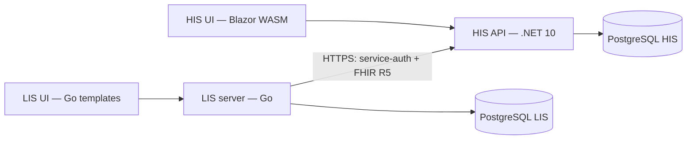

# Лабораторная 3: общий технический контракт HIS–LIS C2 — v1

Дата: **05.11.2026**. Статус: **проект, ожидает согласования Льва и Тёмыча**.

Этот документ фиксирует границу существующей HIS на C# и новой LIS на Go. Это спецификация будущей реализации, а не отчёт о готовности функций. Основание — парные карточки `lab3-lev-tasks-v2.md` и `lab3-temych-tasks-v2.md` от 04.11.2026.

**C2** — версия общего контракта; **v1** — первая редакция этого отдельного документа. После согласования источниками истины для обмена становятся этот файл и [JSON-примеры](../tests/Fixtures/Lab3/). Общий текст в карточках лучше заменить ссылкой сюда, чтобы не поддерживать три копии. В карточках v1 описан прежний вариант C1; для интеграции HIS с Go LIS он не используется. Оценки трудоёмкости и распределение личных задач здесь не пересматриваются.

## 1. Ответственность и независимая разработка

| Сторона | Владелец | Область |
|---|---|---|
| HIS | Лев | .NET 10, существующие UI/API/БД, LOINC-справочник, назначения, ЭМК и её история, FHIR R5, сервисные аккаунты и машинная авторизация |
| LIS | Тёмыч | Go-сервер, HTML UI, собственная PostgreSQL, FHIR-клиент, настройки подключения, токены, проведение анализов, локальная история, тесты и контейнер |
| Контракт | Оба | Согласование HTTP/JSON, общие примеры, TLS и сквозная приёмка; каждый исправляет свою реализацию |

Тёмычу не нужны классы, EF-миграции, JWT-validator и внутренние REST DTO HIS. Льву не нужны внутренние Go-типы или схема БД LIS. Медицинские данные передаются только через FHIR; прямого доступа к чужой БД нет.

До появления настоящего HIS API Тёмыч использует `httptest.Server` и общие JSON-примеры. Лев проверяет HIS со своим HTTP-клиентом и тестовой аутентификацией только внутри test host. Рабочую авторизацию ради разработки не отключаем.



## 2. Объём лабораторной

HIS позволяет врачу назначить один или несколько анализов: каждый выбранный анализ создаёт самостоятельный заказ. Каталог содержит как минимум глюкозу, гемоглобин, исследование на чуму, ВИЧ, гепатит B, гепатит C и сифилис. Конкретные LOINC-коды подбирает Лев; LIS получает код из заказа и не содержит зашитого перечня анализов.

LIS настраивается через сервисный API key, получает назначения, показывает пациента и назначившего врача, принимает результат и передаёт его в правильную ЭМК. Свой пользовательский вход/SSO в LIS не добавляется. Завершённые анализы доступны для чтения в локальной истории даже без HIS.

Не входят в этот контракт: DICOM, файловый архив, сообщения Kafka/RabbitMQ, FHIR Subscriptions, собственная терминологическая служба, произвольные FHIR-запросы, редактирование результатов, автоматическое выполнение анализов и фоновая очередь повторной отправки.

## 3. Адреса, транспорт и общие типы

| Параметр | Решение C2 |
|---|---|
| `HIS_ORIGIN` | HTTPS origin без пути, userinfo, query и fragment; например `https://his-api:5201` |
| `FHIR_BASE` | `${HIS_ORIGIN}/fhir` |
| Технические endpoints | `${HIS_ORIGIN}/api/...`, а не `${FHIR_BASE}/api/...` |
| Версия FHIR | **R5, 5.0.0**; только JSON |
| Медицинские запросы | `Accept: application/fhir+json`; POST также `Content-Type: application/fhir+json` |
| Технические JSON | `Accept: application/json`, POST с `Content-Type: application/json` |
| Идентификаторы | UUID в строковом формате `D`, без скобок; HIS возвращает нижний регистр |
| Дата рождения | `YYYY-MM-DD`, без времени |
| Моменты времени | RFC3339 с секундами и timezone; исходящие значения UTC `Z`, точность не выше миллисекунд |
| Строки | UTF-8; имена JSON-полей регистрозависимы |

Дробная часть времени необязательна, максимум три цифры. Go формирует `issued`, например через `time.Now().UTC().Truncate(time.Millisecond).Format(time.RFC3339Nano)`. HIS принимает timezone offset и нормализует его в UTC. UI обеих систем показывает время с секундами; локальная timezone применяется только при отображении.

Лимит POST Observation и технического credential-запроса — **64 KiB**. Go ограничивает чтение одного ответа HIS **4 MiB** и завершает запрос при превышении. HTTP-клиент имеет конечный timeout и принимает `context.Context`; рекомендуемое начальное значение timeout — 15 секунд, настраиваемое владельцем LIS.

URL в примерах — адрес тестового стенда, а не обещание уже работающего контейнера. Для реального HTTPS нужны доверенный публичный CA-сертификат и SAN, соответствующий имени `his-api` либо фактическому hostname. Закрытые ключи HIS в LIS не передаются. Пропуск проверки сертификата запрещён.

## 4. Идентичность и состояния

1. `ServiceRequest.id` — серверный UUID отдельного назначения. Повтор того же анализа тому же пациенту разрешён с новым ID.
2. `Observation.id` — другой серверный UUID результата. Его создаёт HIS, клиент не выбирает ID.
3. Один заказ содержит один анализ; на заказ допускается **не более одного** результата. Уникальность защищает БД HIS, включая конкурирующие запросы.
4. Состояние заказа: `active` → `completed`. Создаваемый результат имеет `status=final`. Промежуточный «В работе» в LIS — состояние открытой формы, без записи в HIS или локальной БД очереди.
5. После успешного результата HIS завершает заказ сама. LIS не отправляет PUT/PATCH ServiceRequest.
6. Выполненный заказ и его результат открываются только для чтения. PUT/PATCH/DELETE результатов не поддерживаются.
7. `Observation.subject` совпадает с `ServiceRequest.subject`. `Observation.basedOn` содержит ровно одну ссылку на этот заказ; LOINC `system+code` совпадает со снимком анализа в заказе.
8. `Observation.issued` — время подтверждения результата Go-сервером. HIS отдельно хранит `ReceivedAtUtc`. История ЭМК и восстановление состояния используют время регистрации HIS; входной `issued` не позволяет вставить событие задним числом.

## 5. Машинная авторизация: технический JSON

### 5.1. Получение пары токенов

`POST /api/service-auth/token`, без bearer и без человеческих cookies:

```json
{ "apiKey": "<ключ, однократно выданный администратором HIS>" }
```

Успех — **200**, `Content-Type: application/json`, `Cache-Control: no-store`:

```json
{
  "accessToken": "<service JWT>",
  "accessTokenExpiresAt": "2026-11-05T10:10:00Z",
  "refreshToken": "<одноразовое случайное значение>",
  "refreshTokenExpiresAt": "2026-11-12T10:00:00Z"
}
```

Все четыре поля обязательны. Времена — абсолютные моменты истечения: начиная с этого момента токен недействителен. Исходные сроки для стенда: access 5 минут, семейство refresh 7 дней; HIS задаёт их отдельными options. LIS ориентируется на полученные даты, а не на зашитые сроки или содержимое JWT.

API key для Go — непрозрачная строка. HIS генерирует не менее 32 случайных байт секрета. Предлагаемый формат HIS: `msa_<32 hex символа ID аккаунта>.<43 base64url символа секрета без padding>`. В HIS хранятся открытый ID и SHA-256 секрета; сравнение хешей выполняется за постоянное время. Go не разбирает формат и не рассчитывает хеш за HIS.

### 5.2. Обновление

`POST /api/service-auth/refresh` принимает только:

```json
{ "refreshToken": "<текущее одноразовое значение>" }
```

Успех — **200**, те же четыре поля и `Cache-Control: no-store`. Новая пара сохраняется в LIS атомарно. Предыдущий refresh больше не принимается; срок семейства не продлевается при каждом обновлении.

**Обычное обновление не отзывает сервисную сессию и уже выданные access-токены:** они работают до своего `exp`. Это позволяет завершить параллельный FHIR-запрос. «Refresh использован» и «сервисная сессия отозвана» — разные состояния. Повторное использование refresh отзывает всё его семейство; отключение аккаунта и замена ключа отзывают все семейства аккаунта и их access.

LIS сериализует получение/обновление по подключению: mutex/single-flight внутри процесса; при нескольких экземплярах дополнительно межпроцессная блокировка PostgreSQL **до HTTP-вызова** и перечитывание актуальной пары. За 30 секунд до истечения access его можно обновить перед новой медицинской операцией.

Если refresh завершился timeout, его результат неизвестен: автоматического повтора refresh и скрытого fallback на API key нет. LIS сохраняет состояние подключения «нужно переподключение» и больше не использует прежний refresh, в том числе после перезапуска. Оператор видит ошибку и может явно заново проверить подключение/получить сессию по действующему API key. После отправки медицинского POST токен не обновляется с последующим скрытым повтором этого POST.

### 5.3. Проверка подключения

`GET /api/testConnection`, заголовок `Authorization: Bearer <service-access>`.

Успех — **200**, `application/json`:

```json
{
  "status": "connected",
  "serviceAccountId": "55555555-5555-4555-8555-555555555555",
  "role": "LIS",
  "fhirVersion": "5.0.0"
}
```

Проверка в UI LIS: получить действующий access → вызвать testConnection → проверить `/fhir/metadata`. Статус «подключено» показывается после обеих успешных проверок. Открытая metadata сама по себе не доказывает авторизацию. При недоступности HIS локальная история остаётся доступной.

### 5.4. Ошибки технического API

Согласованный формат этих трёх endpoints, **не меняющий существующий человеческий API HIS**:

```json
{
  "code": "invalid_credentials",
  "message": "Не удалось подтвердить сервисные учётные данные.",
  "traceId": "<идентификатор запроса>"
}
```

| HTTP | `code` | Когда |
|---|---|---|
| 400 | `invalid_request` | Неверный JSON или отсутствующее обязательное поле |
| 401 | `invalid_credentials` | Ключ неверен, отозван или аккаунт отключён; детали состояния не раскрываются |
| 401 | `invalid_refresh` | Refresh неверен, истёк, отозван или уже использован |
| 401 | `unauthorized` | Нет действующего service bearer на testConnection |
| 403 | `forbidden` | Подтверждённая сервисная идентичность не имеет разрешения |
| 413 / 415 | `request_too_large` / `unsupported_media_type` | Размер тела / тип содержимого |
| 429 | `rate_limited` | Ограничение частоты; автоматического повтора нет |
| 500 | `internal_error` | Без SQL, stack trace, ключей и токенов в ответе |

`code` — машинный идентификатор; текст `message` и `traceId` не сравниваются на точное совпадение. На ошибках также действует `Cache-Control: no-store`. Никаких редиректов на HTML-вход или установки человеческой refresh-cookie.

## 6. Сервисная сессия, роли и граница доступа

Внутри HIS используется отдельная схема `ServiceBearer` и policies `LisFhirRead`, `LisObservationCreate`, `LisConnectionProbe`. Для Go JWT остаётся непрозрачным bearer; отдельный разбор claims на стороне LIS не является проверкой прав.

Предлагаемый набор service-claims HIS:

| Claim | Значение |
|---|---|
| `iss` / `aud` | `MedSoft.Api` / `MedSoft.Lis` |
| `sub` | UUID сервисного аккаунта |
| `account_kind` | `service` |
| `role` | `LIS` |
| `sid` | UUID действующей логической сервисной сессии/семейства; стабилен при refresh |
| `auth_ver` | Версия безопасности аккаунта |
| `jti` | Уникальный ID access-токена |
| `iat`, `nbf`, `exp` | Стандартные NumericDate, проверяемые HIS |

HIS подписывает JWT RS256 и проверяет подпись, issuer, audience, время, вид аккаунта, роль, актуальную версию, активность и состояние сессии в БД на каждом защищённом запросе. Ротация ключа и отключение аккаунта атомарно меняют версию/состояние и отзывают сессии; следующий запрос со старым access получает отказ. Повторная активация старые сессии не восстанавливает.

Роль LIS получает только перечисленные ниже FHIR-операции и testConnection. Service JWT не открывает человеческие `/api/accounts`, `/api/patients`, `/api/medical-records`, аудит и управление сервисными аккаунтами. Человеческий JWT не принимается как ServiceBearer; отказ из-за чужой audience — **401**, а не обязательный 403.

Сервисные аккаунты создаются/изменяются/отключаются и получают новый ключ только через UI/API администратора HIS с существующей человеческой авторизацией и CSRF. Предложенные административные маршруты из L7 остаются локальной задачей HIS и не являются API LIS.

Исключения HIS из CSRF касаются только двух credential endpoints без cookies и известного POST Observation после успешной сервисной аутентификации. В LIS HTML-формы настройки и проведения анализов тоже защищаются от CSRF и чужого Origin; отсутствие собственного логина эту защиту не отменяет.

API key вводится оператором в форму LIS и отправляется только своему Go-серверу. После сохранения его полное значение не возвращается в HTML/JSON. Access/refresh в браузер не выдаются; `localStorage` и browser-cookie для них не используются. Go хранит секреты зашифрованными, master key — вне БД и репозитория. Логи обеих систем исключают bearer, ключи, refresh и медицинские тела; аудит содержит тип события, ID сервиса/ресурса и безопасные метаданные. Сервисный автор результата не подменяется врачом или человеческим `ActorUserId`.

## 7. Минимальный FHIR R5 API

Все медицинские операции требуют service bearer. Публичной может быть только metadata.

| Метод и путь | Успех | Назначение |
|---|---|---|
| `GET /fhir/metadata` | 200 `CapabilityStatement` | `fhirVersion=5.0.0`, формат JSON и фактически поддерживаемые операции |
| `GET /fhir/Patient/{id}` | 200 `Patient` | Данные пациента заказа |
| `GET /fhir/Practitioner/{id}` | 200 `Practitioner` | Назначивший медработник, включая ранее удалённого |
| `GET /fhir/ServiceRequest/{id}` | 200 `ServiceRequest` | Один заказ |
| `GET /fhir/ServiceRequest?status=active&_count=20` | 200 `Bundle` | Открытые назначения |
| `GET /fhir/ServiceRequest?status=completed&_count=20` | 200 `Bundle` | Выполненные назначения |
| `GET /fhir/ServiceRequest?_count=20` | 200 `Bundle` | Оба состояния |
| `GET /fhir/Observation/{id}` | 200 `Observation` | Один результат |
| `GET /fhir/Observation?based-on=ServiceRequest/{id}&_count=20` | 200 `Bundle` | Ноль или один результат конкретного заказа |
| `POST /fhir/Observation` | 201 `Observation` + `Location` | Создать результат и завершить заказ |

Поиск Patient/Practitioner и Observation без `based-on`, PUT/PATCH/DELETE, batch/transaction и `_history` не входят в согласованный минимум. CapabilityStatement не рекламирует нереализованные возможности. Формы ресурсов соответствуют [FHIR R5 ServiceRequest](https://hl7.org/fhir/R5/servicerequest.html) и [FHIR R5 Observation](https://hl7.org/fhir/R5/observation.html); ограничения C2 ниже — локальные договорённости этой интеграции.

## 8. Формы ресурсов и валидация

### Patient

Пример: [patient.json](../tests/Fixtures/Lab3/patient.json).

`resourceType=Patient`, `id`, `active`, `name[0].use=official`, `name[0].family`, `name[0].given`, `birthDate`, `gender`. `given` содержит имя и, при наличии, отчество; отсутствующее отчество не заменяется пустой строкой. `gender` — `male`, `female`, `other` или `unknown`, без передачи русского названия enum. LIS собирает ФИО из `family` и `given`, а не пытается разделять одну строку.

### Practitioner

Пример: [practitioner.json](../tests/Fixtures/Lab3/practitioner.json).

`resourceType=Practitioner`, `id`, `active`, официальное `name` в том же формате. Должность можно передать в `qualification[].code.text`, клиент не обязан её использовать. Все сохранённые ссылки requester/subject остаются разрешимыми после логического удаления сотрудника/пациента; исторический врач может иметь `active=false`. Ресурсы не содержат логин, пароль, TOTP и внутренние Identity-данные.

### ServiceRequest

Примеры: [active](../tests/Fixtures/Lab3/service-request-active.json), [completed](../tests/Fixtures/Lab3/service-request-completed.json).

Обязательны `resourceType`, `id`, `status`, `intent=order`, `code.concept.coding`, `subject.reference`, `requester.reference`, `authoredOn`. Один LOINC coding: `system=http://loinc.org`, `code` из снимка назначения; `display` — название снимка. **В R5 используется `code.concept.coding`, а не R4 `code.coding`.**

Комментарий необязателен: при наличии один `note[0].text`, до 2000 Unicode-символов. Без комментария поле `note` отсутствует. Идентичность анализа задают `system+code`, а не `display`: изменение справочника не переписывает старый заказ.

### Observation

Примеры: [тело POST без id](../tests/Fixtures/Lab3/observation-create.json), [сохранённый ресурс](../tests/Fixtures/Lab3/observation-final.json).

Обязательны `resourceType=Observation`, `status=final`, один `code.coding` с LOINC, `subject.reference`, массив `basedOn` ровно с одним элементом, `issued`, `valueString`. В отличие от ServiceRequest, здесь обычный **`code.coding`**.

`valueString` после обрезки внешних пробелов содержит от 1 до 2000 Unicode scalar values; для подсчёта Go использует runes, C# — `EnumerateRunes()`. Числа тоже передаются строкой, например `"5.6"`, `"142"`; текст `"Отрицательно"` допустим. Научное заключение и единицы измерения отдельно не передаются. В UI HIS/LIS видна фраза **«Учебный режим: единицы измерения не используются»**.

Другие `value[x]`, несколько значений, `component`, `hasMember`, `dataAbsentReason` или `modifierExtension` этот минимальный профиль не принимает: 400. Обычные дополнительные R5-метаданные не заменяют обязательные поля и не дают прав. Go при чтении допускает незнакомые информационные поля, но явно проверяет обязательные поля, типы ресурсов, ссылки и значения; одного успешного `json.Unmarshal` недостаточно.

Все медицинские references имеют строго относительный вид `Patient/{uuid}`, `Practitioner/{uuid}`, `ServiceRequest/{uuid}`. Внешние absolute references, `..`, query, fragment, `urn:uuid:` и подмена типа ресурса не принимаются. Исторические/условные ссылки в этом минимуме не используются.

## 9. Поиск и пагинация

Поиск возвращает [FHIR searchset Bundle](https://hl7.org/fhir/R5/search.html), а не внутренний `PagedResult` HIS:

- `resourceType=Bundle`, `type=searchset`;
- `link` с `relation=self`; при следующей странице также `relation=next`;
- ресурсы в `entry[].resource`, у непустых entries также `fullUrl` и `search.mode=match`;
- `total` необязателен; отсутствие следующей страницы определяется отсутствием `next`, а не `total`;
- пустой ответ — 200, `total=0`, поле `entry` отсутствует. LIS также допускает отсутствие необязательного `total`.

`_count` — целое 1–100, по умолчанию 20; неподдержанное значение status, повтор одного параметра или неизвестный клиентский search-параметр дают 400 `invalid_search`. Для Observation параметр `based-on` обязателен и имеет только согласованный относительный вид.

HIS сортирует ServiceRequest по `(authoredOn ASC, id ASC)`, Observation — по `(issued ASC, id ASC)`. На неизменном наборе обход не теряет и не дублирует записи. Обновление состояния заказа между страницами не даёт гарантии снимка очереди: оператор может явно обновить список.

Содержимое `next` непрозрачно для Go: он следует возвращённой ссылке, не вычисляет номер страницы и не конструирует cursor. В примерах `_cursor=fixture-page-2` — тестовый маркер; алгоритм реального cursor выбирает HIS. Служебные параметры пагинации, выданные HIS в собственном next, поддерживаются HIS и не считаются неизвестными клиентскими search-параметрами. LIS допускает только тот же HTTPS origin и путь соответствующего поиска `/fhir/ServiceRequest` или `/fhir/Observation`, не повторяет уже посещённый next и не пересылает bearer на другой host. HTTP-редиректы автоматически не выполняются, в том числе для технических credential-запросов.

Примеры: [страница 1](../tests/Fixtures/Lab3/service-requests-page-1.json), [страница 2](../tests/Fixtures/Lab3/service-requests-page-2.json), [пустой поиск](../tests/Fixtures/Lab3/service-requests-empty.json), [найденный результат](../tests/Fixtures/Lab3/observations-found.json).

## 10. Создание результата и ответ HIS

Go сначала получает актуальные ServiceRequest/Patient/Practitioner, проверяет `status=active` и показывает оператору данные. При подтверждении формирует `issued` на сервере, проверяет access и отправляет **один** POST. ID пациента и анализа не берутся на доверии из hidden-полей браузера. Повторное подтверждение одной открытой формы блокируется серверной обработкой LIS; гонка разных операторов окончательно разрешается БД HIS.

HIS проверяет сервисную идентичность и профиль Observation, находит заказ, сверяет пациента и LOINC и в одной транзакции сохраняет результат, завершает заказ, обновляет версию/историю ЭМК и необходимые события аудита. Конкурентное изменение не должно терять другие данные карты. Уже существующий результат не перезаписывается.

LIS отправляет `Prefer: return=representation`. Согласованный успешный ответ всегда содержит:

```http
HTTP/1.1 201 Created
Content-Type: application/fhir+json
Location: https://his-api:5201/fhir/Observation/44444444-4444-4444-8444-444444444444
Cache-Control: no-store
```

Тело — сохранённый Observation с новым `id`, подтверждёнными ссылками, `issued`, нормализованным `valueString` и кодом/названием из снимка заказа. Location указывает на этот же ресурс текущего HIS; versioned Location и история ресурсов в C2 не используются. GET по Location возвращает тот же результат. Входной `Observation.id`, если передан, не задаёт серверный ID и игнорируется по правилам [FHIR create](https://hl7.org/fhir/R5/http.html#create).

Go проверяет 201, resourceType, непустой UUID, Location, заказ, пациента, LOINC и значение результата. Невалидное тело/Location после отправки — неизвестный исход, а не повод отправить ещё один POST.

## 11. Ошибки FHIR

Ошибки известных `/fhir/*` endpoints, включая отказы middleware/аутентификации, имеют `Content-Type: application/fhir+json` и `resourceType=OperationOutcome`. У медицинских ответов действует `Cache-Control: no-store`. Если ответ был оборван или не получен, UI показывает транспортную ошибку: наличие корректного OperationOutcome по сети не гарантируется.

В `issue` минимум один элемент с `severity=error`, стандартным `code`, безопасным `diagnostics` и машинным кодом `details.coding` с `system=urn:medsoft:lab3:error`. Тексты diagnostics не фиксируются побайтно. В них нет SQL, stack trace, ключей и токенов.

| HTTP | `issue.code` | Машинный `details.coding.code` | Значение |
|---|---|---|---|
| 400 | `invalid` | `invalid_resource` / `invalid_search` / `invalid_reference` | JSON, профиль, параметры или ссылки невалидны |
| 401 | `login` | `unauthorized` | Нет принятого сервисного bearer; при необходимости `WWW-Authenticate: Bearer` |
| 403 | `forbidden` | `forbidden` | Сервис подтверждён, операция ему не разрешена |
| 404 | `not-found` | `not_found` | Целевой ресурс или заказ не найден |
| 409 | `conflict` | `result_already_exists` | По заказу уже сохранён результат |
| 409 | `conflict` | `state_conflict` | Заказ/карта изменились конкурентно и операция не выполнена |
| 413 | `too-costly` | `request_too_large` | Превышен размер тела |
| 415 | `not-supported` | `unsupported_media_type` | Не согласованный Content-Type |
| 429 | `throttled` | `rate_limited` | Ограничение частоты |
| 500 | `exception` | `internal_error` | Ошибка сервера; исход отправленного POST проверяется отдельно |

Валидный UUID без ресурса даёт 404, неверный формат ID — 400. Неизвестные/запрещённые операции не дают изменения данных; аутентификация может отказать раньше разбора маршрута/тела. Для статуса 405 сервер возвращает `Allow` и OperationOutcome. Невалидный/человеческий JWT не должен ошибочно давать доступ независимо от выбранного кода отказа.

## 12. Один POST, ошибки связи и локальная история

| Ситуация | Что показывает/делает LIS |
|---|---|
| Валидный 201 и локальный commit успешен | Успех, переход к неизменяемой записи истории |
| 201, но локальный commit не удался | «HIS приняла результат, история LIS не сохранена»; явное восстановление через GET |
| 409 `result_already_exists` | GET заказа и его Observation, показ существующего результата для чтения |
| 409 `state_conflict` | Видимая ошибка конкурентного изменения; явное обновление состояния через GET, без автоматического POST |
| 400 / 401 / 403 / 404 / 413 / 415 / 429 | Понятная ошибка; никакого автоматического POST-retry; исправление/новое действие выполняет оператор |
| 500, timeout, разрыв связи, некорректный ответ после отправки | «Не удалось подтвердить исход отправки»; кнопка проверки состояния, без повторной отправки |
| Ошибка GET/refresh/проверки TLS | Видимая ошибка; скрытой фоновой обработки/повторной отправки нет |

Сетевые библиотеки, redirect handlers и retry middleware не должны повторно отправлять POST. Проверка access/refresh выполняется **до** медицинского POST. Для исправленного запроса после явного 400 допускается новое осознанное подтверждение оператором; правило одного POST относится к одной попытке, а не к пожизненному запрету исправить ошибку.

Кнопка **«Проверить состояние в HIS»** делает только GET: ServiceRequest → поиск Observation по based-on → Patient/Practitioner для снимков. Ровно одна final Observation с совпадающими заказом, пациентом и LOINC позволяет идемпотентно восстановить локальную историю. Если текущая форма ещё содержит отправленное значение, оно также сравнивается; чужой уже сохранённый результат не выдаётся за собственный успешный ввод. Если результата нет, запросы проверки сами ничего не создают. При нескольких результатах, неверных связях или completed без результата показывается нарушение контракта.

В LIS сохраняются только завершённые записи: идентичность HIS, ID заказа/результата/пациента/врача, код/название анализа, значение, даты назначения/фиксации/локального сохранения и полные FHIR JSON-снимки четырёх ресурсов. Снимки не редактируются и доступны без HIS. Исходный снимок ServiceRequest может иметь `active`, если прочитан до успешного POST; LIS не подделывает его JSON, а завершённость записи подтверждается сохранённой final Observation. При восстановлении сохраняется фактически прочитанный completed ServiceRequest.

Уникальные ключи локальной БД: `(HisEndpointId, ServiceRequestId)` и `(HisEndpointId, ObservationId)`. `HisEndpointId` — стабильный локальный UUID подключаемого экземпляра HIS: смена его API key не меняет идентичность, подключение другой HIS получает новый ID, история старой сохраняется. Смена URL того же сервера требует явно сохранить ту же идентичность; это не определяется по совпадению UUID медицинских ресурсов.

Операция фиксирует неизменяемые origin/FHIR base/HisEndpointId/версию настроек до начала. При изменении подключения она либо завершается в исходной HIS, либо отменяется с понятным статусом; не переезжает незаметно на новый адрес. Открытая очередь, черновики отправки и outbox в БД LIS не создаются. При потере состояния после перезапуска оператор находит заказ в HIS и запускает явную проверку.

## 13. Общие JSON-примеры

Каталог: [tests/Fixtures/Lab3](../tests/Fixtures/Lab3/). Это текстовые примеры для тестов обеих сторон, без зависимости от .NET assemblies. Значения ключей/токенов в них — **неработающие заглушки**, не реальные credentials и не подписанные JWT. Времена фиксированы для воспроизводимых тестов; mock использует управляемые часы, а не проверяет их относительно текущего времени машины.

| Группа | Файлы |
|---|---|
| Ссылочные данные | `patient.json`, `practitioner.json` |
| Заказ и результат | `service-request-active.json`, `service-request-completed.json`, `observation-create.json`, `observation-final.json` |
| Поиск | `service-requests-page-1.json`, `service-requests-page-2.json`, `service-requests-empty.json`, `observations-empty.json`, `observations-found.json` |
| Ошибки FHIR | `operation-outcome-400.json`, `-401.json`, `-403.json`, `-404.json`, `-409.json`, `-500.json` |
| Технический JSON | `service-token-request.json`, `service-token-response.json`, `service-refresh-request.json`, `test-connection.json`, `service-auth-error.json` |

Страницы содержат два разных заказа; active/completed файлы с одним ID — разные состояния одного заказа, не одновременные записи. HTTP-статусы/заголовки задаёт mock по таблицам этого документа: сами JSON-файлы содержат только тела. Для CapabilityStatement, 413/415/429, конфликтов и негативных тел реализации добавляют проверки по правилам C2; перечисленные примеры не являются полным FHIR SDK/валидатором или готовыми автотестами.

На стороне HIS с 09.11.2026 примеры проверяются в [Lab3FhirContractTests](../tests/HospitalInformationSystem.UnitTests/Lab3FhirContractTests.cs) настоящим `Hl7.Fhir.R5` 6.7.0 в строгом режиме десериализации. Дополнительно проверяются связи и договорённости C2, а технические DTO — в [ServiceAuthContractTests](../tests/HospitalInformationSystem.UnitTests/ServiceAuthContractTests.cs). Это проверка модели и примеров, а не готовность HTTP API или полная терминологическая/profile-валидация. Статус согласования документа от появления этих тестов не меняется.

## 14. Приёмка контракта и стыковка

До объединения реализации обе стороны проверяют один и тот же набор сценариев:

1. Получение access/refresh по ключу, testConnection и R5 metadata. Неверный ключ, чужой CA и hostname отвергаются.
2. Пустая очередь и обход двух страниц без пропусков на неизменном наборе. Внешний next/reference и HTTP redirect не уводят credentials.
3. Карточка показывает ФИО, дату рождения и назначившего врача; requester с `active=false` разрешается.
4. Один POST создаёт один результат, завершает правильный заказ и обновляет ЭМК; значение и секунды времени видны в обеих системах. Исторический снимок ЭМК до получения результата его не содержит.
5. Повторный/конкурирующий POST того же заказа даёт 409 без перезаписи. Такой же анализ с новым ID выполняется отдельно. Несовпадение пациента/LOINC не меняет БД.
6. Timeout/500/невалидный ответ и сбой локального commit не приводят к повторному POST; явная GET-проверка восстанавливает историю идемпотентно.
7. Локальная история читается после выключения HIS и перезапуска LIS. Открытые назначения в БД LIS не дублируются.
8. Параллельные Go-операции не используют один refresh дважды. Обычный refresh не обрывает ещё действующий access; reuse, отключение и ротация ключа отзывают положенные сессии.
9. Service JWT не открывает человеческие API; человеческий JWT не открывает медицинский FHIR. Человеческие CSRF-сценарии продолжают работать.
10. Запуск и тесты HIS/LIS независимы. Финальная проверка идёт по настоящему HTTPS, а не только через mock.

Общие Make/Compose-изменения согласовываются отдельно от медицинского wire-контракта: существующие `make run` и `make demo` продолжают запускать HIS; новые цели LIS не удаляют рабочие БД, сертификаты или ключи. Тёмыч передаёт Go Dockerfile/миграции/параметры, Лев координирует общий стенд. Необходимые публичные сертификаты и фактические адреса передаются до реальной стыковки.

## 15. Что должен согласовать Тёмыч

Согласование — явный ответ по документу и конкретной его редакции, а не предположение по наличию карточек. До ответа можно делать каркас и mock-тесты; изменения спорных wire-решений не считаются утверждёнными.

- [ ] Вся LIS на Go и своей PostgreSQL; изменения HIS остаются у Льва.
- [ ] Список endpoints, формы Patient/Practitioner/ServiceRequest/Observation, references и R5 `code.concept`.
- [ ] Технические ответы token/refresh/testConnection, JSON-ошибки и непрозрачность credentials для Go.
- [ ] Сервисная сессия переживает обычную ротацию refresh; повтор refresh отзывает семейство; сроки и отсутствие автоматического повтора при timeout.
- [ ] Строковый результат, предел 2000 символов, точность времени до миллисекунд, секунды и оговорка об единицах в UI.
- [ ] Пагинация через непрозрачный next, лимиты, запрет внешних ссылок и автоматических redirects.
- [ ] Один POST на попытку; обработка 201/409/неизвестного исхода; восстановление только явными GET.
- [ ] Только завершённая локальная история, четыре неизменяемых снимка, стабильный HisEndpointId и работа без HIS.
- [ ] CSRF форм LIS, серверное хранение секретов, TLS и независимые тесты по общим примерам.

Форма ответа для передачи:

> C2 v1 просмотрел. Принимаю пункты: … . Замечания/предлагаемые изменения: … . После исправлений можно использовать контракт для параллельной разработки.

| Кто | Статус | Дата / commit согласованной редакции |
|---|---|---|
| Лев | Ожидает подтверждения | — |
| Тёмыч | Ожидает подтверждения | — |

## 16. Изменения контракта

Добавление обязательного поля, изменение маршрута/статуса/профиля/авторизации обсуждаются до реализации: оба согласуют решение, документ и примеры меняются одним набором правок, затем каждый обновляет свою сторону. Несовместимая версия получает новый номер C3; редакционные исправления C2 — новую редакцию `v2` с перечислением изменений. Внутренние классы, имена таблиц, версию Go или выбор совместимой библиотеки владелец меняет самостоятельно, пока wire-контракт сохраняется.
