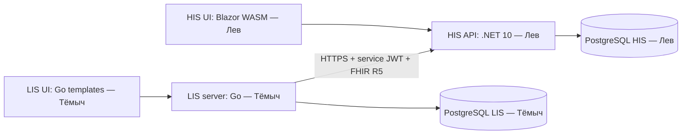

# Лабораторная 3 — задачи Льва: интеграция Go LIS с HIS, v2

Дата: 04.11.2026. Исполнитель: **Лев**. Согласованная парная карточка: [задачи Тёмыча](lab3-temych-tasks-v2.md).

**Твоя ответственность — вся сторона HIS и сквозная интеграция:** лабораторный домен и интерфейсы существующей .NET 10 HIS, FHIR R5 API, приём результатов, сервисные аккаунты и машинная безопасность **на стороне HIS**. Тёмыч самостоятельно разрабатывает **всю LIS на Go**, не редактируя HIS. После переноса сервисной авторизации из прежней карточки Тёмыча твоя ориентировочная оценка — **44 SP**; искусственно выравнивать её под 36 SP Go-части не нужно.

Исходные карточки v1 — планы, а не свидетельство реализации функций. Этот файл — актуализированное ТЗ для разработки, код в репозитории им не создаётся.

## Прогресс реализации — 09.11.2026

| Задача | Состояние | Что появилось в коде |
|---|---|---|
| L1 | Техническая основа готова к согласованию | Общие JSON подключены к тестам; FHIR R5 SDK проверяет медицинские ресурсы и их связи. Добавлены технические DTO, имена claims/policies и абстракция сервисного автора. |
| L2 | Справочник реализован; назначение проверяется вместе с L3–L4 | Семь исходных LOINC, Domain/DTO/DBO/Mapperly, репозиторий, команды/запросы, миграция, защищённый API и экран администратора. |
| L3 | Домен, API и хранение реализованы | Отдельные заказы/результаты, пакетное назначение врачом, сервисный автор результата, миграция, история и восстановление лабораторного состояния на дату. |
| L7 | Выполнена часть с доменом и хранением | Модель и фабрика сервисного аккаунта, отдельный DBO, Mapperly, EF-конфигурация, миграция `AddServiceAccounts`, проверки ограничений и конкурентных изменений. |
| L4–L6, L8–L10 | Ещё не реализованы | Интерфейс анализов в ЭМК, FHIR HTTP API, сервисная авторизация и финальная интеграция остаются следующими этапами. |

Согласование C2 с Тёмычем по-прежнему отмечается в [общем контракте](lab3-integration-contract-c2-v1.md#15-что-должен-согласовать-тёмыч). Автоматические проверки JSON не заменяют это согласование. L1 сохранён коммитом `3da98dc` ([PR #14](https://github.com/medsoft-united-system/hospital-information-system/pull/14)), L2 — `a42c07c` ([PR #15](https://github.com/medsoft-united-system/hospital-information-system/pull/15)). Каждая следующая задача получает отдельную ветку и PR; зависимый PR направляется в предыдущую ветку, чтобы его diff содержал только свою задачу.

Добавленные компоненты:

- `Application/Abstractions/ICurrentServiceAccount` возвращает `ServiceAccountIdentity`. До L8 стандартная реализация отказывает в сервисном доступе; fake применяется только в тестах. Данные из HTTP-тела не определяют автора.
- `Contracts/ServiceAuth` содержит wire DTO и константы C2. Отдельный converter двух дат токенов пишет UTC `Z` с миллисекундами и проверяет входной timezone/точность. Это ещё не endpoints выдачи токенов.
- `HospitalDbContext` подготовлен к расширению через partial-файлы; регистрация инфраструктуры разделена на Identity, аудит и клинические репозитории.
- `service_accounts` отделена от `HospitalUser`: уникальное нормализованное имя, роль `LIS`, SHA-256-хеш длиной 32 байта, версия безопасности, UTC-даты и PostgreSQL `xmin`. Записи и секреты автоматически не создаются.
- SDK `Hl7.Fhir.R5` 6.7.0 пока подключён только к тестовому проекту. Domain/Application от FHIR SDK не зависят.

Проверки L1 находятся в `Lab3FhirContractTests`, `ServiceAuthContractTests`, `CurrentServiceAccountTests`; домен и схема L7 — в `ServiceAccountTests` и `ServiceAccountPersistenceTests`. Запуск:

```bash
dotnet test tests/HospitalInformationSystem.UnitTests
dotnet test tests/HospitalInformationSystem.IntegrationTests
```

Для второго запуска нужен Docker Engine: тесты поднимают одноразовые PostgreSQL, рабочая БД приложения не используется.

Верификация после L1: **546 unit-тестов и 288 интеграционных тестов пройдены**, без пропусков. После добавления L2 09.11.2026 полный прогон прошёл **618 unit-тестов и 325 интеграционных тестов**, без пропусков. Проверены как новые модули лабораторной 3, так и существующие сценарии HIS. Медицинские и технические HTTP-примеры C2 не изменялись; добавлен отдельный JSON исходного справочника.

После L3 09.11.2026 полный прогон прошёл **689 unit-тестов и 355 интеграционных тестов**, без пропусков. Рабочая БД не использовалась.

После исправлений ревью PR #15 11.11.2026 прошли **683 unit-теста и 330 интеграционных тестов**, без пропусков. Контрольная цифра LOINC, исторические исключения, исходная версия редактора и конфликтные обновления покрыты регрессионными проверками.

### Что реализовано в L2

Администратору доступен раздел **«Лабораторные анализы»** (`/admin/laboratory-tests`): список всех статусов, поиск по коду/названию, фильтр активности, создание, редактирование, активация и деактивация с подтверждением. Создание и изменение показаны с секундами в часовом поясе браузера. Обычный запуск — прежний `make run`; при включённом `Database:ApplyMigrations` новая схема применяется при запуске API.

Цепочка изменения: `LaboratoryTests.razor` → `ILaboratoryTestsGateway` → `LaboratoryTestsApiClient` → `LaboratoryTestsController` → MediatR/FluentValidation → handler → фабрика/сервис `LaboratoryTestDefinition` → `ILaboratoryTestRepository` → Mapperly → DBO → `HospitalDbContext.SaveChangesAsync`. Модель содержит состояние; правила создания и изменения вынесены отдельно. Бизнес-слой не зависит от FHIR SDK.

| Человеческий API | Поведение |
|---|---|
| `GET /api/laboratory-tests` | По умолчанию только активные; `?activeOnly=false` возвращает все |
| `GET /api/laboratory-tests/{id}` | Одна запись, включая неактивную |
| `POST /api/laboratory-tests` | Создать: `{ "loincCode": "2345-7", "displayName": "Название анализа" }`; ответ 201 и Location |
| `PUT /api/laboratory-tests/{id}` | Изменить код и название, передав `version` из прочитанной карточки |
| `PUT /api/laboratory-tests/{id}/active` | Сменить статус, передав обязательные `isActive` и ненулевую `version` из прочитанной карточки |

Чтение доступно администратору и всем существующим медицинским ролям. Запись — только администратору и с обычным CSRF. Неавторизованный запрос получает 401, медицинский аккаунт при записи — 403, некорректные данные — 400, конфликт уникальности/версии — 409, отсутствующая запись — 404. Физического DELETE нет. Из интерфейса LIS эти маршруты не вызываются.

LOINC-код нормализуется обрезкой внешних пробелов, имеет длину 3–32, форму «цифры-дефис-цифра» и корректную контрольную цифру Mod10. Поддержаны 14 исторических исключений LOINC. UI и Domain используют общий исходный алгоритм. Название содержит 3–256 Unicode-символов после trim и проверяется на NUL. Уникальность кода действует и для отключённых записей. PostgreSQL `xmin` возвращается клиенту как `version`. При изменении кода, названия или активности обязательно передать прочитанную версию. Пропуск или ноль даёт 400, устаревшая версия — 409. После конфликта форма сохраняет ввод и требует явно перечитать карточку. Обновление списка сохраняет версию открытой формы.

Миграция `20261109000515_AddLaboratoryTests` добавляет только `laboratory_test_definitions`, ограничения и уникальный индекс. `LaboratoryTestCatalogInitializer` запускается после миграций даже при `Database:Seed=false`: это справочные данные, а не демопациенты. Семь исходных элементов имеют постоянные UUID; повторный запуск не дублирует их и не перезаписывает код, название или активность. Недостающие исходные записи добавляются безопасно при параллельном запуске.

Исходный набор и ссылки на официальные карточки LOINC находятся в [laboratory-test-catalog.json](../tests/Fixtures/Lab3/laboratory-test-catalog.json): глюкоза `2345-7`, гемоглобин `718-7`, ВИЧ `7918-6`, гепатит B `5196-1`, гепатит C `13955-0`, сифилис `5393-4`, чума/Yersinia pestis `101363-0`. Названия учитывают материал и метод. JSON сверяется с initializer отдельным контрактным тестом; внешняя терминология при работе приложения не запрашивается.

Проверки L2: `LaboratoryTestDefinitionTests`, `LaboratoryTestUseCaseTests`, `LaboratoryTestCatalogContractTests`, `Web/LaboratoryTests*`, `LaboratoryTestsApiTests`, `LaboratoryTestsAuthorizationApiTests`, `LaboratoryTestPersistenceTests`. Проверены Unicode-границы, дубли, сохранность при ошибках, роли и CSRF, обязательный флаг активности, повторный/параллельный seed и изменение исходного кода перед перезапуском. Web-тесты проверяют рендеринг, фильтры, повторные нажатия, устаревшие ответы и уход со страницы. В UiMock новый маршрут пока возвращает явный 501; для работы со справочником нужен настоящий API.

### Что реализовано в L3

Ветка задачи — `feat/lab3-l3-medical-record-analyses`, основана на L2. `MedicalRecord` содержит лабораторные заказы; у каждого свой UUID, пациент, назначивший врач, ссылка на определение анализа, снимки LOINC/названия, комментарий, время и статус `Active/Completed`. Результат имеет другой UUID, строковое значение, время фиксации LIS (`IssuedAtUtc`), время получения HIS (`ReceivedAtUtc`) и ID сервисного автора.

`POST /api/medical-records/{id}/laboratory-analysis-requests` принимает `{ "laboratoryTestDefinitionIds": ["UUID анализа"], "comment": "Комментарий", "expectedVersions": { "UUID анализа": 57 } }` и возвращает 201 со списком созданных заказов. Клиент сохраняет `version` каждой выбранной записи из `GET /api/laboratory-tests` и передаёт карту `expectedVersions` с теми же UUID. Отсутствующая карта, пропущенный или лишний ключ и нулевая версия дают 400. Изменение кода, названия или активности после выбора врача даёт 409 для всего пакета. До повторной отправки врачу требуется перечитать справочник и подтвердить выбор.

Автор берётся из `ICurrentMedicalWorker`; действующий врач проверяется как политикой API, так и обработчиком команды. Администратор не получает клинических прав. Один вызов создаёт 1–100 разных выбранных анализов; повтор одного ID внутри выбора запрещён, отдельное повторное назначение разрешено. До изменения карты проверяются версии и состояние всего набора, затем заказы, события и версия карты сохраняются одной операцией Unit of Work. Ошибка любого элемента сохраняет карту и историю без частичных назначений.

`RecordLaboratoryAnalysisResultCommand` — внутренняя команда для следующего FHIR-адаптера L6. Она берёт автора только из `ICurrentServiceAccount`. Стандартный accessor пока запрещает сервисный доступ, HTTP-endpoint записи результата человеческим аккаунтом не добавлен. В команде проверяются пациент, сохранённый LOINC, отсутствие прежнего результата и допустимое значение. Закрытый заказ нельзя выполнить ещё раз; зафиксированный результат нельзя обновить или удалить через EF/repository. Путь успешно проверяется с fake сервисной идентичностью в тестах; настоящий вход LIS будет в L8.

История получила `LaboratoryAnalysisRequested` и `LaboratoryAnalysisResultRecorded`. У события есть `AuthorKind` и ровно один из human/service ID. Старые строки мигрируются как человеческие, старые JSON и конструкторы DTO продолжают работать; отсутствующая лабораторная коллекция по умолчанию пустая. Интерфейс истории показывает сервисный аккаунт отдельно от врача. Replay строит лабораторные снимки исключительно из событий, а не актуального результата; `issued` не позволяет поместить результат в прошлое карты. Новые времена HIS согласованы с микросекундной точностью PostgreSQL; `issued` принимается с точностью до миллисекунд и нормализуется в UTC.

Миграция `20261109121005_AddLaboratoryAnalyses` расширяет авторство истории и добавляет `laboratory_analysis_requests/results`. Составные внешние ключи сохраняют соответствие карте/пациенту; уникальный RequestId результата запрещает дубли, CHECK запрещает одинаковые ID заказа и результата. Репозиторий загружает новые дочерние данные и сохраняет их при последующих изменениях диагнозов/назначений. Версия карты и уникальная версия события защищают конкурентные изменения. Downgrade с лабораторными данными останавливается до удаления таблиц.

Проверки L3 находятся в `LaboratoryAnalysisDomainTests`, `LaboratoryAnalysisUseCaseTests`, `LaboratoryAnalysisSnapshotTests`, `LaboratoryAnalysisContractTests`, `LaboratoryAnalysisRequestsApiTests`, `LaboratoryAnalysisPersistenceTests` и `LaboratoryAnalysisUpgradeTests`. Матрица настоящих JWT-ролей дополнена в `ClinicalPermissionsApiTests`. В том числе проверены обновление схемы L2 со старыми пятью типами событий, чтение снимков после миграции, конфликт двух результатов, соответствие пациенту, сохранность при постороннем изменении ЭМК и round-trip времени через PostgreSQL. Для `expectedVersions` проверены пропуск, лишние и отсутствующие ключи, ноль, изменение последнего анализа пакета и сохранность всей карты/истории при конфликте. Сценарий API воспроизводит выбор врача, последующее изменение кода администратором, отказ всего пакета и успешное назначение после явного перечитывания версии.

**Следующий шаг — L4:** вкладка анализов в ЭМК, форма выбора нескольких исследований, таблица результатов и отображение в историческом снимке. Сейчас назначение доступно через API; специальной формы в UI ещё нет. Для завершения L7 отдельно остаются генерация/замена ключей, административный API/UI и аудит; отзыв сессий связывается с L8. Полный вход LIS, token/refresh/testConnection, реальные FHIR endpoints и приём HTTP Observation сейчас не считаются выполненными.

## Общий технический контракт C2 — одинаковый в обеих карточках

Документ описывает **план**, а не уже реализованный код. C2 заменяет C1 из v1 только в части технологии и распределения работ; медицинские требования и оговорённое поведение сохраняются. Правки методов, полей, статусов, безопасности и ошибок синхронно вносятся в оба файла и `tests/Fixtures/Lab3/`. Относительные оценки SP не являются часами.

### Разделение ответственности

| Область | Исполнитель | Что именно делает |
|---|---|---|
| **Вся LIS** | **Тёмыч** | Самостоятельное приложение на **Go**: HTTP-сервер, UI, собственная PostgreSQL, модели, FHIR R5-клиент, хранение ключа и токенов на стороне LIS, история, тесты, Docker, запуск и инструкции |
| **Вся HIS и её интеграционный интерфейс** | **Лев** | Существующая .NET 10 HIS: каталог LOINC, назначения, ЭМК, FHIR R5-сервер, запись Observation, **сервисные аккаунты, API key/JWT/refresh и доступы на стороне HIS**, миграции HIS, тесты |
| **Граница LIS ↔ HIS** | **Лев — интеграционный координатор; Тёмыч — владелец Go-клиента** | Совместно согласовать FHIR JSON, технические HTTP DTO, fixtures, TLS и сквозной сценарий. Каждый исправляет только свою сторону |

**Критичная граница:** Тёмыч не меняет HIS Domain/Application/Infrastructure/Api/Web, включая `ServiceAccounts`, `ServiceBearer`, `ServiceAuthController`, `HospitalDbContext` и админский экран сервисных аккаунтов. Лев не пишет Go-код, UI, схемы или бизнес-логику LIS. Обе стороны могут независимо тестироваться через fake HTTP-сервер / fake client и общие fixtures.

### Требования исходных карточек

| Требование | Исполнитель |
|---|---|
| Независимые приложение, UI и БД LIS, без своего пользователя, пароля или SSO | Тёмыч T1, T4, T8 |
| Настройка LIS через API key, явная проверка соединения и понятные ошибки | Тёмыч T2; HIS-часть — Лев L8 |
| Получение очереди, детали анализа, пациента и врача, проведение и read-only выполненного | Тёмыч T3–T6; FHIR API — Лев L5–L6 |
| Полная автономная локальная история **только выполненных** анализов | Тёмыч T6 |
| Врач назначает несколько отдельных анализов, справочник LOINC (не менее 7 вариантов) | Лев L2–L4 |
| Результат попадает в нужную ЭМК и историю/снимок на дату | Лев L3, L6; Тёмыч T5 |
| FHIR **R5** между HIS-сервером и LIS-клиентом: `Patient`, `Practitioner`, `ServiceRequest`, `Observation` | Лев L5–L6, Тёмыч T3–T5 |
| Один `ServiceRequest.id` = одно назначение; не более одного `Observation` на запрос | Лев L3, L6; Тёмыч T5–T6 |
| Открытая очередь **не** хранится в LIS DB; без автообработки, автоматических POST-retry и фонового outbox | Тёмыч T3–T6 |
| Сервисные аккаунты HIS отдельно от пользовательских, роль `LIS`, ротация ключа и отзыв сервисных сессий | **Лев L7–L8** |
| UI явно сообщает, что единицы измерения не используются | Лев L4; Тёмыч T5 |

Макеты — ориентиры компоновки, а не требование копировать один-в-один. DICOM, архив, редактирование зафиксированных результатов, FHIR Subscriptions, Kafka/RabbitMQ, собственная авторизация LIS и полный набор FHIR search-параметров не входят в минимум.

### Зафиксированный технологический стек

- **HIS / Лев:** существующие C# / .NET 10, ASP.NET Core, Blazor WASM, EF Core/PostgreSQL, MediatR, FluentValidation, Mapperly и текущие аудит/роли/снимки. Для **сервера FHIR R5** допускается согласованная версия Firely `Hl7.Fhir.R5`, фиксируемая в `Directory.Packages.props` HIS.
- **LIS / Тёмыч:** **Go** (`net/http`, `context`, `encoding/json`, `html/template` или эквивалентный Go-шаблонизатор), PostgreSQL с `pgx/v5`, SQL-миграции и отдельный Go-модуль (`go.mod`). UI рендерится **Go-сервером** (HTML/CSS + минимальный JavaScript при необходимости); React/Blazor/.NET-сервер LIS не используются. Дополнительные библиотеки допустимы после фиксации версий в Go-модуле.
- **FHIR на Go:** небольшие **типизированные Go-структуры и явная R5-валидация** для согласованных ресурсов/полей. Не подменять R5 выдуманным REST DTO и не использовать R4-поле `ServiceRequest.code.coding`. Если будет выбран внешний Go FHIR SDK, сначала подтвердить поддержку R5 и проверить fixtures, а не предполагать её.
- **Развёртывание:** раздельные контейнеры HIS и LIS, раздельные PostgreSQL и миграции, HTTPS между сервисами; секреты не коммитить. Медицинский обмен только по FHIR, без прямого SQL-доступа LIS к HIS и без общих доменных библиотек.



### Бизнес-правила и идентификаторы

1. HIS выдаёт самостоятельный UUID на каждый лабораторный заказ (`ServiceRequest.id`), в том числе при массовом назначении. Каждому заказу соответствует **не более одного** `Observation` с **другим** UUID. Второй POST для этого заказа — `409 OperationOutcome`, без изменения результата. Повторное назначение того же теста с новым ID допустимо.
2. Минимальные состояния заказа: `active` → `completed`; результат `status=final`. LIS не меняет ServiceRequest через PUT; HIS завершает его после создания Observation.
3. Значение результата хранится **строкой** (`Observation.valueString`): например, `5.6`, `142`, `Отрицательно`. **Без единиц измерения**, в формах HIS и LIS явная фраза «Учебный режим: единицы измерения не используются».
4. Время `Observation.issued` формирует **Go-сервер LIS** через `time.Now().UTC()` в момент подтверждения оператором, не браузер. HIS хранит отдельно время регистрации (`ReceivedAtUtc`); событие ЭМК имеет серверное время HIS, чтобы replay не добавлял результат задним числом. Все транспортные времена — RFC3339/ISO 8601 с timezone, UI показывает секунды.
5. Завершённые LIS записи содержат неизменяемые FHIR JSON-снимки `ServiceRequest`, `Patient`, `Practitioner`, `Observation` и достаточные индексируемые поля. Уникальность в PostgreSQL LIS: `(HisEndpointId, ServiceRequestId)` и `(HisEndpointId, ObservationId)`. Активная очередь в БД LIS не копируется.
6. При сетевом timeout после POST исход неизвестен: **не повторять POST автоматически**. Явная кнопка проверки только GET-запросами может восстановить локальную историю. Успех HIS 201 и сбой локального commit — ошибка, не «успех» и не причина для повторного POST.

### FHIR R5 API HIS, который реализует Лев и потребляет Тёмыч

`{FHIR_BASE}` = проверяемый HTTPS URL HIS, оканчивающийся `/fhir`; hostname/port конфигурируются. URL внутри Docker — например, `https://his-api:5201/fhir`, лишь при наличии `his-api` в SAN сертификата.

| HTTP | Ответ | Владелец реализации |
|---|---|---|
| `GET /fhir/metadata` | `CapabilityStatement`, `fhirVersion=5.0.0`, реально поддерживаемые операции | Лев L5 |
| `GET /fhir/Patient/{id}` | FHIR `Patient`, 200/404 | Лев L5 |
| `GET /fhir/Practitioner/{id}` | FHIR `Practitioner` (в т.ч. soft-deleted прежний requester), 200/404 | Лев L5 |
| `GET /fhir/ServiceRequest/{id}` | Одно назначение, 200/404 | Лев L5 |
| `GET /fhir/ServiceRequest?status=active&_count=20` | `Bundle` `searchset`; также `status=completed` и поиск без status | Лев L5 |
| `GET /fhir/Observation/{id}` | Зафиксированный результат, 200/404 | Лев L5 |
| `GET /fhir/Observation?based-on=ServiceRequest/{id}&_count=20` | Bundle: 0 или 1 результат | Лев L5 |
| `POST /fhir/Observation` | 201, серверный Observation ID, тело FHIR + `Location` | Лев L6 |

Ответы поиска содержат `Bundle.type=searchset`, `entry.resource`, `link.self` и при наличии следующей страницы `link.next`; `_count` 1–100. Клиент Go должен проходить страницы. `metadata` может быть открытым, **все медицинские** ресурсы защищены сервисным bearer. FHIR ошибки (в т.ч. 401/403) возвращаются `OperationOutcome` с корректным статусом. `Content-Type: application/fhir+json` для медицинских JSON. Человеческий API HIS продолжает использовать свои контракты/ProblemDetails.

Серверная роль `LIS` разрешает `GET Patient/Practitioner/ServiceRequest/Observation` и `POST Observation`; запрещает изменение этих трёх исходных ресурсов, PUT/PATCH/DELETE Observation, доступ к `/api/accounts`, `/api/patients`, `/api/medical-records` и аудиту. Браузер LIS не получает API key, сервисный JWT или refresh.

Пример FHIR R5 назначения (**`ServiceRequest.code.concept.coding`, не R4**):

```json
{
  "resourceType": "ServiceRequest",
  "id": "11111111-1111-4111-8111-111111111111",
  "status": "active",
  "intent": "order",
  "code": { "concept": { "coding": [{ "system": "http://loinc.org", "code": "2345-7", "display": "Glucose [Mass/volume] in Serum or Plasma" }] } },
  "subject": { "reference": "Patient/22222222-2222-4222-8222-222222222222" },
  "requester": { "reference": "Practitioner/33333333-3333-4333-8333-333333333333" },
  "authoredOn": "2026-11-04T10:00:00Z",
  "note": [{ "text": "Учебное назначение" }]
}
```

Пример POST FHIR R5 результата (**без** клиентского `id`):

```json
{
  "resourceType": "Observation",
  "status": "final",
  "code": { "coding": [{ "system": "http://loinc.org", "code": "2345-7", "display": "Glucose [Mass/volume] in Serum or Plasma" }] },
  "subject": { "reference": "Patient/22222222-2222-4222-8222-222222222222" },
  "basedOn": [{ "reference": "ServiceRequest/11111111-1111-4111-8111-111111111111" }],
  "issued": "2026-11-04T10:05:00Z",
  "valueString": "5.6"
}
```

Сервер HIS требует ровно один `basedOn`, правильные `subject`, LOINC, status/valueString и ссылки только согласованного относительного формата. HIS назначает свой `Observation.id`; ненужный входной `id` не используется. Абсолютные внешние ссылки не обходятся автоматически ни одной стороной.

### Машинная авторизация: HIS выдаёт, LIS потребляет

| HTTP HIS | Контракт | Реализация |
|---|---|---|
| `POST /api/service-auth/token` | `{ "apiKey": "..." }` → accessToken, accessTokenExpiresAt, refreshToken, refreshTokenExpiresAt | **Лев L8** |
| `POST /api/service-auth/refresh` | `{ "refreshToken": "..." }` → новая пара с ротацией refresh | **Лев L8** |
| `GET /api/testConnection` | `Authorization: Bearer <service-access>` → 200, технический статус | **Лев L8** |
| `GET/POST /api/service-accounts`, `PUT /api/service-accounts/{id}`, `PUT /api/service-accounts/{id}/active`, `POST /api/service-accounts/{id}/rotate-key` | Только человеческий администратор HIS | **Лев L7** |

Это **технические JSON**, не FHIR медицинские ресурсы. Секреты не передавать в URL, access/refresh — не browser-cookie HIS. Машинный access — отдельная схема `ServiceBearer`, `aud=MedSoft.Lis`, `account_kind=service`, роль LIS, id/версия безопасности/сессия. Политики `LisFhirRead` и `LisObservationCreate` явно используют `ServiceBearer`, человеческие JWT не подходят. При смене ключа или отключении аккаунта старые access и refresh недействительны с ближайшего запроса (проверка сессии/активности в HIS DB). `ApiAntiforgeryMiddleware` исключает только явно согласованные credential-endpoints и POST Observation после проверенной сервисной аутентификации; CSRF человеческих форм не ослаблять.

На стороне Go LIS реализуется **только клиент** этих операций, безопасное хранение секрета и синхронизация refresh; не копируются классы авторизации HIS и не создаются собственные сервисные аккаунты внутри LIS.

### Общий порядок работ, миграции и передача

1. **G0 (Лев, согласование Тёмыча):** закрепить C2, методы, поля и примеры в `tests/Fixtures/Lab3/` и проверках Go; согласовать JWT claim names, 401/403 и обязательные сертификаты. Для Go-клиента сохранить fixtures как обычные JSON, а не зависеть от .NET DTO/Firely assembly. На раннем этапе Тёмыч отвечает HTTP-моками, Лев тестирует HIS тестовой схемой аутентификации только внутри test host.
2. **Дальше параллельно:** Лев строит лабораторный модуль и всю сервисную безопасность HIS, Тёмыч строит отдельное Go-приложение LIS. **Больше нет** прежнего ожидания «Тёмыч передаёт миграцию service_accounts»: её делает сам Лев.
3. **Миграции:** HIS `HospitalDbContext` один; Лев единолично формирует сервисные таблицы, затем лабораторные, расширение истории и согласованный ModelSnapshot. Тёмыч не трогает HIS EF. LIS имеет **самостоятельные SQL-миграции PostgreSQL** под Go (без EF/DbContext/ModelSnapshot). Обе БД сохраняют данные после перезапуска.
4. **Стыковка:** Лев предоставляет настоящие token/refresh/testConnection и FHIR endpoints; Тёмыч переключает `httptest`/fixtures на реальный HTTPS. Обнаруженные несовместимости фиксируются по владельцу стороны, не обходятся прямыми SQL/внутренними REST DTO.
5. **Запуск:** Тёмыч отвечает за Dockerfile/compose-фрагмент LIS и команду автономного запуска; Лев — за существующую HIS, TLS/SAN и объединение стенда. Общие `Makefile`, compose и инструкции меняются согласованным интеграционным коммитом.

Приёмка общего сценария: врач HIS назначает несколько анализов → Go LIS вручную загружает очередь по FHIR → проводит один анализ → HIS атомарно завершает заказ и обновляет ЭМК → Go LIS сохраняет локальную историю → повторный просмотр read-only и автономная история при выключенной HIS → отзыв ключа/JWT блокирует будущие обращения. Никаких реальных секретов и данных пациента в fixtures/Git.

## Личный план и оценка

| ID | Задача | SP | Что передаётся Тёмычу |
|---|---|---:|---|
| L1 | Общий контракт C2, JSON fixtures, точка сервисного автора | 3 | Подписанные структуры JSON и HTTP-ошибки |
| L2 | LOINC-справочник, seed и UI администратора HIS | 5 | Реальные коды в ServiceRequest |
| L3 | Назначения, результаты, история ЭМК и replay | 5 | Стабильные ID/состояния/ссылки |
| L4 | Врачебный раздел «Анализы» в HIS | 3 | Реальный путь назначения для end-to-end |
| L5 | FHIR R5 GET/search/metadata + OperationOutcome | 5 | HTTP FHIR-сервер |
| L6 | POST Observation, транзакционность и завершение | 5 | Приём результата Go LIS |
| L7 | **Сервисные аккаунты и административный UI HIS** | 5 | API key, создаваемый администратором |
| L8 | **ServiceBearer, JWT/refresh, ротация, аудит, политики** | 6 | `token`, `refresh`, `testConnection` |
| L9 | Тесты HIS, безопасности и контрактные проверки | 4 | Подтверждённая совместимость |
| L10 | Миграции HIS, HTTPS/TLS, сквозная приёмка | 3 | Запущенный HIS + стабильный TLS endpoint |
| **Итого** | | **44** | |

### Порядок реализации

1. L1 — один короткий G0 PR с fixtures C2; Тёмыч согласует их с Go-структурами.
2. **Параллельно внутри HIS:** L7 (схема сервисных аккаунтов) и L2/L3/L5. Перед завершением EF/FK L3/L6 у тебя должна быть собственная миграция сервисных аккаунтов L7. **Никакого ожидания PR/миграции HIS от Тёмыча.**
3. L8 завершает авторизацию; L4/L6 связывают назначения и результаты; L9 закрывает настоящую матрицу доступа.
4. L10 обеспечивает настоящий HTTPS endpoint; Тёмыч подключает Go-клиент к нему и проходит совместную приёмку. Go-исправления остаются у Тёмыча, HIS-исправления — у тебя.

### L1. Зафиксировать границу HIS–LIS — 3 SP

**Результат:** маленький общий G0-коммит, от которого оба начинают свои feature-ветки.

Что сделать:

1. Перенести C2 в проверяемые примеры `tests/Fixtures/Lab3/`: отдельно Patient, Practitioner, ServiceRequest active/completed, Observation final, POST Observation без id, Bundle пустой/с несколькими страницами и OperationOutcome 400/401/403/404/409. Ответ сервиса на создание должен иметь новый Observation.id, согласованный с его GET.
2. Зафиксировать семь типов анализов как требуемый набор; окончательные LOINC-коды кроме двух подтверждённых примеров выбираются на L2. LIS читает коды из ServiceRequest и не зашивает перечень в свой клиент, поэтому ждать L2 Тёмычу не нужно.
3. Добавить абстракцию получения сервисного автора в Application: например, `ICurrentServiceAccount` → `ServiceAccountIdentity(Id, Name, AuthenticationVersion)`. Ты реализуешь её в HIS по проверенным service-claims в L8. В твоих тестах используется fake; обычный UI не передаёт авторство запроса в теле.
4. Согласовать с Тёмычем wire-контракт и ошибки token/refresh. Service policy/scheme, auth DTO и FHIR-контроллеры реализуешь и согласуешь **внутри своей HIS** (L7–L8).
5. Подготовить `partial HospitalDbContext` и разделяемые регистрации. Самостоятельно создать схему `service_accounts` в L7 и тестовую фабрику сервисной записи; FK результатов/истории должен ссылаться на настоящую строку, даже если auth-handler в тесте подменён. Миграцию HIS больше не ожидаем от Тёмыча. Зафиксировать новую SDK-зависимость централизованно. Не переформатировать весь solution и существующие проекты.

Контрактные тесты должны парсить примеры именно как R5 и проверять ссылки/статусы/значения. Полностью permissive JSON-parser не доказывает корректность FHIR. Пока настоящая ServiceBearer не готова, регистрировать тестовую схему можно только в тестовом host; временный production-обход авторизации не добавлять.

**Готово, когда:** оба собирают проекты и могут использовать один набор примеров; в C2 нет несогласованных endpoint/claim names; дальнейшая разработка не требует живого приложения напарника.

### L2. Добавить самостоятельный справочник лабораторных анализов — 5 SP

**Результат:** администратор ведёт анализы, врач выбирает их при назначении.

Предлагаемые новые типы:

- `LaboratoryTestDefinition` хранит Id, LoincCode, DisplayName, IsActive, CreatedAtUtc, UpdatedAtUtc, Version.
- `LaboratoryTestDefinitionFactory` и сервис изменения: только они создают/изменяют состояние; модель содержит данные.
- Отдельные DBO/configuration/Mapperly-mapper, `ILaboratoryTestRepository`, команды/запросы и валидаторы.
- `LaboratoryTestsController`, API client, gateway и `Pages/Admin/LaboratoryTests.razor` по существующим паттернам.

Предлагаемый человеческий API: GET/POST `/api/laboratory-tests`, GET/PUT `/api/laboratory-tests/{id}`, отдельная смена активности. Создание/изменение доступны Administrator, чтение для выбора — существующим медицинским ролям. Сервис LIS эти внутренние endpoints не использует.

Правила:

1. LOINC-код — самостоятельная строка, например `2345-7` или `718-7`. Уникальность — по нормализованному коду. Не переносить ограничения «ровно 6 символов» и «название до 24» из диагнозов. Предлагаемые технические пределы: Code 3–32 символа, DisplayName 3–256.
2. Добавить минимум **семь** записей: глюкоза, тест на чуму, гемоглобин, ВИЧ, гепатит B, гепатит C, сифилис. Четыре обязательных инфекционных анализа — четыре отдельных варианта.
3. Подобрать реальные LOINC-коды с учётом того, что определяется и в каком материале. Для каждого в fixture/seed записать источник и понятное название. Тест на чуму должен соответствовать исследованию Yersinia pestis, а не случайному инфекционному коду. Не делать поиск терминологии во внешней сети при каждом назначении.
4. Использованный анализ деактивировать, а не физически удалять. Ранее созданный запрос хранит снимок кода/названия; редактирование справочника не меняет прошлые назначения и не ломает сравнение входящего Observation.
5. Seed идемпотентный: повторный запуск не дублирует справочник и не перезаписывает пользовательские изменения без явной политики. Уникальные ограничения БД обязательны.

**Проверки:** дубликат кода; неверные длины; запрет изменения неадминистратору; семь записей; повторный seed; отключённый анализ отсутствует в выборе новых назначений, но остаётся в истории.

**Готово, когда:** все семь типов можно назначить, меню администратора отделяет их от диагнозов, изменения справочника не портят старые записи.

### L3. Расширить ЭМК заказами анализов и корректным авторством — 5 SP

**Результат:** заказ и результат являются самостоятельными медицинскими элементами, участвуют в сохранении и истории карты.

Предлагаемые модели HIS:

| Модель | Основные поля |
|---|---|
| LaboratoryAnalysisRequest | Id, MedicalRecordId, PatientId, RequestedByMedicalWorkerId, LaboratoryTestDefinitionId, LoincCodeSnapshot, DisplayNameSnapshot, Comment, AuthoredAtUtc, Status |
| LaboratoryAnalysisResult | Id, LaboratoryAnalysisRequestId, PatientId, Value, IssuedAtUtc, ReceivedAtUtc, CreatedByServiceAccountId |

Result отсутствует до выполнения; затем у запроса ровно один результат. Request.id и Result.id — разные UUID. В БД у Result.RequestId уникальный индекс и внешние ключи к нужным сущностям. Ссылки на карточку/пациента не должны позволять присоединить результат к чужой карте.

Для назначения нескольких анализов использовать `CreateLaboratoryAnalysisRequestsCommand` с MedicalRecordId, списком LaboratoryTestDefinitionId, комментарием и картой ExpectedVersions. Для каждого выбранного ID требуется прочитанная ненулевая версия справочника. Набор ключей точно совпадает с выбранными ID. Валидировать весь набор и сравнить версии, затем одной транзакцией создать N заказов с N разными ID. Устаревшая версия любого элемента отклоняет весь пакет с 409 до изменения карты или истории. Автор — текущий врач через `ICurrentMedicalWorker`, время — сервер HIS. Пользователь может отдельно назначить тот же анализ ещё раз и получить новый Request.id.

История:

1. Добавить события `LaboratoryAnalysisRequested` и `LaboratoryAnalysisResultRecorded` с payload, достаточным для воспроизведения состояния.
2. Обновить `MedicalRecordEventType`, ограничения допустимых типов в БД, payload parser/validation и `MedicalRecordSnapshotReplay`. Старые события и снимки продолжают читаться; в старой карте лабораторные коллекции пустые, а не null.
3. Учесть сервисного автора результата. Сейчас `PerformedByMedicalWorkerId` обязателен и связан FK с сотрудником — сервис туда записывать нельзя. Добавить явный вид автора, nullable human/service ID и снимок имени, мигрировать существующие строки как человеческие. CHECK должен разрешать ровно один подходящий вид автора. Сервисный ID — не ID назначившего врача; requester и исполнитель интеграции выполняют разные роли.
4. Обновить domain factory/service, history DTO/mapping/UI и replay вместе. Для сервисного события не выдумывать врача и не подставлять пустой Guid. Врач остаётся автором самого назначения, сервис — автором регистрации результата.
5. Обновить агрегат, EF Include-загрузку, синхронизацию дочерних DBO и Mapperly. Простого добавления DbSet недостаточно: обычное сохранение карты не должно терять новые дочерние строки.
6. Увеличение версии карты, добавление события и изменение заказа/результата — единая транзакция HIS. Время события — время регистрации результата в HIS; `Observation.issued` хранится отдельно как дата фиксации LIS и не используется для вставки события в прошлое. Порядок блокировок согласовать с принятым репозиторием, сохранить обработку конфликта версий.

**Проверки:** N разных заказов; повторное назначение того же анализа; чужой пациент; несовпадение автора; мягкое удаление врача не ломает старый requester; снимок до заказа/между заказом и результатом/после результата; старые пять типов событий; сохранение карты после лабораторных изменений.

**Готово, когда:** результат не исчезает при другом изменении ЭМК, история достоверно показывает человеческого и сервисного автора, снимки восстанавливают лабораторное состояние.

### L4. Сделать раздел «Анализы» в HIS — 3 SP

**Результат:** лабораторный сценарий доступен из существующей ЭМК.

Добавить панель/вкладку в `Pages/Medical/MedicalRecord.razor`, а при росте страницы вынести отдельные компоненты. Расширить MedicalRecords API client/gateway и DTO. Для UI список можно получать своим REST DTO; только межсистемный обмен обязан быть FHIR.

В таблице: дата назначения, название и LOINC, назначивший врач, статус, значение и дата фиксации результата. Пустой результат — прочерк, а не `0`. Даты с секундами, рядом с результатами явная подпись об отсутствии единиц.

Врач открывает форму «Назначить анализ», выбирает один или несколько активных анализов, добавляет комментарий и подтверждает. Показывать количество создаваемых отдельных заказов; на время отправки отключать повторное нажатие. Валидационные ошибки возвращаются к форме.

Права проверять и в UI, и на сервере:

- Doctor: создавать заказы и читать результаты.
- Nurse/LaboratoryTechnician/Other: читать лабораторную часть доступной ЭМК.
- Administrator: управлять справочником, но не получать клинический доступ к картам.
- LIS: только FHIR; человеческая форма ему недоступна.

Результат из LIS подхватывается при явном обновлении ЭМК/вкладки; автоматическое серверное push-обновление не требуется. Существующие диагнозы, назначения, история и снимок на дату продолжают работать. В просмотре прошлого состояния не показывать будущий лабораторный результат из актуальной таблицы.

**Готово, когда:** врач назначает несколько анализов одной формой, остальные медицинские роли видят данные без кнопки назначения, результат и дата появляются у правильного пациента после получения Observation.

### L5. Реализовать читающую часть FHIR R5 — 5 SP

**Результат:** LIS получает медицинские данные без доступа к внутренним HIS DTO и БД.

Предлагаемые области: `Api/Fhir/`, `FhirResourceMapper`, `FhirResponseWriter`, Application queries и read-модели. SDK-модели остаются на границе интеграции, Domain не зависит от HTTP/FHIR.

Сделать все GET из C2. Маппинг:

- Patient.id = существующий Patient.Id; HumanName из фамилии/имени/отчества; birthDate из DateOnly; gender по явному преобразованию существующего enum.
- Practitioner.id = MedicalWorker.Id; HumanName и должность из медицинского сотрудника. Пароли, логины/хеши Identity и TOTP не входят в ресурс. Исторический requester остаётся разрешимым после soft delete; active может быть false.
- ServiceRequest.id = LaboratoryAnalysisRequest.Id; intent order; status из заказа; code через CodeableReference.concept; subject/requester — относительные ссылки; authoredOn и note — из сохранённого запроса.
- Observation.id = LaboratoryAnalysisResult.Id; status final; code из снимка назначения; subject/basedOn — из проверенных связей; issued и valueString — сохранённые значения.

Поиск и ошибки:

1. Bundle вместо внутреннего PagedResult. Стабильная сортировка и страницы без потерь/повторов на неизменном наборе; пользователь LIS может перейти на следующую страницу. Не загружать молча только первые 20 записей.
2. Поддержать только C2-параметры, ограничения _count и корректный разбор references. Не передавать неизвестный параметр напрямую в LINQ/SQL. Неподдержанные строгие запросы возвращают понятный OperationOutcome.
3. Подготовить CapabilityStatement с фактическими ресурсами/read/search/create, JSON и версией R5. Это техническая декларация возможностей, а не расширение клинических прав LIS.
4. Для FHIR-ошибок 400/404/409 сделать отдельный перевод исключений в OperationOutcome. Для собственного ServiceBearer в L8 реализовать такой же формат 401/403; человеческий ProblemDetails не менять.
5. Включить service policy, а не общую проверку «любой JWT». До готовности L8 тестировать через тестовый auth-handler, не через выключенную защиту.

**Проверки:** R5 JSON, корректный Content-Type, правильные ссылки, отсутствие человеческих секретов, поиск пустой/несколько страниц, неизвестный ID, Practitioner после soft delete, активный и завершённый запрос, минимальный metadata.

**Готово, когда:** fixtures и реальные endpoints взаимозаменяемы для LIS, а подписанный человеческий access не получает сервисные разрешения.

### L6. Принять Observation и сохранить результат атомарно — 5 SP

**Результат:** один FHIR POST создаёт результат, завершает назначение и обновляет ЭМК.

Последовательность обработчика:

1. Проверить ServiceBearer, роль LIS, request body size и media type. Разобрать именно FHIR Observation R5; отвергнуть чужой resourceType, неверный value[x] и не согласованный status.
2. Получить ID сервиса из `ICurrentServiceAccount`. Разрешить только относительные ServiceRequest/Patient ссылки C2, без HTTP-загрузки произвольных reference URL.
3. Загрузить запрос с картой; убедиться, что Patient в Observation совпадает с пациентом заказа/карты, code соответствует снимку LOINC, basedOn ровно один, значение непустое и в техническом лимите. Время issued сохраняется как время фиксации LIS, ReceivedAtUtc ставится сервером HIS.
4. В транзакции проверить отсутствие результата и состояние active. Создать Result с новым серверным UUID, завершить заказ, обновить версию карты, добавить событие истории и security-audit сервиса.
5. Защититься от одновременных POST уникальным ограничением RequestId плюс механизмом конкурентного обновления карты. Конфликт возвращает 409 OperationOutcome; не оставляет частичный Result, completed без результата или лишнее событие истории.
6. Вернуть 201, Location и сохранённый Observation. При наличии resource.id в обычном POST create игнорировать его и назначить новый серверный ID — это правило FHIR create, а не авторизация клиентского идентификатора.

LIS не получает PUT на ServiceRequest: его completed устанавливается внутренней операцией HIS после допустимого Observation. Нельзя доверять присланным PatientId, requester или service ID как способу назначить права.

Отдельно проверить второй POST для обработанного Request.id: 409 и прежний результат неизменен; тот же анализ для того же пациента, но новый Request.id, допускает новый результат. GET Observation?based-on позволяет LIS показать уже проведённый запрос только для чтения.

**Готово, когда:** параллельные результаты не создают дубли, ошибочные ссылки не меняют БД, после 201 текущая карта и replay показывают одно и то же.

### L7. Сервисные аккаунты и административный UI в HIS — 5 SP

**Цель:** администратор создаёт аккаунт интеграции с ролью `LIS`, получает ключ один раз, отключает аккаунт и заменяет ключ. Аккаунт не связан с медработником и не появляется среди человеческих учётных записей.

Сначала создать схему `service_accounts`, её EF-конфигурацию, применимую миграцию и тестовую фабрику сервисной записи с согласованным ID. Она нужна твоим же лабораторным результатам/истории с реальным FK к сервисному аккаунту; Go LIS от этой схемы и классов не зависит.

Предлагаемые файлы в существующих HIS-проектах:

- `Domain/ServiceAccounts/ServiceAccount.cs`, `ServiceAccountRole.cs`, `Factories/ServiceAccountFactory.cs`, `Services/ServiceAccountService.cs`.
- `Contracts/ServiceAccounts/`: DTO списка, создания/редактирования, активации и ответа с новым ключом; `Application/Abstractions/IServiceAccountService.cs`.
- `Infrastructure/ServiceAccounts/ServiceAccountService.cs`, `ServiceApiKeyGenerator.cs`, `Persistence/Models/ServiceAccountDbo.cs`, EF-конфигурация и Mapperly-маппер.
- `Infrastructure/Contexts/HospitalDbContext.ServiceAccounts.cs`; сервисная миграция по правилам общего HIS-модуля.
- `Api/Controllers/ServiceAccountsController.cs`; `Web/Pages/Admin/ServiceAccounts.razor`, scoped CSS, отдельные `ServiceAccountsApiClient` и gateway.

Данные аккаунта: `Id`, уникальное имя, роль `LIS`, активность, хеш ключа и его открытый идентификатор/префикс, версия безопасности, UTC-время создания и изменения. В модели только состояние; создание, изменение и преобразования вынести в фабрики/сервисы/Mapperly. Ограничения длины имени и других полей одинаковы в UI, валидаторе и БД.

Алгоритм ключа: сгенерировать не менее 32 случайных байт криптографическим генератором; кодировать безопасной для передачи строкой. Конкретный формат с открытым идентификатором закрепить на G0. В БД хранить только SHA-256 секрета, проверять через сравнение постоянного времени. Высокоэнтропийный API key не является пользовательским паролем; копировать парольный Argon2id-поток для него не требуется.

Предлагаемые административные endpoints: `GET/POST /api/service-accounts`, `PUT /api/service-accounts/{id}`, `PUT /api/service-accounts/{id}/active`, `POST /api/service-accounts/{id}/rotate-key`. Доступ — только человеческому администратору с действующим CSRF. Роль пока только `LIS`; редактор произвольных ролей и дополнительные роли макета не реализуются.

При замене ключа изменить хеш и версию безопасности, отозвать все действующие `ServiceRefreshSession` аккаунта и записать аудит **в одной локальной транзакции**. Отключение делает такой же отзыв. Повторная активация не возвращает старые токены. Удаление в UI реализовать как логическое отключение/удаление, сохраняя ссылки и аудит; точное название операции согласовать на G0.

В UI показать имя, роль, статус и время с секундами; добавить создание, редактирование, отключение и замену ключа. Ключ вернуть только в успешном ответе создания/замены, показать в отдельном блоке с копированием и очистить после закрытия. Повторно раскрыть старый ключ невозможно. Он не должен попадать в URL, localStorage, таблицу списка или журнал аудита.

**Проверки:** медработник получает 403; дубли имени дают понятный 409; повторное чтение не возвращает ключ; ротация сохраняет атомарность при ошибке; список человеческих аккаунтов не содержит сервисных.

**Готово:** [ ] CRUD и ограничения БД; [ ] UI; [ ] одноразовая выдача ключа; [ ] отзыв на смене ключа/отключении; [ ] тесты; [ ] сервисная миграция согласована с L1/L3.

**Зависимости и параллельность:** после G0 и своих контрактов делаешь независимо от Go LIS. Для отзыва используй интерфейс L8; до его готовности проверь сервис подменой и отдельно протестируй транзакцию после объединения.


### L8. Сервисные токены, роль LIS и аудит внутри HIS — 6 SP

**Цель:** LIS получает и обновляет машинные токены; эти токены открывают только согласованные ресурсы FHIR и техническую проверку связи.

Добавить в HIS `ServiceRefreshSession`/DBO/EF-конфигурацию, `ServiceTokenOptions`, `ServiceTokenSessionService`, `ServiceAuthenticationService`, `ServiceAuthController`, `ServiceBearer` и отдельный файл DI/регистрации, например `ServiceAccountSecurityRegistration.cs`. В Contracts определить запросы/ответы из C2 и общие имена claims. DI и миграции сервисной авторизации отделять от своего лабораторного модуля HIS.

`POST /api/service-auth/token` принимает только ключ в теле. Найти аккаунт по согласованному открытому идентификатору, проверить хеш, активность, роль и версию. Затем в транзакции выдать новую пару токенов. Не создавать `HospitalUser`, не запрашивать логин/TOTP и не устанавливать человеческую refresh-cookie.

Машинный access — подписанный JWT с отдельной audience `MedSoft.Lis`, `account_kind=service`, ID сервисного аккаунта, ролью `LIS`, версией безопасности, семейством и конкретной сессией. При переиспользовании RSA-ключа HIS отдельно сконфигурировать параметры валидации; не менять общий объект настроек человеческого JWT. Сроки токенов задаются собственными валидируемыми options.

Refresh — случайное одноразовое значение; в БД только его хеш, ID аккаунта/семейства, версия, даты, причина отзыва и замена. `POST /api/service-auth/refresh` проверяет состояние под блокировкой/транзакцией, отзывает старый refresh и возвращает новую пару. Повторное использование отозванного значения прекращает его семейство. Ключ и refresh не логируются и не передаются в query string.

На каждом защищённом запросе `ServiceBearer` проверяет подпись, issuer/audience/exp, `account_kind`, актуальные роль/версию/активность и конкретную действующую сервисную сессию в БД. Поэтому после отключения аккаунта или смены ключа старый access не работает уже на следующем запросе. Не подключать для этой схемы человеческий `TokenSessionService.ValidatePrincipalAsync`.

Policies должны явно выбирать `ServiceBearer`: `LisFhirRead`, `LisObservationCreate` и технический доступ к `/api/testConnection`. Человеческий JWT не удовлетворяет этим policies. Машинный JWT не должен удовлетворять `Administrator`, `Clinical` и остальным политикам человеческого API. При необходимости добавить явное ограничение схемы на человеческих policies; не заменять их общей проверкой `IsAuthenticated`.

Согласовать с L5 формат 401/403 на `/fhir/*`: там нужен `OperationOutcome`, включая отказы до входа в контроллер. Для service-auth оставить обычный технический JSON. Общий writer/адаптер FHIR-ошибок описать на G0, чтобы подключение схемы не ожидало полной реализации FHIR.

В `ApiAntiforgeryMiddleware` добавить точечные исключения для двух credential-endpoints, не использующих cookies. Для POST Observation пропуск CSRF разрешён только на известном FHIR endpoint после успешной сервисной аутентификации. Существующие login/logout/TOTP, формы администратора и медработника продолжают проверять CSRF. Ограничить частоту выдачи/refresh и объём входного тела.

В `HttpAuditActorAccessor` сначала различать `account_kind=service`: вернуть существующий `System` actor с `Component=lis:<id>`. Добавить типизированный `ServiceAccountId` в metadata, если требуется. Не записывать сервисный ID в FK `ActorUserId`. Аудировать создание/изменение аккаунта, замену ключа, отключение, выдачу/отказ/обновление токена; запись медицинского результата координируется с L6. Для неверного ключа не приписывать событие неподтверждённому аккаунту.

**Проверки:** неверный/отключённый ключ — 401; человеческий JWT на FHIR — отказ; сервисный JWT на человеческих API — отказ; ротация/повтор refresh; два конкурентных refresh; отзыв после смены ключа; человеческие CSRF-тесты продолжают проходить; все события без секретов.

**Готово:** [ ] две credential-операции; [ ] testConnection; [ ] отдельная схема/policies; [ ] немедленный отзыв; [ ] узкий CSRF; [ ] корректный actor аудита; [ ] отрицательные проверки.

**Зависимости и подмены:** зафиксируй claims, policy names и FHIR error-writer на G0 и в собственных L1/L5. Реализацию можно тестировать через минимальные тестовые endpoints с нужными policies и fixtures, не ожидая настоящего Observation handler.


**Граница с Go LIS:** Тёмыч только отправляет HTTP-запросы к `/api/service-auth/*`, сохраняет выданные токены на своём Go-сервере и предъявляет bearer. Никаких HIS JWT-validator, EF-моделей или админских страниц на Go он не пишет.

### L9. Проверить HIS, сервисную безопасность и оба протокола — 4 SP

Тестировать бизнес-правила внутри задач, здесь собрать итоговую матрицу:

| Проверка | Ожидаемый результат |
|---|---|
| Doctor назначает 3 анализа | 3 уникальных ServiceRequest, по одному коду |
| Nurse/LaboratoryTechnician/Other назначают анализ | 403, без новых строк |
| Все медицинские роли читают ЭМК | Видят анализы и результаты |
| Administrator читает клиническую карту | Прежний запрет сохраняется |
| LIS читает 4 ресурса и создаёт Observation | Успех только для согласованных операций |
| LIS создаёт Patient/Practitioner/ServiceRequest или меняет Observation | Запрет, никаких изменений |
| Human JWT предъявлен как service JWT | Не принимается |
| Неверный пациент, basedOn, код, пустой результат | 400/409, атомарный отказ |
| Одновременные результаты одного запроса | Ровно один результат/одно завершение |
| Повторное назначение с другим ID | Разрешено |
| Снимок до/после результата и старая история | Верные состояния, обратная совместимость |
| Назначивший врач удалён мягко | Ссылка Practitioner остаётся разрешимой |
| Сервис отключён или API key заменён | Его прежний refresh и access не принимаются |

Использовать xUnit, Testcontainers и существующий WebApplicationFactory. В тестах выдачи/отзыва/подписи токенов брать один `TimeProvider` из DI; не смешивать реальные и замороженные часы. Для FHIR проверять и parse/serialize R5, и бизнес-ограничения: одно не заменяет другое.

Добавить отдельные тесты HIS `ServiceAccountsApiTests`, `ServiceTokenSessionTests`, `ServiceAuthorizationTests`, `ServiceAuditTests`: неверный ключ, ротация, конкурентный refresh, отзыв access с ближайшего запроса, разделение human/service policies, неизменность обычного CSRF. Проверить, что медработник не управляет сервисными аккаунтами, а сервис не получает доступ к обычным API.

**Готово, когда:** твоя ветка проверяется без запущенной LIS, проходят реальные отрицательные сценарии авторизации. Фикстуры проверяются как потребителем, так и сервером.

**Взаимодействие с Тёмычем:** Go `httptest` и xUnit должны использовать одни JSON fixtures C2; реальный совместный тест обязателен, но не заменяет автономные тесты HIS.

### L10. Миграции HIS, TLS и финальная стыковка с Go LIS — 3 SP

1. После собственной сервисной миграции L7–L8 собрать финальную миграцию лабораторных таблиц и расширенного авторства/типов истории. Проверить обновление копии схемы лабораторной 2 с существующими записями, а не только пустую БД.
2. Согласовать общие регистрации DI, SDK package HIS, ServiceBearer policies и конфигурацию с T8 (Go LIS). Существующий `make run` и демосценарий лабораторной 2 должны сохраниться.
3. На стороне HIS обеспечить сетевой адрес для LIS, поддержанный сертификатом: при общей Docker-сети стабильный alias `his-api` и соответствующий SAN, либо другой явно настроенный проверяемый HTTPS endpoint. Перевыпускать только нужный TLS leaf с сохранением JWT/Data Protection; рабочие БД/ключи не сбрасывать.
4. Подготовить данные и инструкции показа: один пациент, врач и читатель ЭМК, семь LOINC-вариантов, несколько назначений одного пациента, два заказа одного и того же анализа с разными ID. Сервисный API key на показе создаётся через административный UI HIS из L7, не хранится в seed/Git.
5. Совместный smoke проверяет 201 Observation → результат и дата в HIS → completed в FHIR → локальная история LIS → повторный запрос только для чтения. Затем смена API key/деактивация и отказ старых токенов.

**Готово, когда:** HIS можно запустить и проверить отдельно; связка запускается документированными командами; завершённый результат виден на обеих сторонах без ручного редактирования БД.


## Владение файлами и точки сопряжения

| Файлы/схемы | Кто изменяет |
|---|---|
| HIS Domain/Application/Infrastructure: `LaboratoryTests`, назначения, Observation, ЭМК, history replay | **Лев** |
| HIS `ServiceAccounts/*`, `ServiceRefreshSession`, сервисные EF миграции, `ServiceBearer`, policies, аудит, CSRF, админский UI | **Лев** |
| HIS `Api/Fhir/*`, `Api/Controllers/ServiceAuthController`, `/api/testConnection`, FHIR writer | **Лев** |
| HIS EF `HospitalDbContext`, `.ModelSnapshot`, лабораторные миграции | **Лев** |
| Все исходники Go LIS (`go.mod`, `internal/*`, `cmd/*`, `web/*`, `migrations/*`), SQL, Go FHIR-клиент и Go-тесты | **Тёмыч** |
| Контрактные JSON fixtures, общий make/compose, интеграционная документация | Совместно; Лев координирует контракты и HIS запуск |

**HIS точки изменения:** `Domain/MedicalRecords/MedicalRecord.cs`, `MedicalRecordService`, `MedicalRecordEventType`, `MedicalRecordCommandContext`, `MedicalRecordSnapshotReplay`, `MedicalRecordMapping`, `HospitalDbContext`, `MedicalRecordRepository`, `MedicalRecordHistoryEventConfiguration`, `MedicalRecordsController`, `Web/Pages/Medical/MedicalRecord.razor`. Пути из v1 — ориентиры; новые файлы ещё предстоит создать.

## Итоговый чек-лист Льва

- [ ] C2/fixtures согласованы с Go LIS; R5 ServiceRequest.code.concept и Observation.valueString проверяются обеими сторонами.
- [ ] Семь настоящих LOINC-вариантов, уникальный справочник и UI администратора HIS.
- [ ] Только врач назначает; один выбор N анализов создаёт N заказов с разными ID.
- [ ] Результат видят все существующие читатели ЭМК; replay и старые снимки не сломаны.
- [ ] FHIR R5 metadata/read/search/Bundle/OperationOutcome и HTTPS/сервисная защита соответствуют контракту.
- [ ] POST Observation создаёт **один** результат, завершает заказ, сохраняет время HIS, событие и автора атомарно.
- [ ] **Сервисные аккаунты, API key, роль LIS, admin UI, JWT/refresh, аудит и CSRF в HIS сделаны мной**, не Тёмычем.
- [ ] Отключение/смена ключа немедленно отзывает сервисные access и refresh; human JWT на FHIR не принимается.
- [ ] Неизменность человеческих логина/ролей/CSRF и старых функций лабораторной 2 доказана тестами.
- [ ] Миграции HIS делаются мною и проходят на существующей БД без сброса.
- [ ] Положительный и отрицательный end-to-end с реальной Go LIS выполнен; прямого SQL/DTO-обмена между системами нет.
