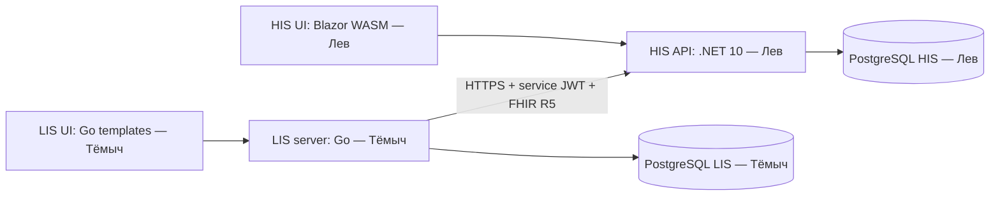

# Лабораторная 3 — задачи Тёмыча: вся LIS на Go, v2

Дата: 04.11.2026. Исполнитель: **Тёмыч**. Согласованная парная карточка: [задачи Льва](lab3-lev-tasks-v2.md).

**Твоя зона — исключительно самостоятельная LIS на Go**: сервер, интерфейс, собственная PostgreSQL, FHIR R5-клиент, настройки и безопасное хранение service credentials, проведение анализов, локальная история, тесты и инфраструктура запуска. **Никакой .NET/Blazor/EF Core внутри LIS** и никаких задач по реализации/изменению HIS. API HIS, её сервисные аккаунты, JWT-сервер и приём Observation пишет Лев. Ориентировочная новая оценка **36 SP**.

Карточка описывает будущую работу; файлы исходников/готовые сервисы документом не создаются.

## Общий технический контракт C2 — одинаковый в обеих карточках

Документ описывает **план**, а не уже реализованный код. C2 заменяет C1 из v1 только в части технологии и распределения работ; медицинские требования и оговорённое поведение сохраняются. Правки методов, полей, статусов, безопасности и ошибок синхронно вносятся в оба файла и `tests/Fixtures/Lab3/`. Относительные оценки SP не являются часами.

### Разделение ответственности

| Область | Исполнитель | Что именно делает |
|---|---|---|
| **Вся LIS** | **Тёмыч** | Самостоятельное приложение на **Go**: HTTP-сервер, UI, собственная PostgreSQL, модели, FHIR R5-клиент, хранение ключа и токенов на стороне LIS, история, тесты, Docker, запуск и инструкции |
| **Вся HIS и её интеграционный интерфейс** | **Лев** | Существующая .NET 10 HIS: каталог LOINC, назначения, ЭМК, FHIR R5-сервер, запись Observation, **сервисные аккаунты, API key/JWT/refresh и доступы на стороне HIS**, миграции HIS, тесты |
| **Граница LIS ↔ HIS** | **Лев — интеграционный координатор; Тёмыч — владелец Go-клиента** | Совместно согласовать FHIR JSON, технические HTTP DTO, fixtures, TLS и сквозной сценарий. Каждый исправляет только свою сторону |

**Критичная граница:** Тёмыч не меняет HIS Domain/Application/Infrastructure/Api/Web, включая `ServiceAccounts`, `ServiceBearer`, `ServiceAuthController`, `HospitalDbContext` и админский экран сервисных аккаунтов. Лев не пишет Go-код, UI, схемы или бизнес-логику LIS. Обе стороны могут независимо тестироваться через fake HTTP-сервер / fake client и общие fixtures.

### Требования исходных карточек

| Требование | Исполнитель |
|---|---|
| Независимые приложение, UI и БД LIS, без своего пользователя, пароля или SSO | Тёмыч T1, T4, T8 |
| Настройка LIS через API key, явная проверка соединения и понятные ошибки | Тёмыч T2; HIS-часть — Лев L8 |
| Получение очереди, детали анализа, пациента и врача, проведение и read-only выполненного | Тёмыч T3–T6; FHIR API — Лев L5–L6 |
| Полная автономная локальная история **только выполненных** анализов | Тёмыч T6 |
| Врач назначает несколько отдельных анализов, справочник LOINC (не менее 7 вариантов) | Лев L2–L4 |
| Результат попадает в нужную ЭМК и историю/снимок на дату | Лев L3, L6; Тёмыч T5 |
| FHIR **R5** между HIS-сервером и LIS-клиентом: `Patient`, `Practitioner`, `ServiceRequest`, `Observation` | Лев L5–L6, Тёмыч T3–T5 |
| Один `ServiceRequest.id` = одно назначение; не более одного `Observation` на запрос | Лев L3, L6; Тёмыч T5–T6 |
| Открытая очередь **не** хранится в LIS DB; без автообработки, автоматических POST-retry и фонового outbox | Тёмыч T3–T6 |
| Сервисные аккаунты HIS отдельно от пользовательских, роль `LIS`, ротация ключа и отзыв сервисных сессий | **Лев L7–L8** |
| UI явно сообщает, что единицы измерения не используются | Лев L4; Тёмыч T5 |

Макеты — ориентиры компоновки, а не требование копировать один-в-один. DICOM, архив, редактирование зафиксированных результатов, FHIR Subscriptions, Kafka/RabbitMQ, собственная авторизация LIS и полный набор FHIR search-параметров не входят в минимум.

### Зафиксированный технологический стек

- **HIS / Лев:** существующие C# / .NET 10, ASP.NET Core, Blazor WASM, EF Core/PostgreSQL, MediatR, FluentValidation, Mapperly и текущие аудит/роли/снимки. Для **сервера FHIR R5** допускается согласованная версия Firely `Hl7.Fhir.R5`, фиксируемая в `Directory.Packages.props` HIS.
- **LIS / Тёмыч:** **Go** (`net/http`, `context`, `encoding/json`, `html/template` или эквивалентный Go-шаблонизатор), PostgreSQL с `pgx/v5`, SQL-миграции и отдельный Go-модуль (`go.mod`). UI рендерится **Go-сервером** (HTML/CSS + минимальный JavaScript при необходимости); React/Blazor/.NET-сервер LIS не используются. Дополнительные библиотеки допустимы после фиксации версий в Go-модуле.
- **FHIR на Go:** небольшие **типизированные Go-структуры и явная R5-валидация** для согласованных ресурсов/полей. Не подменять R5 выдуманным REST DTO и не использовать R4-поле `ServiceRequest.code.coding`. Если будет выбран внешний Go FHIR SDK, сначала подтвердить поддержку R5 и проверить fixtures, а не предполагать её.
- **Развёртывание:** раздельные контейнеры HIS и LIS, раздельные PostgreSQL и миграции, HTTPS между сервисами; секреты не коммитить. Медицинский обмен только по FHIR, без прямого SQL-доступа LIS к HIS и без общих доменных библиотек.



### Бизнес-правила и идентификаторы

1. HIS выдаёт самостоятельный UUID на каждый лабораторный заказ (`ServiceRequest.id`), в том числе при массовом назначении. Каждому заказу соответствует **не более одного** `Observation` с **другим** UUID. Второй POST для этого заказа — `409 OperationOutcome`, без изменения результата. Повторное назначение того же теста с новым ID допустимо.
2. Минимальные состояния заказа: `active` → `completed`; результат `status=final`. LIS не меняет ServiceRequest через PUT; HIS завершает его после создания Observation.
3. Значение результата хранится **строкой** (`Observation.valueString`): например, `5.6`, `142`, `Отрицательно`. **Без единиц измерения**, в формах HIS и LIS явная фраза «Учебный режим: единицы измерения не используются».
4. Время `Observation.issued` формирует **Go-сервер LIS** через `time.Now().UTC()` в момент подтверждения оператором, не браузер. HIS хранит отдельно время регистрации (`ReceivedAtUtc`); событие ЭМК имеет серверное время HIS, чтобы replay не добавлял результат задним числом. Все транспортные времена — RFC3339/ISO 8601 с timezone, UI показывает секунды.
5. Завершённые LIS записи содержат неизменяемые FHIR JSON-снимки `ServiceRequest`, `Patient`, `Practitioner`, `Observation` и достаточные индексируемые поля. Уникальность в PostgreSQL LIS: `(HisEndpointId, ServiceRequestId)` и `(HisEndpointId, ObservationId)`. Активная очередь в БД LIS не копируется.
6. При сетевом timeout после POST исход неизвестен: **не повторять POST автоматически**. Явная кнопка проверки только GET-запросами может восстановить локальную историю. Успех HIS 201 и сбой локального commit — ошибка, не «успех» и не причина для повторного POST.

### FHIR R5 API HIS, который реализует Лев и потребляет Тёмыч

`{FHIR_BASE}` = проверяемый HTTPS URL HIS, оканчивающийся `/fhir`; hostname/port конфигурируются. URL внутри Docker — например, `https://his-api:5201/fhir`, лишь при наличии `his-api` в SAN сертификата.

| HTTP | Ответ | Владелец реализации |
|---|---|---|
| `GET /fhir/metadata` | `CapabilityStatement`, `fhirVersion=5.0.0`, реально поддерживаемые операции | Лев L5 |
| `GET /fhir/Patient/{id}` | FHIR `Patient`, 200/404 | Лев L5 |
| `GET /fhir/Practitioner/{id}` | FHIR `Practitioner` (в т.ч. soft-deleted прежний requester), 200/404 | Лев L5 |
| `GET /fhir/ServiceRequest/{id}` | Одно назначение, 200/404 | Лев L5 |
| `GET /fhir/ServiceRequest?status=active&_count=20` | `Bundle` `searchset`; также `status=completed` и поиск без status | Лев L5 |
| `GET /fhir/Observation/{id}` | Зафиксированный результат, 200/404 | Лев L5 |
| `GET /fhir/Observation?based-on=ServiceRequest/{id}&_count=20` | Bundle: 0 или 1 результат | Лев L5 |
| `POST /fhir/Observation` | 201, серверный Observation ID, тело FHIR + `Location` | Лев L6 |

Ответы поиска содержат `Bundle.type=searchset`, `entry.resource`, `link.self` и при наличии следующей страницы `link.next`; `_count` 1–100. Клиент Go должен проходить страницы. `metadata` может быть открытым, **все медицинские** ресурсы защищены сервисным bearer. FHIR ошибки (в т.ч. 401/403) возвращаются `OperationOutcome` с корректным статусом. `Content-Type: application/fhir+json` для медицинских JSON. Человеческий API HIS продолжает использовать свои контракты/ProblemDetails.

Серверная роль `LIS` разрешает `GET Patient/Practitioner/ServiceRequest/Observation` и `POST Observation`; запрещает изменение этих трёх исходных ресурсов, PUT/PATCH/DELETE Observation, доступ к `/api/accounts`, `/api/patients`, `/api/medical-records` и аудиту. Браузер LIS не получает API key, сервисный JWT или refresh.

Пример FHIR R5 назначения (**`ServiceRequest.code.concept.coding`, не R4**):

```json
{
  "resourceType": "ServiceRequest",
  "id": "11111111-1111-4111-8111-111111111111",
  "status": "active",
  "intent": "order",
  "code": { "concept": { "coding": [{ "system": "http://loinc.org", "code": "2345-7", "display": "Glucose [Mass/volume] in Serum or Plasma" }] } },
  "subject": { "reference": "Patient/22222222-2222-4222-8222-222222222222" },
  "requester": { "reference": "Practitioner/33333333-3333-4333-8333-333333333333" },
  "authoredOn": "2026-11-04T10:00:00Z",
  "note": [{ "text": "Учебное назначение" }]
}
```

Пример POST FHIR R5 результата (**без** клиентского `id`):

```json
{
  "resourceType": "Observation",
  "status": "final",
  "code": { "coding": [{ "system": "http://loinc.org", "code": "2345-7", "display": "Glucose [Mass/volume] in Serum or Plasma" }] },
  "subject": { "reference": "Patient/22222222-2222-4222-8222-222222222222" },
  "basedOn": [{ "reference": "ServiceRequest/11111111-1111-4111-8111-111111111111" }],
  "issued": "2026-11-04T10:05:00Z",
  "valueString": "5.6"
}
```

Сервер HIS требует ровно один `basedOn`, правильные `subject`, LOINC, status/valueString и ссылки только согласованного относительного формата. HIS назначает свой `Observation.id`; ненужный входной `id` не используется. Абсолютные внешние ссылки не обходятся автоматически ни одной стороной.

### Машинная авторизация: HIS выдаёт, LIS потребляет

| HTTP HIS | Контракт | Реализация |
|---|---|---|
| `POST /api/service-auth/token` | `{ "apiKey": "..." }` → accessToken, accessTokenExpiresAt, refreshToken, refreshTokenExpiresAt | **Лев L8** |
| `POST /api/service-auth/refresh` | `{ "refreshToken": "..." }` → новая пара с ротацией refresh | **Лев L8** |
| `GET /api/testConnection` | `Authorization: Bearer <service-access>` → 200, технический статус | **Лев L8** |
| `GET/POST /api/service-accounts`, `PUT /api/service-accounts/{id}`, `PUT /api/service-accounts/{id}/active`, `POST /api/service-accounts/{id}/rotate-key` | Только человеческий администратор HIS | **Лев L7** |

Это **технические JSON**, не FHIR медицинские ресурсы. Секреты не передавать в URL, access/refresh — не browser-cookie HIS. Машинный access — отдельная схема `ServiceBearer`, `aud=MedSoft.Lis`, `account_kind=service`, роль LIS, id/версия безопасности/сессия. Политики `LisFhirRead` и `LisObservationCreate` явно используют `ServiceBearer`, человеческие JWT не подходят. При смене ключа или отключении аккаунта старые access и refresh недействительны с ближайшего запроса (проверка сессии/активности в HIS DB). `ApiAntiforgeryMiddleware` исключает только явно согласованные credential-endpoints и POST Observation после проверенной сервисной аутентификации; CSRF человеческих форм не ослаблять.

На стороне Go LIS реализуется **только клиент** этих операций, безопасное хранение секрета и синхронизация refresh; не копируются классы авторизации HIS и не создаются собственные сервисные аккаунты внутри LIS.

### Общий порядок работ, миграции и передача

1. **G0 (Лев, согласование Тёмыча):** закрепить C2, методы, поля и примеры в `tests/Fixtures/Lab3/` и проверках Go; согласовать JWT claim names, 401/403 и обязательные сертификаты. Для Go-клиента сохранить fixtures как обычные JSON, а не зависеть от .NET DTO/Firely assembly. На раннем этапе Тёмыч отвечает HTTP-моками, Лев тестирует HIS тестовой схемой аутентификации только внутри test host.
2. **Дальше параллельно:** Лев строит лабораторный модуль и всю сервисную безопасность HIS, Тёмыч строит отдельное Go-приложение LIS. **Больше нет** прежнего ожидания «Тёмыч передаёт миграцию service_accounts»: её делает сам Лев.
3. **Миграции:** HIS `HospitalDbContext` один; Лев единолично формирует сервисные таблицы, затем лабораторные, расширение истории и согласованный ModelSnapshot. Тёмыч не трогает HIS EF. LIS имеет **самостоятельные SQL-миграции PostgreSQL** под Go (без EF/DbContext/ModelSnapshot). Обе БД сохраняют данные после перезапуска.
4. **Стыковка:** Лев предоставляет настоящие token/refresh/testConnection и FHIR endpoints; Тёмыч переключает `httptest`/fixtures на реальный HTTPS. Обнаруженные несовместимости фиксируются по владельцу стороны, не обходятся прямыми SQL/внутренними REST DTO.
5. **Запуск:** Тёмыч отвечает за Dockerfile/compose-фрагмент LIS и команду автономного запуска; Лев — за существующую HIS, TLS/SAN и объединение стенда. Общие `Makefile`, compose и инструкции меняются согласованным интеграционным коммитом.

Приёмка общего сценария: врач HIS назначает несколько анализов → Go LIS вручную загружает очередь по FHIR → проводит один анализ → HIS атомарно завершает заказ и обновляет ЭМК → Go LIS сохраняет локальную историю → повторный просмотр read-only и автономная история при выключенной HIS → отзыв ключа/JWT блокирует будущие обращения. Никаких реальных секретов и данных пациента в fixtures/Git.

## Личный план LIS / Go

| ID | Задача | SP | Независимая проверка без HIS |
|---|---|---:|---|
| T1 | Go-проект LIS, архитектура, PostgreSQL и UI-каркас | 5 | Сервер, БД, пустые страницы |
| T2 | Настройки интеграции, защита API key, сервисные токены | 5 | Fake token/refresh/testConnection |
| T3 | Строгий Go-клиент FHIR R5, модели и пагинация | 5 | `httptest` + FHIR fixtures |
| T4 | UI списка назначений, пациентов/врачей и read-only деталей | 4 | Фейковая очередь и страницы |
| T5 | Проведение анализа и одиночная отправка Observation | 5 | 201/400/409/500/timeout |
| T6 | Локальная история, снимки, ручное восстановление | 5 | Тестовая PostgreSQL, HIS выключена |
| T7 | Go-тесты контракта, устойчивости и безопасности | 4 | `go test`, `httptest`, интеграционная БД |
| T8 | Go Docker, отдельный запуск, документация и совместный стенд | 3 | `make lis`, `make lis-test` |
| **Итого** | | **36** | |

Отдельно: Тёмыч **не выполняет** старые T1/T2 версии v1 (сервисные аккаунты HIS и машинный JWT-сервер). Они целиком перенесены Льву в **L7–L8**. Здесь `ServiceTokenProvider` — **Go-клиент** уже существующих по контракту HIS endpoints, а не реализация выдачи JWT.

## T1. Создать самостоятельную LIS на Go с PostgreSQL — 5 SP

**Результат:** отдельный веб-сервис LIS запускается без HIS, имеет свой интерфейс и таблицы собственной PostgreSQL. Нет формы входа, Identity, SSO или ссылок на .NET-проекты.

Рекомендуемая структура в **отдельной папке/Go-модуле**, не в `src/Application/`, `src/Infrastructure/` или `src/Presentation/` существующей HIS:

```text
lis/
  go.mod, go.sum
  cmd/lis/main.go
  internal/domain/                  # сущности, инварианты
  internal/application/             # use cases, интерфейсы портов
  internal/infrastructure/db/       # pgx, SQL repositories
  internal/infrastructure/fhir/     # Go FHIR R5 HTTP client
  internal/infrastructure/auth/     # token provider, защита секретов
  internal/http/                    # маршруты, handler, middleware
  web/templates/                    # Go HTML templates
  web/static/                       # CSS, немного JS при необходимости
  migrations/                       # свои SQL up/down
  tests/                             # Go tests / fixtures
  Dockerfile
```

Допустима иная структура по согласованию, но направление зависимостей не меняется: domain/application не импортируют HTTP, SQL и пакеты HIS; инфраструктура реализует интерфейсы приложения, `cmd/lis` собирает зависимости. `context.Context` проходит из HTTP-handler в use case, PostgreSQL и FHIR HTTP request, без скрытых background tasks.

Данные LIS:

- `integration_connections`: URL HIS, стабильный `HisEndpointId`, версия конфигурации, зашифрованный API key и машинные refresh/access, сроки/состояние подключения.
- `completed_analyses`: локальный ID, `HisEndpointId`, ID заказа/результата HIS, исходные даты, FHIR JSON-снимки пациента/врача/запроса/результата, индексируемые поля поиска.
- Допускаются таблицы для ключевых метаданных/миграций. **Не создавать** `pending_requests`, `active_service_requests` и копию всей очереди HIS.

В PostgreSQL задать FK **только внутри LIS**, индексы и ограничения на уникальность из C2, временные поля `timestamptz`, идентификаторы UUID. Миграции самостоятельные SQL, применимые с чистой БД и при обновлении. Локальные операции — транзакции `pgx.Tx` с явным `Commit`/`Rollback`, таймаутами контекста. DBO/SQL-структуры отделены от доменной модели и UI.

Страницы (пути можно согласовать): `/connection`, `/requests`, `/requests/{id}`, `/requests/{id}/perform`, `/history`, `/history/{id}`. Рендер — `html/template` и Go handlers; простой HTML form + redirect/PRG предпочтительнее усложнения фронтенда. Для inline-обновления допустим минимальный JS/HTMX, но **вся серверная логика остаётся на Go**. При отключённой HIS работают UI настроек и локальная история.

**Проверки:** `go build ./...`, миграции up/down на пустой БД, отсутствие зависимостей на HIS SDK/EF/DbContext, запуск с HIS выключенной, отсутствие пользовательского login, нет таблицы очереди.

**Готово:** [ ] Go-модуль и пакеты; [ ] отдельная БД/SQL-миграции; [ ] UI-каркас; [ ] независимый старт; [ ] Go fake FHIR transport подставляется в тестах.

**Зависимости:** только G0/C2. Не ждать L7/L8/L5 — использовать Go `httptest.Server` с согласованными HTTP JSON.

## T2. Настройки, защищённый API key и Go ServiceTokenProvider — 5 SP

**Результат:** оператор задаёт адрес HIS и API key в браузере LIS; её Go-сервер безопасно хранит секрет, получает/обновляет сервисные токены и явно проверяет связь с HIS.

Реализовать `IntegrationConnection`, `IntegrationSettingsRepository`, `ServiceTokenProvider`, `HISConnectionProbe`, отдельные HTTP-клиенты для технических JSON и медицинского FHIR. Типы/имена на Go — на усмотрение владельца, wire JSON сохраняется в точности как C2. Форма настройки всегда общается только с LIS Go HTTP server; браузер **не** обращается напрямую к `/api/service-auth/*` HIS.

- Нормализовать URL: только HTTPS; без userinfo, query и fragment, без подмены хоста; конечный FHIR base `/fhir`. Технические `/api/service-auth/*` строить от **origin** HIS, не добавлять их к `/fhir`.
- API key и refresh/access хранить **зашифрованными**, например AES-256-GCM с ключом приложения из защищённого внешнего secret-файла/secret manager (не из репозитория, не в той же открытой таблице). Nonce на каждый шифротекст уникальный. Время ключевой ротации/восстановления настроек документировать. Условия переживают рестарт контейнера.
- После сохранения показывать только маску/признак ключа. В HTML/JSON, логах, URL, trace, аварийных ошибках и снимках тестов нет секретов.
- Общий token provider на **уровне процесса Go**, а не на каждый HTTP-запрос/пользовательский сеанс. Предсказуемый refresh: проверка срока с запасом → в отсутствие свежего access вызвать один `/api/service-auth/refresh` → сохранить новую пару **атомарно** → выдавать access потребителю.
- Для одновременных goroutine одного процесса защитить выдачу/refresh `sync.Mutex` или single-flight по integration ID. Если допускается несколько replicas LIS, **дополнительно** сериализовать refresh межпроцессной блокировкой строки PostgreSQL (например `SELECT ... FOR UPDATE`), перечитывая состояние перед реальным HTTP refresh. Одного mutex на несколько процессов недостаточно.
- Перед медицинским POST проверять срок и иметь валидный access **до начала отправки**; после 401/timeout/409/500 **не повторять POST** и не пытаться незаметно переотправить его с новым bearer. Просроченная/отозванная сессия требует явной реакции оператора.
- Проверка связи: создать/обновить пару токенов → вызвать `GET /api/testConnection` с service bearer → при необходимости `GET /fhir/metadata` → вывести настоящие статусы. Открытый metadata сам по себе **не** доказывает успешную аутентификацию.
- При изменении конфигурации взять неизменяемый snapshot `HisEndpointId` + version; начатая для HIS A операция не может незаметно отправиться в HIS B.

Таймауты HTTP, проверка TLS hostname/CA, лимиты тела и явный `context.Context` обязательны; `InsecureSkipVerify` и обход TLS запрещены. Показать отдельно неверный ключ, 401/403, timeout, нераспознанный сертификат, недоступность сети. Закрытые JWT/CA ключи HIS в LIS **не передаются**.

**Проверки:** конкурентные Go goroutine → один refresh; смена настроек посреди операции; рестарт и дешифрование; неверный CA отвергнут; ошибка refresh видна; GET testConnection без bearer не даёт ложный «подключено»; браузер не получает токен.

**Готово:** [ ] настройка; [ ] шифрование и хранение master key вне БД; [ ] masked UI; [ ] token/refresh; [ ] конкурентная безопасность; [ ] проверка связи; [ ] негативные TLS-тесты.

**Зависимости:** C2 и HIS L8 лишь для финального подключения. До этого — `httptest` с token/refresh/testConnection.

## T3. Написать FHIR R5-клиент на Go — 5 SP

**Результат:** Go LIS получает `Patient`, `Practitioner`, `ServiceRequest`, `Observation`, `Bundle` и `OperationOutcome` и умеет отправлять final Observation; знает формат FHIR R5 без внутренних DTO HIS.

В `internal/infrastructure/fhir` ввести небольшой набор **типизированных** Go-моделей только для согласованного FHIR subset: `ResourceType`, `Reference`, `CodeableReference` с `concept.coding`, `ServiceRequest`, `Observation`, `Patient`, `Practitioner`, `Bundle`, `OperationOutcome`, `CapabilityStatement`. JSON tags сохраняют R5 wire-имена; optional fields учитываются явно, `json.RawMessage` можно применять для сохранения полного исходного снимка, но не вместо проверки основных полей. Валидировать `resourceType`, status, обязательные ссылки, `valueString`, код LOINC, время и `Bundle.type`.

Транспорт: единый `http.Client` c `Transport`/TLS, ограниченным временем, `http.NewRequestWithContext`, корректным `Accept: application/fhir+json`, для POST `Content-Type: application/fhir+json`. Технические credential calls используют `application/json` и клиент T2. Не обращаться к внутренним HIS REST DTO или PostgreSQL HIS.

Методы: `GetServiceRequest`, `SearchServiceRequests`, `GetPatient`, `GetPractitioner`, `GetObservation`, `FindObservationByServiceRequest`, `CreateObservation`, `GetMetadata`. Для поиска обязательно разбирать `Bundle.entry.resource` и `Bundle.link.next`, поддерживать _count 1–100 и не ограничивать всю очередь первой страницей. `status=active` и `status=completed` нужны отдельно.

**Защита ссылок:** разрешать `Patient/{id}`, `Practitioner/{id}`, `ServiceRequest/{id}`, `Observation/{id}` в рамках base. Внешние `link.next`, протоколы/hostname вне HIS, абсолютные `reference` на неожиданный сервер и path traversal отвергать; не использовать ссылки FHIR как произвольные URL (SSRF). Не вычислять ID пациента из данных браузера.

При 4xx/5xx разобрать FHIR `OperationOutcome` и вернуть безопасное структурированное сообщение UI без секретов. Различать transport timeout и ответ сервера 409: при первом результат **неизвестен**, второй подтверждает конфликт. `POST Observation` выполняется **один раз**; запретить автоматические retry HTTP middleware. R5 `ServiceRequest.code.concept.coding` не путать с R4 `.code.coding`.

**Проверки:** контрактные fixtures; пустой/многостраничный Bundle; R4-форма ServiceRequest; внешний next/reference; битый id/тип/LOINC; русский `valueString=Отрицательно`; OperationOutcome 400/401/403/404/409/500; 201 Location; счётчик ровно одного POST.

**Готово:** [ ] FHIR R5 модели/парсинг; [ ] типизированные методы; [ ] paging; [ ] безопасные ссылки; [ ] ошибки; [ ] `httptest` контракты.

**Зависимости:** T2 для настоящего bearer, L5/L6 для реальной HIS; можно полностью разрабатывать через fixtures G0.

## T4. Go UI очереди и деталей анализа — 4 SP

**Результат:** в LIS можно вручную обновлять очередь заказов, видеть назначение, пациента, врача и уже выполненный заказ только для чтения.

Страницы на Go templates: список с кнопкой «Обновить», состояниями «Нет назначений», «Связь не настроена», «HIS недоступна» и «Загрузка» (если динамическое обновление), пагинация/«Следующая страница». Допускается режим «Активные» / «Выполненные»; при открытии выполненного — GET его Observation, **без** кнопки проведения.

Для деталей по ID загрузить `ServiceRequest`, затем `Patient`, `Practitioner`; показать UUID заказа, дату/время с секундами, ФИО и дату рождения пациента, назначившего врача, LOINC/display, комментарий, status. Использовать правильный FHIR-парсер T3, а не чтение непосредственных полей HIS. Если врач мягко удалён, отображать исторические данные. При недоступном patient/doctor корректно сообщать ошибку; не вставлять чужого пациента по умолчанию.

Активные запросы и открытые формы хранятся **в памяти одного HTTP request / короткого UI-state**, не persist в PostgreSQL LIS. Отдельную предварительную локальную запись для ещё не завершённого заказа не создавать. Поиск по текущей странице/загруженным строкам нельзя подписывать как полный поиск по HIS. Статус «В работе» не посылает FHIR PUT и не меняет ServiceRequest.

При `completed` запросить `Observation?based-on=ServiceRequest/{id}`, проверить что он один и принадлежит запросу, вывести значение и дату, явно read-only. При нескольких результатах показать нарушение контракта. При HTTP ошибках/отключённой HIS нельзя показывать устаревшую открытую очередь как свежую.

**Проверки:** пагинация, пустой Bundle, completed + Observation, врач soft-delete, внешний next, 401/403, отсутствие записей открытой очереди в собственной БД, оба состояния UI при выключении HIS.

**Готово:** [ ] Go-rendered страницы списка/деталей; [ ] пагинация; [ ] данные пациента/врача; [ ] read-only completed; [ ] понятные ошибки.

**Зависимости:** T1, T2, T3; тесты на fixtures до появления реальной HIS L5.

## T5. Провести анализ и отправить один FHIR Observation — 5 SP

**Результат:** оператор LIS вводит фактический результат, Go-сервер формирует корректный FHIR R5 Observation и отправляет его в HIS; HIS подтверждает создание `201`.

Порядок операции после явного нажатия «Зафиксировать результат»:

1. На Go-сервере снова проверить `ServiceRequest` и его `Patient`/`Practitioner`: `status=active`, корректный LOINC, один заказ = один тест. Не доверять только спрятанным HTML-полям; ID запроса из URL не даёт права создавать произвольный результат.
2. Проверить непустую строку значения и техническую длину, не приводить каждый анализ к числу. Показать фразу «Учебный режим: единицы измерения не используются». Поля клинического заключения и произвольной пользовательской даты нет.
3. Сформировать `Observation`: `status=final`, код из сохранённого ServiceRequest, тот же patient, ровно один `basedOn`, `valueString` и `issued=time.Now().UTC().Format(time.RFC3339Nano)`. **Не** устанавливать `Observation.id` при POST.
4. Получить валидный service access от T2 **до** начала операции, отправить **один** `POST /fhir/Observation` через T3. От двойного нажатия защитить UI (disabled + серверная проверка); итоговую уникальность обеспечивает HIS. Не повторять POST при 401, 409, 500 или timeout.
5. На `201 Created` прочитать FHIR Observation и `Location`, убедиться в HIS `Observation.id`, правильных `subject`, `basedOn`, LOINC и значении. Только принятый сервером результат может войти в LIS-историю.
6. Передать подтверждённый ответ T6 для локального сохранения. Ошибка локальной транзакции не меняет уже сделанный POST и не превращается во второй POST.

В Go application use case отделить валидацию/сборку FHIR от HTTP-handler и SQL. Все отмены проходят через `context.Context`. После 201 переходить на страницу истории; после 409 предлагать явное GET выполненного заказа в read-only; при timeout говорить «результат в HIS неизвестен» и показывать кнопку ручной проверки T6. Фактическое значение, принятое HIS, не переписывается после конфликта.

**Проверки:** `valueString=5.6` и `Отрицательно`; другой patient/code; ответ 201 без id/Location; конфликт второго клиента; два одновременных POST; timeout после принятого результата; POST count=1 при любом отказе.

**Готово:** [ ] Go handler и use case; [ ] серверное время и FHIR R5; [ ] валидация; [ ] 201/Location; [ ] защита от повторной отправки; [ ] передача T6.

**Зависимости:** T2–T4; реальный L6 только для совместного теста.

## T6. Автономная история и ручное восстановление после сбоя — 5 SP

**Результат:** после принятия HIS результата LIS хранит локальную полную историю выполненных анализов; эта история открывается даже при выключенной HIS.

Схема `completed_analyses`: `Id`, `HisEndpointId`, `ServiceRequestId`, `ObservationId`, `PatientId`, `PractitionerId`, название/LOINC/значение, `AuthoredAtUtc`, `IssuedAtUtc`, `SavedAtUtc`, **полные** FHIR JSON snapshot `ServiceRequest`, `Patient`, `Practitioner`, `Observation`. Не хранить лишь ID ссылочных ресурсов: автономный просмотр не должен запрашивать HIS. Индексы и уникальность `(HisEndpointId, ServiceRequestId)` и `(HisEndpointId, ObservationId)` обеспечиваются PostgreSQL.

После корректного 201 сделать одну короткую локальную транзакцию `pgx.Tx` (вставить snapshot и индексы, commit). Никакой распределённой транзакции с HIS нет. Если `201` получен, а локальный commit не выполнен, показать **«HIS приняла результат, история LIS не сохранена»** и кнопку восстановления; не сообщать общий успех и не отправлять Observation снова.

Явное действие «Проверить результат в HIS / восстановить историю» **только** читает по GET `ServiceRequest`, `Observation?based-on`, `Patient`, `Practitioner`. Если найдена одна согласованная финальная Observation, делает идемпотентную локальную вставку snapshot с прежними датами. Если Observation нет — сообщает неопределённость/отсутствие. Если completed без результата или много Observation — явная ошибка контракта. Никаких авто-ретраев POST, фоновой доставки, тайных очередей, повторного проведения.

Список истории из PostgreSQL: дата, пациент, анализ, значение, пагинация/поиск. Детали читаются **без вызовов FHIR/HIS**, показывают исходное назначение с комментарием и датой, данные пациента/врача, LOINC, результат, issued и локальную дату сохранения. Данные неизменяемые и read-only; отредактировать/удалить зафиксированный результат через LIS нельзя. Хранилище может переживать смену адреса HIS: разные HisEndpointId защищают от пересечения одинаковых UUID.

**Проверки:** после 201 одна запись; ошибка POST — ноль записей; отказ БД после 201; ручное GET-восстановление; повтор восстановления идемпотентен; HIS выключена — полная история доступна; совпадение ID на разных HIS; update результата через UI запрещён.

**Готово:** [ ] full snapshots; [ ] PostgreSQL транзакция; [ ] уникальные индексы; [ ] read-only UI/поиск; [ ] ручное GET-восстановление; [ ] автономность и отсутствие фонового POST.

**Зависимости:** T1/T3/T5; real HIS L6 для финальной проверки.

## T7. Go unit/integration/contract/security tests — 4 SP

**Результат:** тесты подтверждают медицинский контракт и безопасность именно **Go LIS**, а не HIS. В `go test ./...` / Go CI все клиентские тесты автономны от запущенной .NET HIS.

- `httptest.Server` предоставляет JSON fixtures C2 с token/refresh/testConnection/FHIR GET/POST; тесты проверяют метод, точный path/query, `Authorization`, Accept/Content-Type, число вызовов, тело Observation. Нельзя ограничиться mock return arbitrary DTO.
- Unit tests domain/use case: пустое значение, status completed, иной пациент/LOINC, `basedOn` не один, `issued` генерируется сервером; R4-форма `ServiceRequest.code.coding` отклоняется.
- Go FHIR client tests: пустая и многостраничная выдача, `OperationOutcome` 400/401/403/404/409, чужой абсолютный next/reference, неправильный `resourceType`, text/unicode valueString.
- Token provider concurrency: `go test -race`, два/много параллельных запросов — один refresh. Для нескольких инстансов — PostgreSQL lock и тест контрактного поведения, не путать гонки горутин с процессами.
- Persistence integration: временная настоящая PostgreSQL (Docker/Testcontainers или независимая тестовая БД) для миграций, уникальности `(HisEndpointId, ServiceRequestId)` / `(HisEndpointId, ObservationId)`, idempotent restore, rollback после ошибки.
- Failures: timeout после HIS 201, локальный DB failure, race двух операторов, token revocation, TLS verification failure, доступ к локальной истории при выключенной HIS. Доказать, что счётчик HTTP POST остаётся **1**, нет открытой очереди в БД и секретов в HTML/логах.

Проверки безопасности HIS (human JWT, admin role, CSRf, отзыв refresh на стороне HIS) **пишет Лев L9**. Здесь проверяется, что LIS корректно **потребляет** его HTTP-ответы. Общий end-to-end дополняет, а не заменяет `go test`.

**Готово:** [ ] unit/contract/integration tests; [ ] `go test -race`; [ ] DB constraints; [ ] single-flight; [ ] отсутствие POST retry; [ ] автономная история; [ ] пересечённые с Левом fixtures.

## T8. Go сборка, Docker, отдельный запуск и интеграционный стенд — 3 SP

**Результат:** LIS — самостоятельный артефакт с однокомандным запуском, собственной БД и инструкцией; можно демонстрировать без HIS, а затем связать с .NET HIS через HTTPS.

- `lis/Dockerfile` — multi-stage Go build (оптимально небольшой runtime image), без исходников/секретов в финальном image; отдельная `lis-postgres` + volume; миграции Go LIS применяются явной командой или безопасным шагом старта.
- `make lis`, `make lis-test`, `make run-all` — предложенные цели, которые нужно **добавить**, а не считать существующими. Не сломать `make run`/`make demo` HIS. Соответствующие compose/Make изменения — через общий интеграционный коммит с Левом.
- Отдельные переменные `LIS_DB_DSN`, `LIS_MASTER_KEY_FILE` или эквивалентный mount, URL HIS; пароль БД и master key — из локального env/secrets **без** попадания в Git. Секрет расшифровки должен переживать перезапуск; на рестарте ключ/история не теряются.
- LIS получает лишь **публичный CA** для проверки HIS и действующий API key, вводимый оператором. Не копировать закрытые HIS JWT/CA ключи, не делать `InsecureSkipVerify`. В Docker URL типа `https://his-api:5201/fhir` согласуется с SAN сертификата, которым управляет **Лев**.
- Health/liveness Go LIS проверяет свою готовность/БД, а потеря связи с HIS отражается в UI, но не делает локальную историю недоступной. Нельзя чинить сеть автоматической повторной отправкой медицинских результатов.
- README содержит `go`/PostgreSQL версии из зафиксированных артефактов, реальные пути, env без секретов, миграции, запуск только LIS, Go тесты, сценарий с fake transport, подключение к HIS Льва, ошибочные режимы.

**Проверки:** go build и Docker build; запуск без HIS; повторный запуск с сохранением master key и данных; совместное TLS соединение; воспроизводимые `make lis` и `make run-all`; никаких секретов в git/image/logs.

**Готово:** [ ] Go Dockerfile; [ ] отдельная PostgreSQL/volume; [ ] автономная команда; [ ] общая compose-стыковка; [ ] HTTPS CA/SAN; [ ] документация и smoke.

## Владение файлами и порядок работы

| Папка/файл | Кто владеет | Правило |
|---|---|---|
| `lis/go.mod`, `lis/cmd`, `lis/internal`, `lis/web`, `lis/migrations`, `lis/tests`, `lis/Dockerfile` | **Тёмыч** | Не зависит от HIS assemblies/DbContext/DTO |
| LIS PostgreSQL schema/volume, `lis-postgres` | **Тёмыч** | Только выполненная история, настройки и секретные данные |
| Все HIS сервисные аккаунты, EF/миграции, ServiceBearer/JWT/refresh, админ UI и `testConnection` | **Лев L7–L8** | Тёмыч туда коммитов не делает |
| HIS LOINC, ЭМК, FHIR server/Observation/OperationOutcome | **Лев L2–L6** | Тёмыч меняет только Go-клиент при изменении контрактов |
| `tests/Fixtures/Lab3`, C2, общий Make/compose/readme | Оба, координирует Лев | Контракты меняются синхронно, без одностороннего исправления |

Порядок: **G0/C2 → T1 параллельно с L2/L5/L7 → T2/T3 на `httptest` → T4/T5/T6 → T7/T8 → настоящий HTTPS smoke**. Тёмыч **не ждёт** готовых сервисных аккаунтов/миграций HIS; для разработки хватает фиксированных JSON-fixtures. Лев **не ждёт** SQL/Go-кода LIS для начала FHIR-сервера.

## Демонстрация своей Go-части

1. Запустить только Go LIS и отдельную PostgreSQL без HIS; открыть UI, настройки и сохранённую историю; формы входа нет.
2. В HIS, настроенной Львом, администратор создаёт сервисный аккаунт и **передаёт API key оператору** (ты не создаёшь сервисный аккаунт в HIS-коде).
3. Ввести HIS HTTPS base URL и ключ в Go LIS; проверить реальные token/testConnection/metadata и отображение ошибки при неправильном ключе.
4. Врач в HIS назначает несколько разных анализов. В Go LIS вручную загрузить очередь с разными ServiceRequest.id, показать страницы и данные пациента/назначившего врача.
5. Провести один анализ, увидеть дисклеймер единиц, результат `valueString`, время Go-сервера и ответ 201 c назначенным HIS Observation ID.
6. Убедиться, что HIS ЭМК показывает правильный результат; при повторном открытии заказа Go LIS показывает его только для чтения.
7. Остановить HIS, открыть в Go LIS полные детали из **своей** БД: запрос/пациент/врач/результат и исходные даты.
8. На тестовом стенде эмулировать timeout после принятия и сбой PostgreSQL после 201; нажать явное «Проверить / восстановить» и доказать отсутствие второго POST и дубликатов.
9. После отключения сервисного аккаунта Львом убедиться, что Go LIS показывает ошибку авторизации и не «переотправляет» данные автоматически.
10. Продемонстрировать `go test ./...`, тесты race/миграций и автономный Docker запуск.

**Работа Тёмыча завершена**, когда LIS полностью написана на Go, не содержит разработок в HIS и проходит T1–T8 и общий реальный FHIR-сценарий с HIS Льва.
