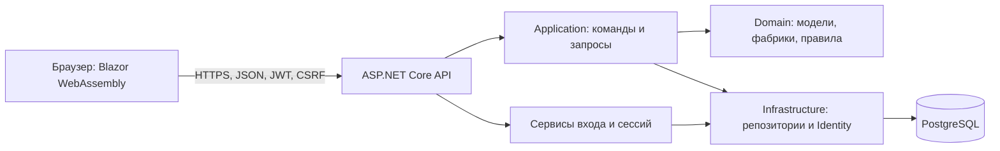
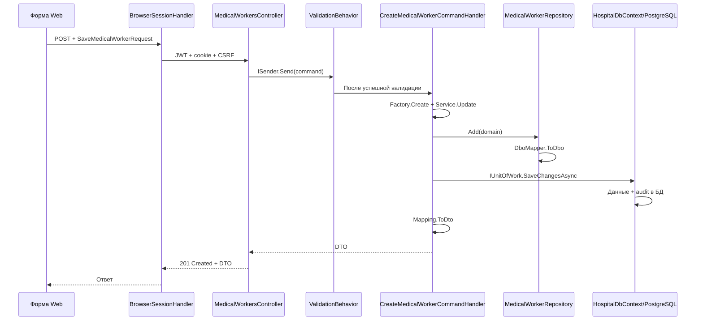

# MedSoft: устройство системы, технологии, запуск и демонстрация — v1

Обновлено 9 ноября 2026 года. Документ описывает реализацию лабораторных 1 и 2, включая обычный и демонстрационный скрипты запуска, и текущие этапы лабораторной 3 — справочник, заказы/результаты в ЭМК и техническую основу интеграции. Подробный статус лабораторной 3 находится в [карточке Льва](lab3-lev-tasks-v2.md). Здесь нет действительных паролей, токенов или закрытых ключей.

Для первого знакомства прочитайте разделы 1–3. Для понимания реализации — 4–10. Для подготовки к защите — 11–13.

Содержание:

- [1. Возможности и роли](#1-что-представляет-собой-система)
- [2. Первоначальная подготовка на Mac](#2-запуск-на-mac-что-нужно-подготовить-один-раз)
- [3. Обычный и демонстрационный запуск](#3-два-режима-запуска)
- [4. Архитектура и модели](#4-архитектура-и-ответственность-проектов)
- [5. Подробно о технологиях](#5-технологии-что-они-делают-в-проекте)
- [6. Взаимодействие классов](#6-как-запрос-проходит-между-классами)
- [7. Сотрудники, пациенты, CSV и ЭМК](#7-предметные-модули-и-данные)
- [8. Безопасность](#8-безопасность-механизмы-и-их-взаимодействие)
- [9. База данных и параллельные изменения](#9-хранение-транзакции-и-параллельные-изменения)
- [10. API и интерфейс](#10-карта-api-и-интерфейса)
- [11. Сценарий защиты](#11-сценарий-показа-преподавателю)
- [12. Резервирование, продление TLS и передача проекта](#12-обслуживание-резервирование-и-перенос-напарнику)
- [13. Проверки и границы результата](#13-проверки-и-границы-результата)
- [14. Диагностика ошибок](#14-если-что-то-не-запускается)
- [15. Скрипты и исходники](#15-скрипты-и-навигация-по-исходникам)

## 1. Что представляет собой система

MedSoft — учебная медицинская информационная система. Администратор управляет сотрудниками, их аккаунтами, справочниками диагнозов и лабораторных анализов. Медработники работают с пациентами и электронными медицинскими картами — ЭМК. Доступ зависит от роли сотрудника.

Из первой лабораторной сохранены сотрудники, пациенты, справочник диагнозов с CSV-импортом, ЭМК, диагнозы и назначения в карте, история и восстановление состояния карты на выбранный момент. Вторая лабораторная добавляет полноценные аккаунты, медицинские роли, первоначальную настройку администратора, TOTP, JWT/refresh, TLS 1.3 и аудит безопасности.

В штатном запуске нет готового пароля администратора. Владелец задаёт его сам в мастере настройки и подтверждает второй фактор. Медицинским аккаунтам пароль генерирует сервер при создании или сбросе.

### 1.1. Кто что может делать

В системе два разных уровня ролей:

- Роль аккаунта Identity: `Administrator` или `MedicalWorker`.
- Медицинская роль связанного сотрудника: `Doctor`, `Nurse`, `LaboratoryTechnician` или `Other`.

Должность — текстовое поле, например «Врач-терапевт». Она не назначает права автоматически. Права задаёт медицинская роль.

| Действие | Администратор | Врач | Медсестра | Лаборант | Other |
|---|---|---|---|---|---|
| Управлять сотрудниками, аккаунтами, ролями | Да | Нет | Нет | Нет | Нет |
| Изменять и импортировать справочник диагнозов | Да | Нет | Нет | Нет | Нет |
| Создавать, изменять и отключать лабораторные анализы в справочнике | Да | Нет | Нет | Нет | Нет |
| Читать справочник лабораторных анализов через API | Да | Да | Да | Да | Да |
| Читать справочники сотрудников/диагнозов через API | Да | Да | Да | Да | Да |
| Читать аудит безопасности | Да | Нет | Нет | Нет | Нет |
| Читать пациентов, ЭМК, историю и снимки | Нет | Да | Да | Да | Да |
| Создавать и изменять регистрационные данные пациента | Нет | Да | Да | Нет | Нет |
| Удалять пациента без ЭМК | Нет | Да | Да | Нет | Нет |
| Создавать ЭМК | Нет | Да | Да | Нет | Нет |
| Менять диагнозы и назначения в ЭМК | Нет | Да | Нет | Нет | Нет |
| Назначать лабораторные анализы через API | Нет | Да | Нет | Нет | Нет |

Администратор не получает клинический доступ автоматически. Пациента с ЭМК нельзя удалить даже врачу: это отдельное предметное ограничение. Сотрудник с ролью `Other` имеет медицинский доступ на чтение; это роль по умолчанию.

Проверки есть в интерфейсе и API. Скрытая кнопка улучшает интерфейс, но окончательное решение принимает сервер при каждом запросе.

## 2. Запуск на Mac: что нужно подготовить один раз

Нужны Docker Desktop, .NET 10 SDK, Python 3, OpenSSL с TLS 1.3 и браузер. Для администратора потребуется приложение-аутентификатор с TOTP. Команды ниже выполняются из корня проекта:

```bash
cd ~/MedSoft
dotnet --version
docker info
python3 --version
dotnet restore
dotnet tool restore
```

`global.json` задаёт SDK `10.0.100` с `rollForward=latestFeature`: допускается совместимый установленный feature band .NET 10. Версии библиотек хранятся централизованно в `Directory.Packages.props`.

### 2.1. Подготовка базы

Если `.env` и `src/Presentation/HospitalInformationSystem.Api/appsettings.Local.json` уже существуют, не создавайте их заново.

Для совершенно новой установки без существующего тома PostgreSQL:

```bash
python3 scripts/setup-development.py --fresh-database
```

Скрипт сам сгенерирует пароль базы и создаст приватные настройки. Для существующей базы используйте:

```bash
python3 scripts/setup-development.py
```

Если скрипту понадобится пароль, он спросит действительный пароль PostgreSQL. Это не пароль администратора приложения и не пароль пользователя macOS. Существующие настройки скрипт не перезаписывает.

`.env` используется Docker Compose, а `appsettings.Local.json` — локальными инструментами и скриптом обычного запуска. Оба файла исключены из Git. Изменение `POSTGRES_PASSWORD` в `.env` не меняет пароль PostgreSQL в уже созданном томе.

### 2.2. Сертификаты и постоянные ключи

Рабочие материалы хранятся вне репозитория:

```bash
MEDSOFT_SECURITY_DIR="$HOME/.local/share/MedSoft/development-security/408944"
```

Только при первоначальной подготовке, когда этого выпуска ещё нет:

```bash
python3 scripts/generate-development-certificates.py \
  --isu-id 408944 \
  --output-dir "$MEDSOFT_SECURITY_DIR"
```

Если подходящий OpenSSL не найден, на Mac с Homebrew можно установить его командой `brew install openssl@3`, затем повторить генератор. Генератор проверяет также стандартные пути Homebrew и принимает явный `--openssl /absolute/path`.

Генератор создаёт:

| Каталог/файл | Для чего нужен |
|---|---|
| `ca/ca-cert.pem` | Публичный корневой сертификат, которому доверяет клиент |
| `ca/` с закрытым ключом и его паролем | Подпись учебных серверных сертификатов; остаётся у владельца |
| `server/server.pfx` и файл пароля | Сертификат и закрытый ключ HTTPS для локального API/Web |
| `jwt/` | Отдельная RSA-пара для подписи и проверки JWT |
| `data-protection/` | Сертификат защиты и постоянный keyring для Data Protection |
| `setup/token.txt` | Случайный токен владельца для первоначальной настройки |
| `development-security.json` | Манифест с путями к материалам, который читает launcher |

`408944` — ИСУ владельца учебного CA. У издателя указаны `O=ITMO`, `OU=MedSoft 2026/27 408944`.

### 2.3. Доверие сертификату

На Mac установите доверие только публичному корневому сертификату:

```bash
security add-trusted-cert \
  -r trustRoot \
  -p ssl \
  -k "$HOME/Library/Keychains/login.keychain-db" \
  "$MEDSOFT_SECURITY_DIR/ca/ca-cert.pem"
```

Команда меняет доверие текущего пользователя. macOS может запросить подтверждение или пароль пользователя компьютера. После установки полностью перезапустите браузер. Браузер с собственным хранилищем доверия может потребовать отдельный импорт того же публичного CA.

Закрытый ключ CA и серверный PFX не нужны для установки доверия. Проверку сертификатов в клиенте отключать не требуется.

## 3. Два режима запуска

В корне проекта есть [Makefile](../Makefile) с короткими командами запуска. После первоначальной подготовки из раздела 2 достаточно:

```bash
make run
```

Это обычный запуск PostgreSQL, API и Web с рабочими данными. Для отдельного демонстрационного стенда:

```bash
make demo
```

`make demo` использует одноразовую БД и запрашивает добавление публичного CA в пользовательскую связку ключей macOS. Если доверие уже настроено, используйте `make demo TRUST_CA=0`. Остановка приложения — Ctrl+C. Первоначальные настройки и сертификаты обычного стенда Makefile не пересоздаёт.

| Команда | Назначение |
|---|---|
| `make` или `make help` | Показать команды без запуска приложения |
| `make run` | Обычный запуск вместе с PostgreSQL |
| `make demo` | Демонстрационный запуск с отдельной пустой БД |
| `make db` | Запустить только рабочий PostgreSQL и дождаться готовности |
| `make db-stop` | Остановить рабочий PostgreSQL, сохранив данные |
| `make build` | Собрать solution |
| `make test` | Запустить C#-тесты и Python-проверки скриптов |

Параметры передаются явно: `make run NO_BUILD=1`, `make run SECURITY_DIR="/absolute/path/to/security"`, `make demo ISU_ID=408944 TRUST_CA=0`. Для другого Python/Docker можно задать `PYTHON`/`DOCKER`. На Mac при отсутствии `make` установите Command Line Tools через `xcode-select --install`. Команды совместимы с системным GNU Make 3.81; `docker-compose.yml` остаётся единственным Compose-описанием PostgreSQL. Удаления рабочих томов в Makefile нет.

Ниже описаны Python-команды, которые вызывает Makefile, и подробности обоих режимов.

### 3.1. Обычная работа: существующие данные и администратор

Запустите Docker Desktop. Остановите предыдущий API/Web через Ctrl+C, если они работают. Затем:

```bash
cd ~/MedSoft
python3 scripts/run-application.py --start-database
```

Скрипт:

1. Читает существующую строку подключения из `appsettings.Local.json`.
2. Для API в Docker заменяет локальный адрес БД на `host.docker.internal`, сохраняя остальные параметры и пароль.
3. По `--start-database` запускает PostgreSQL через Docker Compose и ждёт его готовности.
4. Использует прежний каталог рабочих сертификатов `development-security/408944`.
5. Вызывает общий launcher, который собирает API-образ и Web и запускает оба процесса.

Если PostgreSQL уже работает, флаг можно опустить:

```bash
python3 scripts/run-application.py
```

После сборки откройте:

| Адрес | Назначение |
|---|---|
| `https://localhost:5101` | Приложение |
| `https://localhost:5101/admin/login` | Вход администратора |
| `https://localhost:5101/login` | Вход сотрудника |
| `https://localhost:5201` | API, не отдельный пользовательский сайт |
| `https://localhost:5201/health/ready` | Готовность API и соединения с БД |

Используйте именно `localhost`: адреса должны совпадать с сертификатами, CORS и cookies. Терминал с launcher оставьте открытым.

Дополнительные параметры:

```bash
python3 scripts/run-application.py --security-directory /absolute/path/to/existing/security
python3 scripts/run-application.py --no-build
```

`--no-build` подходит, когда API-образ и Web уже собраны и код не менялся. При перевыпуске TLS укажите новый выпуск через `--security-directory`, сохранив прежние JWT/Data Protection согласно разделу 12.

В обычном Development применяются миграции и могут добавляться синтетические сотрудники и диагнозы. Аккаунты и известный пароль администратора seed не создаёт. Если рабочая БД уже настроена, прежний администратор, его пароль и TOTP остаются действительными.

Остановка API/Web — Ctrl+C. PostgreSQL продолжает работать, данные остаются в постоянном томе. При необходимости остановите его отдельно:

```bash
docker compose stop postgres
```

### 3.2. Повторная демонстрация настройки: отдельная одноразовая база

Этот режим нужен, чтобы показать создание администратора с самого начала, не меняя рабочую систему:

```bash
python3 scripts/run-setup-demo.py --trust-ca
```

Скрипт создаёт отдельный PostgreSQL со случайным паролем и свободным портом. Данные находятся во временной файловой системе контейнера, без рабочего Docker-тома. Миграции включены, seed выключен: первоначально в демонстрационной БД нет сотрудников и диагнозов.

Демонстрационные сертификаты, JWT и Data Protection хранятся отдельно в `$HOME/.local/share/MedSoft/demo-security/408944`. Если выпуска ещё нет, скрипт создаёт его. Флаг `--trust-ca` явно разрешает добавить публичный CA этого стенда в пользовательскую связку ключей macOS. Если доверие уже установлено, флаг можно опустить.

После сборки откройте `https://localhost:5101/admin/login`. Скрипт напечатает команду `pbcopy < ...` для копирования токена владельца. Выполните её во втором терминале и вставьте токен в мастер.

**Ctrl+C удаляет демонстрационную БД вместе со всеми созданными в ней аккаунтами, пациентами и аудитом.** Сертификаты сохраняются. При следующем запуске БД снова пустая и настройку можно повторить.

Для полного нового выпуска сертификатов, ключей и токена владельца:

```bash
python3 scripts/run-setup-demo.py --new-certificates --trust-ca
```

Этот вариант создаёт новый каталог выпуска. Прежние ключи и записи доверия macOS он не удаляет. Для показа настройки администратора новый CA не обязателен: готовность настройки хранится в БД.

На телефоне создавайте отдельную запись `MedSoft DEMO`, не заменяя рабочую. При каждом новом setup появляется новый TOTP-секрет. После завершения демонстрации остановите её и выполните обычный запуск из раздела 3.1; используйте прежнюю рабочую запись аутентификатора.

### 3.3. Первое создание администратора

1. Откройте административный вход. На новой БД система предложит мастер настройки.
2. Вставьте токен владельца. Для рабочего выпуска его можно скопировать во втором терминале:

   ```bash
   pbcopy < "$HOME/.local/share/MedSoft/development-security/408944/setup/token.txt"
   ```

3. Придумайте пароль и подтверждение: 12–128 символов, прописные/строчные латинские буквы и цифры; специальный символ необязателен.
4. В приложении-аутентификаторе добавьте аккаунт вручную, используя показанный секрет. Тип — TOTP, 6 цифр, 30 секунд, SHA1.
5. Введите код с телефона и завершите настройку.
6. Дождитесь следующего кода. На странице входа введите логин `admin` и свой пароль, нажмите «Продолжить». На отдельной странице введите новый код и нажмите «Подтвердить вход».

Код подтверждения setup повторно для входа не подходит. Кнопка повторного начала выдаёт новый секрет: запись аутентификатора тогда тоже нужно обновить. Один challenge действует 5 минут. Для уже настроенной БД мастер второго администратора не создаёт.

## 4. Архитектура и ответственность проектов

### 4.1. Какие процессы работают



Backend — одно приложение. Application, Domain и Infrastructure являются его библиотеками, а не отдельными микросервисами. MediatR не отправляет сетевые запросы между ними.

На Mac API запускается в Linux-контейнере для серверного TLS 1.3. Web обслуживается локальным development-сервером, а компоненты Blazor выполняются в браузере. PostgreSQL работает отдельным контейнером.

### 4.2. Структура solution

```text
src/
  Application/
    HospitalInformationSystem.Domain/
    HospitalInformationSystem.Contracts/
    HospitalInformationSystem.Application/
  Infrastructure/
    HospitalInformationSystem.Infrastructure/
  Presentation/
    HospitalInformationSystem.Api/
    HospitalInformationSystem.Web/
    HospitalInformationSystem.Maintenance/
tests/
  HospitalInformationSystem.UnitTests/
  HospitalInformationSystem.IntegrationTests/
  browser-security/
scripts/
docs/
  system-guide-v1.md
```

В [solution](../HospitalInformationSystem.slnx) три основные solution folder: Application, Infrastructure, Presentation. Solution folder группирует проекты в IDE и сама не является сборкой.

| Проект | Ответственность |
|---|---|
| Domain | Предметные модели, фабрики, правила изменения пациентов, сотрудников, диагнозов и ЭМК |
| Contracts | DTO, запросы и ответы API, enum, общие правила прав и логинов; используется API и Web |
| Application | Команды/запросы, обработчики, валидаторы, интерфейсы репозиториев/сервисов, построение снимков |
| Infrastructure | EF Core, DBO, PostgreSQL, миграции, Identity, криптография, сессии и аудит |
| Api | HTTP-контроллеры, аутентификация/авторизация, middleware и сборка DI |
| Web | Страницы, формы, API-клиенты, gateways, браузерная сессия и интерфейс |
| Maintenance | Отчёт совместимости старой БД, применение явного плана перехода, измерение KDF |

Application зависит от абстракций репозиториев. Конкретные реализации подключаются через DI в Infrastructure. Domain не обращается к HTTP или PostgreSQL. Contracts не передаёт наружу EF-модели.

### 4.3. DTO, предметная модель и DBO

Это три представления данных с разными задачами:

| Представление | Пример | Для чего нужно |
|---|---|---|
| Request/DTO | `SaveMedicalWorkerRequest`, `MedicalWorkerDto` | Контракт HTTP и данных интерфейса |
| Domain | `MedicalWorker` | Предметное состояние, с которым работают use cases |
| DBO | `MedicalWorkerDbo` | Хранение, EF tracking, связи и особенности таблицы |

Обычная цепочка — request → command → domain → DBO при сохранении и DBO → domain → DTO при чтении. Прямой маппинг DTO в таблицу не является обязательным и не заменяет предметную проверку.

Классы моделей содержат данные. Создание вынесено в `*Factory`, предметные изменения — в `*Service`, преобразование представлений — в мапперы. Например, `MedicalWorkerFactory` создаёт исходное состояние и ID, `MedicalWorkerService` применяет допустимые изменения, `MedicalWorkerDboMapper` переносит состояние в хранимую модель, `MedicalWorkerMapping` формирует DTO.

Мапперы обновления намеренно не переписывают идентификатор и время создания. Парольный хеш, закрытые ключи и внутреннее состояние Identity не становятся обычными полями DTO интерфейса.

## 5. Технологии: что они делают в проекте

Версии ниже взяты из репозитория, а не обозначают последние доступные версии. Основные источники — [Directory.Packages.props](../Directory.Packages.props), [Directory.Build.props](../Directory.Build.props), [global.json](../global.json) и [package.json браузерных тестов](../tests/browser-security/package.json).

| Технология | Версия/настройка проекта | Применение |
|---|---|---|
| .NET / C# | `net10.0`, nullable включён | Backend, Web, инструменты и тесты |
| ASP.NET Core, Identity, Blazor, EF Core | Пакеты `10.0.12` | HTTP API, аккаунты, UI, ORM |
| Npgsql EF provider | `10.0.3` | EF Core ↔ PostgreSQL |
| PostgreSQL | Docker-тег `17-alpine` | Реляционное хранилище; тег не фиксирует patch-версию |
| MediatR | `12.5.0` | Доставка команд/запросов обработчикам внутри процесса |
| FluentValidation | `12.1.1` | Валидация use cases перед выполнением |
| Mapperly | `4.3.1` | Генерация C#-мапперов при компиляции |
| Konscious Argon2 | `1.3.1` | Argon2id для паролей |
| System.IdentityModel.Tokens.Jwt | `8.19.2` | Формирование и проверка JWT |
| xUnit | `2.9.3` | Модульные и интеграционные тесты |
| Moq / FluentAssertions | `4.20.72` / `6.12.2` | Подмены зависимостей и проверки результатов |
| Testcontainers.PostgreSql | `4.15.0` | Настоящая временная PostgreSQL для интеграционных тестов |
| Playwright | `1.62.0` | Браузерные сценарии Chromium |
| Python / Bash / Docker / OpenSSL | Инструменты окружения | Подготовка, запуск, сертификаты и проверки |

### 5.1. .NET, C#, async/await и CancellationToken

.NET исполняет C#-код и предоставляет HTTP, криптографию, работу с файлами, JSON и DI. `Nullable=enable` помогает замечать возможный `null` ещё при компиляции. Общие настройки вынесены в `Directory.Build.props`, а версии пакетов — в `Directory.Packages.props`, чтобы проекты не расходились по версиям.

`async/await` позволяет ожидать БД и HTTP без блокирующего ожидания рабочего потока на всю длительность I/O. Это не означает запуск каждого обработчика на отдельном потоке. `CancellationToken` передаётся по цепочке контроллер → обработчик → репозиторий → EF, чтобы отмена запроса могла остановить ненужную работу.

### 5.2. ASP.NET Core, Kestrel и middleware

ASP.NET Core принимает HTTP-запрос, выбирает endpoint, проверяет доступ, десериализует JSON и вызывает контроллер. Kestrel — сервер, который слушает порт и устанавливает TLS-соединение.

Middleware — последовательные этапы обработки запроса. [Program.cs API](../src/Presentation/HospitalInformationSystem.Api/Program.cs) подключает заголовки безопасности, обработку исключений, контроль HTTPS, routing, CORS, rate limit, аутентификацию, авторизацию, ограничения тела и antiforgery. Контроллер вызывается после этих проверок.

`ApiExceptionHandler` переводит известные ошибки в HTTP-ответы с ProblemDetails и `traceId`. Внутренний stack trace не отправляется клиенту при ошибке 500. Аутентификационные и ограничительные middleware также могут сформировать ответ до контроллера.

### 5.3. HTTP, JSON и REST-подобный API

HTTP определяет метод, адрес, заголовки, тело и статус ответа. `GET` читает данные, `POST` создаёт ресурс или запускает действие, `PUT` изменяет его, `DELETE` удаляет или логически снимает состояние согласно конкретной операции.

JSON — формат обмена DTO. UUID идентифицирует объект независимо от позиции в таблице. Даты событий хранятся как UTC-моменты, дата рождения — `DateOnly`; интерфейс показывает местное время, включая секунды у событий.

Пример: создание сотрудника отправляет request в `POST /api/medical-workers`, получает `201 Created` с DTO и адресом ресурса. Неверное тело обычно даёт 400, отсутствие входа — 401, нехватка прав — 403, отсутствие объекта — 404, конфликт состояния — 409.

### 5.4. Dependency Injection

DI-контейнер создаёт объекты и передаёт им зависимости через конструкторы. Поэтому обработчик принимает `IMedicalWorkerRepository`, а не сам создаёт PostgreSQL-соединение. В production ему передаётся EF-реализация, в модульном тесте — подмена.

[AddApplication](../src/Application/HospitalInformationSystem.Application/DI/DependencyInjection.cs) регистрирует MediatR, валидаторы, pipeline валидации, контекст команд ЭМК, builder снимков и время. [AddInfrastructure](../src/Infrastructure/HospitalInformationSystem.Infrastructure/DI/DependencyInjection.cs) связывает интерфейсы с репозиториями, DbContext, Identity и аудитом.

DbContext и репозитории имеют scoped lifetime: в пределах серверного запроса они работают с одним контекстом. `IUnitOfWork` ссылается на этот же `HospitalDbContext`, а не на отдельное подключение со своим несогласованным сохранением. Singleton используется для общих объектов, например генератора паролей и `TimeProvider.System`.

### 5.5. MediatR и разделение команд/запросов

Команда описывает изменение: `CreateMedicalWorkerCommand`. Запрос описывает чтение: `GetMedicalWorkerQuery`. Для каждого есть handler с конкретным сценарием.

`ISender.Send(command)` находит обработчик и вызывает его внутри того же процесса. Это не очередь сообщений, не HTTP и не отдельный сервис. Разделение помогает держать контроллер коротким, а правила одного сценария — в одном обработчике.

В проекте это практическое разделение чтения и изменения; отдельной read-базы или брокера для CQRS нет.

### 5.6. FluentValidation

Валидаторы проверяют входные значения команд. `ValidationBehavior<TRequest,TResponse>` запускается в MediatR pipeline раньше handler. Он последовательно выполняет зарегистрированные валидаторы и собирает ошибки; при ошибке обработчик не вызывается.

Валидация имеет несколько уровней: UI помогает исправить форму, Application проверяет use case, Domain защищает предметные правила, PostgreSQL — уникальность и ссылки. Проверка существования объекта или допустимости перехода состояния не заменяется проверкой длины строки.

### 5.7. Mapperly

Mapperly — генератор исходного кода. По объявлениям partial-мапперов он создаёт обычный C#-код преобразований во время сборки. Это избавляет от повторяющихся присваиваний и позволяет замечать проблемы маппинга при компиляции.

В Application мапперы формируют DTO из domain, в Infrastructure — преобразуют domain и DBO и обновляют tracked DBO. Маппер не решает, имеет ли пользователь право изменить карту, и не назначает автора: эти решения остаются в политиках и use cases.

### 5.8. EF Core, Npgsql, Repository и Unit of Work

EF Core связывает DBO с таблицами и переводит LINQ в SQL. Npgsql — провайдер PostgreSQL. Конфигурации задают имена таблиц/колонок, ограничения, индексы и связи. Миграции описывают последовательное изменение схемы.

Репозиторий скрывает особенности загрузки и сохранения агрегата. Для чтения может использоваться `AsNoTracking`; при изменении используется tracked DBO. После предметного изменения `UpdateDbo` переносит изменяемые поля обратно в отслеживаемый объект.

`SaveChangesAsync` у Unit of Work фиксирует подготовленные изменения совместно. Контекст также добавляет связанные события аудита и обрабатывает изменения безопасности. Сохранение одной строки отдельно от её истории или каскадного отзыва сессий нарушило бы согласованность, поэтому эти операции объединены.

### 5.9. PostgreSQL и транзакции

Реляционная БД обеспечивает внешние ключи, уникальность, проверки значений, транзакции и блокировки. Уникальность кода диагноза или одной карты пациента не полагается только на предварительный `SELECT`: её закрепляет ограничение БД.

Транзакция позволяет сохранить все взаимосвязанные изменения или отменить их. PostgreSQL MVCC и concurrency tokens помогают обнаружить параллельную запись. Подробности согласованности приведены в разделе 9.

### 5.10. Blazor WebAssembly

Blazor WebAssembly исполняет C#-компоненты в браузере. Razor-файл описывает разметку, состояние и события формы. Backend при этом остаётся отдельным API: страницы обращаются к нему через `HttpClient`.

`WebClientRegistration` регистрирует API-клиенты, gateways, браузерную сессию и `BrowserSessionHandler`. Gateways собирают операции интерфейса и клиентские проверки прав. Эти проверки не заменяют серверную авторизацию.

`SessionAuthenticationStateProvider` сообщает компонентам, кто вошёл. `SessionState` держит текущую сессию, access-токен и версию состояния в памяти. При F5 токен в памяти исчезает, но cookie refresh позволяет восстановить вход.

### 5.11. Docker, Python, Bash и OpenSSL

Docker воспроизводит окружение PostgreSQL и Linux API. В обычном режиме БД использует постоянный volume, в демонстрационном — tmpfs без рабочего тома. Контейнер сам по себе не заменяет проверку прав или TLS.

Python-скрипты готовят настройки, выпускают сертификаты, запускают процессы и проверяют артефакты. Они используют стандартную библиотеку Python. Bash-скрипт нужен для отдельной сборки UI mock. OpenSSL выпускает и проверяет сертификаты и позволяет отдельно подтвердить разрешённые версии TLS.

Сертификаты и ключи создаются вне репозитория; пароль БД хранится в игнорируемых локальных `.env` и `appsettings.Local.json`. Launcher передаёт значения через окружение и отдельные mounts. Наличие Docker не означает, что сертификат автоматически стал доверенным в браузере пользователя.

### 5.12. Технологии тестирования

xUnit запускает C#-тесты. Moq подменяет зависимости в изолированных проверках, FluentAssertions делает проверки результатов читаемыми. `WebApplicationFactory` поднимает тестовый API, а Testcontainers предоставляет настоящую PostgreSQL с её ограничениями, транзакциями и SQL-поведением.

Playwright запускает Chromium и проверяет реальные страницы, cookies, HTTPS и CORS. Python unittest проверяет скрипты: права файлов, сохранение ключей, окружение дочерних процессов, очистку временной БД и TLS. Проверка публикации дополнительно ищет секреты и конфигурацию mock в готовых артефактах.

## 6. Как запрос проходит между классами

### 6.1. Создание сотрудника через MediatR



Контроллер принимает HTTP-модель и создаёт команду. Handler создаёт предметный объект через фабрику и применяет правила сервиса. Репозиторий добавляет DBO, а Unit of Work фиксирует его. Формирование DTO не требует передавать EF tracking или внутренние поля таблицы клиенту.

При обновлении handler сначала загружает объект. Репозиторий сохраняет связь с tracked DBO, сервис меняет domain, `UpdateAsync` переносит состояние обратно. Конфликт параллельной записи превращается в 409, а не молча перезаписывает чужое изменение.

Чтение сотрудника короче: controller → query → handler → repository → domain → DTO. Handler списка пациентов дополнительно одним запросом получает множество patient ID с ЭМК, чтобы заполнить `HasMedicalRecord` без запроса на каждую строку.

### 6.2. Почему часть контроллеров вызывает сервис напрямую

Сотрудники, пациенты, справочник и ЭМК организованы как команды/запросы MediatR. Вход, setup, аккаунты и аудит используют специализированные сервисы напрямую. Это существующая граница реализации, а не требование, что всякая операция должна проходить через один шаблон.

Например, `AccountsController` вызывает `IAccountService`, а `AuditController` — `IAuditQueryService`. Эти сервисы сами содержат нужные проверки и работу с хранилищем. MediatR не является условием работы DI или транзакций.

### 6.3. Вход в систему

Основная цепочка:

```text
Страница входа
  → AuthenticationGateway / HttpClient
  → BrowserSessionHandler: cookie и CSRF
  → AuthController
  → UserManager / SignInManager: аккаунт и пароль
  → AccountService.GetSessionAsync: актуальные роли и сотрудник
  → AdministratorSetupService.VerifyAdministratorCodeAsync: TOTP администратора
  → TokenSessionService.IssueAsync: сессия и токены
  → RefreshCookieService: защищённая cookie
  → SessionState.SetTokens: access и пользователь в памяти Web
```

Эта цепочка остаётся действующей для медицинского входа и совместимого единого endpoint. В административном интерфейсе она разделена на два HTTP-шага: `POST /api/auth/admin/login` проверяет пароль и создаёт challenge, а `POST /api/auth/admin/confirm` проверяет TOTP и только после этого выдаёт токены. `GET /api/auth/admin/challenge` позволяет восстановить страницу подтверждения после F5 без повторного хранения пароля на клиенте.

Параметр portal разделяет административный и медицинский вход в совместимом endpoint. Медработнику TOTP не требуется. Общее сообщение о неверных реквизитах не раскрывает, существует ли указанный аккаунт.

### 6.4. Изменение ЭМК

`MedicalRecordsController` получает автора через `ICurrentMedicalWorker.RequireId()` из проверенной сессии. Клиент передаёт диагноз или текст назначения, но не произвольного автора.

Handler использует `MedicalRecordCommandContext`: проверяет автора, загружает карту, получает текущее время и сохраняет изменения через репозиторий/Unit of Work. `MedicalRecordService` меняет агрегат и добавляет событие истории. При сохранении медицинская история также становится основанием для события аудита безопасности.

Например, добавление диагноза: controller → `AddMedicalRecordDiagnosisCommandHandler` → контекст → справочник → `MedicalRecordService.AddDiagnosis` → repository → DbContext → SQL. Сохранённая запись содержит снимок кода и названия диагноза на момент добавления.

## 7. Предметные модули и данные

### 7.1. Сотрудники и аккаунты

Имя и фамилия сотрудника допускают длину от одного символа. У сотрудника есть должность, медицинская роль и признак `IsDeleted`. Удаление сотрудника мягкое: он сохраняется для связей и истории, связанный аккаунт деактивируется, сессии отзываются.

Аккаунт хранит UUID, уникальное имя пользователя длиной 3–16 символов, хеш пароля, даты и активность. В БД связь аккаунт ↔ сотрудник допускает 0..1 с обеих сторон: FK nullable, непустая связь уникальна. Штатный медицинский аккаунт создаётся только из карточки действующего сотрудника; второй аккаунт к тому же сотруднику создать нельзя.

`POST /api/accounts` намеренно возвращает 410 с указанием использовать карточку сотрудника. Создание дополнительных администраторов через этот endpoint закрыто. Сгенерированный пароль из 12 букв/цифр показывается в ответе создания/сброса, но не возвращается в списке аккаунтов.

### 7.2. Пациенты

Пациент содержит регистрационные данные: имя, фамилию, отчество, дату рождения, пол и комментарий. Список показывает наличие ЭМК. Пациент без ЭМК может быть удалён физически; для пациента с картой handler запрещает удаление, а внешний ключ БД дополнительно защищает связь.

### 7.3. Справочник диагнозов и CSV

В текущем учебном формате код диагноза имеет ровно 6 символов, название — 3–24. Это правила проекта, а не полноценная проверка всей классификации МКБ.

CSV должен быть UTF-8, с заголовком `Code,Name` и разделителем-запятой. Допускаются BOM и поля в кавычках. Пример:

```csv
Code,Name
I10.00,Гипертензия
E11.90,Диабет 2 типа
```

Ограничения: ровно один файл в поле `file`, непустой файл до 1 МиБ, не более 10 000 записей и хотя бы одна строка данных. Multipart-запросу разрешён небольшой дополнительный объём для служебных полей.

`DiagnosisCsvParser` использует `TextFieldParser` стандартной .NET-библиотеки `Microsoft.VisualBasic.FileIO`, а не CsvHelper. Парсер возвращает понятные ошибки с номером физической строки.

Handler сначала проверяет все строки, дубли и конфликты. Новый код добавляет запись, существующий обновляет название, полностью совпадающий считается неизменённым. Название, занятое другим кодом, отменяет импорт. Сохранение выполняется после всех проверок одной операцией, без частичного внесения успешно прочитанных строк.

### 7.4. ЭМК, диагнозы и назначения

У пациента не более одной ЭМК. Создание задаёт версию 1 и событие `MedicalRecordCreated`.

Диагноз в карте содержит ссылку и снимок справочных данных. Его снятие фиксирует `RemovedAt/RemovedBy`, а не уничтожает историю. Назначение содержит текст; отмена задаёт `CancelledAt/CancelledBy`. Текущий DTO скрывает снятые диагнозы и отменённые назначения, но история сохраняет их существование.

Замена назначения отменяет старое и создаёт новое с `ReplacesPrescriptionId`. В одной операции сохранения появляются два события и две последовательные версии. Это позволяет объяснить, какое назначение чем заменено.

### 7.5. История и снимок на момент времени

История ЭМК содержит последовательную версию, время, тип действия, автора со снимком имени/должности и JSON payload. Payload хранится в PostgreSQL как `jsonb`.

`MedicalRecordSnapshotBuilder` и `MedicalRecordSnapshotReplay` проигрывают события по версиям и строят состояние на момент `at`. Параметр требует ISO 8601 с `Z` или явным смещением, например `2026-10-28T12:00:00Z`. До момента создания карты возвращается 404.

Replay проверяет целостность всей истории: последовательность версий, время, содержимое событий, идентификаторы и допустимость добавления/снятия/отмены. Нельзя считать повреждённую историю корректной только потому, что запрошен более ранний момент.

Архитектура сочетает таблицы текущего состояния с неизменяемой историей и восстановлением снимков. Вся система не является чистым Event Sourcing: пациенты, аккаунты и другие данные не восстанавливаются универсальным проигрыванием одного журнала.

### 7.6. Лабораторные анализы: текущий этап лабораторной 3

В административном меню появился отдельный справочник **«Лабораторные анализы»** (`/admin/laboratory-tests`). Он поддерживает поиск, фильтр по активности, создание, изменение кода/названия, активацию и деактивацию с подтверждением. Даты создания и изменения показаны с секундами. Физического удаления нет; отключённый элемент остаётся доступен при чтении по ID.

Начальный набор содержит семь исследований: глюкозу, гемоглобин, антитела к ВИЧ, HBsAg, антитела к гепатиту C, антитела к Treponema pallidum и ДНК Yersinia pestis. Коды, уточнённые названия и официальные источники LOINC находятся в [общем JSON](../tests/Fixtures/Lab3/laboratory-test-catalog.json). Приложение не обращается к внешней терминологии при каждом открытии.

`LaboratoryTestDefinition` хранит только состояние. Фабрика и `LaboratoryTestDefinitionService` выполняют нормализацию и изменения; команды/запросы идут через MediatR и FluentValidation. `LaboratoryTestRepository` преобразует Domain ↔ DBO через Mapperly, `HospitalDbContext` сохраняет данные. На UI `LaboratoryTests.razor` вызывает gateway, тот проверяет роль и обращается к typed API client. Проверка прав повторяется на сервере: чтение — администратор и медицинские аккаунты, запись — только администратор, с CSRF.

Код имеет длину 3–32, ASCII-форму `цифры-дефис-цифра` и корректную контрольную цифру Mod10. Поддержаны 14 исторических исключений LOINC. Domain и Web используют один исходный алгоритм проверки. Имя содержит 3–256 Unicode-символов после trim. Уникальный индекс запрещает повтор кода независимо от активности. Проверка контрольной цифры выполняется локально. Источники правил приведены в [руководстве LOINC](https://loinc.org/kb/users-guide/calculating-mod-10-check-digits/) и [списке исторических исключений](https://loinc.org/kb/users-guide/calculating-mod-10-check-digits/terms-with-invalid-check-digits/).

API возвращает `version`, полученную из PostgreSQL `xmin`. При изменении кода, названия или активности клиент передаёт эту версию. Отсутствующая или нулевая версия даёт 400, устаревшая — 409. EF проверяет версию и при записи в БД. После конфликта UI сохраняет введённые данные в форме и предлагает явно загрузить актуальную карточку перед повторным редактированием. Обновление списка сохраняет исходную версию открытой формы. Для смены активности также требуется проверить актуальное состояние и заново подтвердить действие.

Миграция `AddLaboratoryTests` добавляет отдельную таблицу. Справочные записи создаются при инициализации БД даже с выключенными демоданными. Постоянные UUID исходных элементов и `ON CONFLICT DO NOTHING` сохраняют изменения кода, названия и активности при повторном/параллельном запуске. Настройки подключения и обычные команды запуска не меняются.

Этап L3 добавил лабораторные заказы и результаты в агрегат ЭМК. `CreateLaboratoryAnalysisRequestsCommand` через `ICurrentMedicalWorker` определяет текущего врача, проверяет весь набор из 1–100 анализов и одним сохранением создаёт N отдельных заказов и N событий. Один и тот же анализ можно назначить повторно отдельной операцией. Каждый заказ хранит снимки LOINC/названия; редактирование справочника не меняет ранее назначенное исследование.

При назначении клиент передаёт `laboratoryTestDefinitionIds`, `comment` и карту `expectedVersions` с прочитанной `version` каждой выбранной записи справочника. Пример карты имеет вид `{ "UUID анализа": 57 }`. Пропуск карты, отсутствующие или лишние UUID и нулевые значения дают 400. Если администратор изменил выбранный анализ после его загрузки врачом, сервер отвечает 409. Обработчик сравнивает все версии до создания заказов и истории. При конфликте весь пакет остаётся несохранённым, врачу нужно обновить справочник и подтвердить выбор заново. Версии читаются через `LaboratoryTestRepository` из PostgreSQL `xmin`.

У заказа есть статус `Active/Completed` и необязательный результат с самостоятельным ID. Результат содержит строку до 2000 Unicode-символов, дату фиксации LIS и отдельную дату получения HIS. Внутренняя `RecordLaboratoryAnalysisResultCommand` проверяет пациента, сохранённый LOINC и отсутствие прежнего результата. Автор берётся из `ICurrentServiceAccount`; пользователь не передаёт его ID. Сейчас стандартная реализация запрещает сервисный доступ до L8; публичный HTTP-endpoint результата ещё не добавлен. Успешная обработка с сервисной идентичностью проверяется в тестах.

События `LaboratoryAnalysisRequested` и `LaboratoryAnalysisResultRecorded` имеют явный вид автора. Старые события остаются человеческими; у сервисного события нет фиктивного ID врача, UI истории пишет «Сервисный аккаунт LIS». Replay восстанавливает лабораторное состояние по payload событий: результат появляется в снимке только после времени получения HIS, даже если LIS прислала более раннее `issued`. Время HIS согласовано с микросекундами PostgreSQL; входное `issued` имеет точность не более миллисекунд.

Миграция `AddLaboratoryAnalyses` сохраняет прежние данные, расширяет историю и добавляет две таблицы. Составные FK удерживают правильного пациента, уникальность RequestId — один результат на заказ; запись результата, статуса, истории и версии карты атомарна. Завершённый результат защищён от изменения/удаления, а обычное последующее изменение ЭМК его сохраняет. Обратная миграция с лабораторными данными останавливается до их удаления.

Форма назначения и вкладка анализов в UI — следующая задача L4. FHIR HTTP и получение результатов по сети — L5–L6. Из L7 подготовлены домен и схема `service_accounts`; выдача сервисных ключей и токенов ещё не реализована. FHIR SDK пока применяется только в контрактных тестах. В UiMock новые лабораторные маршруты пока не описаны и возвращают 501; для работы нужен настоящий API.

## 8. Безопасность: механизмы и их взаимодействие

### 8.1. Пароли и Argon2id

Хеширование пароля — односторонняя проверка, а не шифрование с возможностью расшифровать исходный пароль. При входе сервер повторяет KDF с сохранённой солью и параметрами и сравнивает результат.

Argon2id требует не только вычислений, но и памяти, повышая стоимость массового перебора. Текущие параметры: 64 МиБ, 3 итерации, parallelism 1, случайная соль 16 байт и результат 32 байта. Хеш хранится в PHC-формате с префиксом `$argon2id$v=19$` и параметрами.

Пароль администратора проверяется правилами Identity: 12–128 символов, большие/маленькие буквы и цифры. Пароли сотрудников генерируются криптографически: 12 символов A–Z/a–z/0–9 с гарантией всех трёх групп.

Для старых БД сохранена ограниченная совместимость с прежним PBKDF2. После успешного входа старый хеш помечается для обновления на Argon2id. Наличие нового hasher не означает, что все старые строки личной БД уже физически преобразованы: это проверяется отчётом Maintenance и штатным входом/сбросом.

### 8.2. Первоначальная настройка

Owner token доказывает владение локальным стендом при setup. Он передаётся в `X-Setup-Token`; сервер сравнивает SHA-256 с использованием сравнения постоянного времени.

`BeginAsync` проверяет пароль/подтверждение и создаёт challenge на 5 минут. В нём хранятся парольный хеш и защищённый TOTP-секрет, а не открытый пароль. Новый begin заменяет предыдущую попытку. Разрешено не более пяти неверных подтверждений кода.

`ConfirmAsync` в транзакции завершает настройку единственного администратора, фиксирует принятый TOTP-шаг и аудит. До успешного подтверждения настройка не считается законченной. Единственность администратора дополнительно защищают singleton state, filtered unique index и ограничения связи с ролью в БД.

Штатный старт API вызывает `IdentityBootstrapper.InitializeRolesAsync`: он подготавливает роли. Администратор создаётся через setup, а не из известного bootstrap-пароля.

### 8.3. TOTP и Data Protection

TOTP — код из общего секрета и текущего временного шага. Телефон и сервер независимо вычисляют один результат; телефон не должен обращаться к нашему API для получения кода.

Используются секрет из 20 случайных байт в Base32, HMAC-SHA1, шесть цифр и шаг 30 секунд. Сервер допускает соседние шаги ±1 для небольшой разницы часов, но сохраняет последний принятый шаг и не принимает повтор кода. После пяти неверных TOTP действует блокировка на 5 минут.

TOTP-секрет нужно восстановить для вычисления кода, поэтому его нельзя хранить только как парольный хеш. Здесь применяется обратимая защита ASP.NET Core Data Protection с назначением `MedSoft.AdministratorTotp.v1` и именем приложения `MedSoft`.

Data Protection хранит постоянный keyring. Сам keyring защищён отдельным сертификатом с закрытым ключом. Сохранение БД без прежнего keyring и этого сертификата может оказаться недостаточным для рабочего TOTP. При обычном запуске эти материалы не перевыпускаются.

#### Два шага административного входа

На `/admin/login` есть только логин и пароль. После серверной проверки открывается `/admin/login/confirm`, где запрашивается TOTP. Первый шаг не выдаёт access/refresh и не открывает административные данные. Пароль очищается после отправки и не переносится в URL, browser storage или состояние следующей страницы.

`AdministratorLoginChallenges` хранит ограниченный набор краткоживущих попыток в памяти одного API-процесса. Попытка действует пять минут, допускает пять неверных кодов и привязана к SecurityStamp аккаунта. Случайный идентификатор защищён Data Protection и передаётся в HttpOnly/Secure cookie. В хранилище попытки нет открытого пароля или TOTP-секрета.

Подтверждение потребляет попытку однократно; параллельные подтверждения не создают две сессии. Logout, новый ввод пароля и завершённый вход отменяют прежнюю попытку. Перезагрузка страницы работает через GET challenge; после истечения попытки или перезапуска API нужно снова ввести пароль. Короткий синхронный `lock` согласует операции с этим локальным кешем, а SQL-блокировки продолжают защищать аккаунт и выдачу токенов. Для нескольких независимых экземпляров API такому хранилищу потребовалось бы общее состояние; текущий локальный стенд использует один API.

### 8.4. TLS, CA и разделение ключей

TLS защищает транспорт между клиентом и API и позволяет проверить сервер по цепочке сертификатов и имени. Учебный корневой CA подписывает серверный сертификат с SAN для localhost/127.0.0.1/::1. Клиент должен доверять публичному CA и проверить соответствие имени адреса.

API Kestrel допускает только TLS 1.3. Сам факт наличия сертификата не запрещает TLS 1.2 — ограничение версии отдельно задано в коде. На Mac штатный launcher запускает API в Linux Docker; нативный Web использует обычный HTTPS.

Ключи разделены по назначению: CA подписывает сертификаты, TLS-ключ обслуживает HTTPS, JWT-ключ подписывает access-токены, сертификат Data Protection защищает keyring. Один ключ не переиспользуется для всех этих задач.

Это описание канала API, а не утверждение о шифровании всей PostgreSQL или всех медицинских полей на диске.

### 8.5. JWT access-токен

JWT имеет три части: header, payload и signature. Header/payload кодируются Base64URL и читаются обладателем токена; подпись не делает их зашифрованными. Поэтому пароль и TOTP-секрет в JWT не помещаются.

Используется RS256: сервер подписывает закрытым RSA-ключом, проверка выполняется открытым. Размер RSA — не меньше 3072 бит. По умолчанию issuer — `MedSoft.Api`, audience — `MedSoft.Web`, срок access — 5 минут, clock skew — 0.

JWT содержит идентификатор пользователя, имя, роль, версию безопасности, семейство и конкретную сессию. Для медицинского аккаунта присутствуют сотрудник и его медицинская роль.

Проверка не ограничивается подписью и сроком. `JwtBearer.OnTokenValidated` вызывает `TokenSessionService.ValidatePrincipalAsync`: сервер сверяет БД, активность/блокировку аккаунта, роль, SecurityStamp, сотрудника и конкретную активную refresh-сессию. Поэтому авторизация здесь не полностью stateless.

### 8.6. Refresh, ротация и отзыв

Refresh — случайное значение из 32 байт, а не второй JWT. В БД хранится только его SHA-256. По умолчанию срок refresh — 7 дней. Значение передаётся в cookie с `HttpOnly`, `Secure`, `SameSite=Lax`, `Path=/`. У каждой вкладки Web собственная refresh-cookie: базовое имя дополнено идентификатором вкладки. Сам токен не попадает в browser storage.

При успешном refresh старая строка сессии отзывается и создаётся новая; клиент получает новый access и новую refresh-cookie. Старый access привязан к прежней строке, поэтому также сразу перестаёт проходить проверку, даже если `exp` ещё не истёк. Повторное использование уже израсходованного refresh отзывает оставшуюся семью сессий.

Logout отзывает соответствующую семью и очищает cookie текущей вкладки. Новый login при уже имеющейся refresh-cookie отзывает прежнюю семью этой вкладки. Вход, выход и обновление в соседней вкладке не меняют её. Разные пользователи и несколько независимых входов одного пользователя могут работать в обычных вкладках одного профиля браузера.

Сброс пароля, деактивация, смена медицинской роли и мягкое удаление сотрудника меняют `SecurityStamp` и отзывают активные непросроченные refresh-сессии. Количество записывается в аудит. Повторная активация аккаунта не возвращает старые сессии: нужен новый вход.

### 8.7. Браузерная сессия и SemaphoreSlim

Access хранится в `SessionState` в памяти WebAssembly, не в localStorage. Refresh-cookie браузер отправляет сам, JavaScript не получает её значение благодаря `HttpOnly`.

`BrowserTabSessionAccessor` через `js/tab-session.js` получает случайный идентификатор вкладки из 32 шестнадцатеричных символов. В `sessionStorage` хранится только этот идентификатор (`MedSoft.TabId`), без токенов и паролей. `BrowserSessionHandler` добавляет его в `X-MedSoft-Tab-Id` ко всем запросам, включая CSRF, вход, подтверждение TOTP, refresh и logout. Идентификатор выбирает набор cookies и не заменяет аутентификацию.

`BrowserTabSessionMiddleware` проверяет формат заголовка и изолирует antiforgery-cookie. `RefreshCookieService` и `AdministratorLoginChallenges` выбирают имена cookies с тем же суффиксом. У вкладок раздельны refresh, CSRF и незавершённые попытки входа администратора. Запрос с идентификатором вкладки не использует прежнюю общую cookie как запасной вариант. API-клиенты без нового заголовка сохраняют прежний формат cookies.

F5 сохраняет идентификатор и восстанавливает только сессию этой вкладки. Web Locks удерживает идентификатор за открытым документом: если браузер скопировал `sessionStorage` при дублировании вкладки, новый документ получает другой идентификатор и требует отдельного входа. При отсутствии Web Locks идентификатор сохраняется для reload и перевыпускается при обычном открытии документа. После закрытия вкладки новая вкладка требует входа; оставшаяся cookie истекает по сроку refresh. После обновления со старой версии Web потребуется один раз заново войти в каждой вкладке.

`BrowserSessionHandler` добавляет Bearer, разрешает отправку cookies только настроенному origin, получает CSRF и при допустимом 401 выполняет refresh и однократный повтор запроса. После F5 `SessionAuthenticationStateProvider` восстанавливает пользователя через session/refresh.

В Web используются три `SemaphoreSlim`:

| Место | Что согласует |
|---|---|
| `AuthenticationOperationCoordinator._gate` | Login/logout/refresh, чтобы операции входа не перезаписывали друг друга |
| `BrowserSessionHandler._tokenLock` | Получение и смену CSRF-токена |
| `BrowserSessionHandler._refreshLock` | Один refresh вместо нескольких одновременных ротаций при нескольких 401 |

Дополнительно проверяется версия сессии: старый ответ не должен восстановить пользователя после logout или входа другим аккаунтом.

Эти семафоры работают внутри экземпляра браузерного приложения. Они не блокируют другую вкладку, браузер или сервер. Вкладки используют разные refresh-семейства, поэтому их обновления не расходуют один токен. На сервере для согласованности используются PostgreSQL-транзакции и блокировки, а не общий `SemaphoreSlim`. Административные операции отзывают все сессии аккаунта: изоляция вкладок не отменяет сброс пароля, отключение аккаунта или смену роли.

### 8.8. CSRF и CORS

Браузер автоматически прикладывает cookie, поэтому одного наличия cookie недостаточно для подтверждения намерения пользователя выполнить изменяющий запрос. Antiforgery использует связку cookie и request token. Web получает token через `GET /api/auth/csrf` и отправляет его в `X-CSRF-TOKEN` для POST/PUT/PATCH/DELETE, включая login, refresh и setup.

CORS регулирует, каким origin браузер разрешает читать ответы API с credentials. В Development разрешён конкретный `https://localhost:5101`; wildcard с credentials не применяется. Origin включает схему, имя и порт.

CORS не заменяет аутентификацию, авторизацию или CSRF и не запрещает небраузерному клиенту отправить запрос. Серверные проверки прав действуют независимо от CORS.

### 8.9. Ограничения запросов и ошибок

По умолчанию auth/setup/login/refresh ограничены 10 запросами за 5 минут на IP; используется sliding window. Общая конкурентность API — 32 запроса без очереди. При превышении возвращается 429 и, когда доступно, `Retry-After`.

Пять неверных паролей приводят к блокировке аккаунта на 15 минут. Это отдельный механизм от ограничения частоты и TOTP-блокировки. Для неизвестного/неактивного пользователя выполняется проверка фиктивного хеша, а сообщение о неверных реквизитах остаётся общим.

Лимит JSON — 64 КиБ, максимальное тело upload — 1 МиБ + служебный запас. Настроены ограничения заголовков и формы. HTTP вне Testing отклоняется; production включает HSTS на 180 дней. Заголовки API запрещают кеширование и встраивание ответа, включают `nosniff`, `no-referrer` и ограничительную CSP.

### 8.10. Аудит безопасности

Аудит и история ЭМК решают разные задачи. История объясняет медицинское состояние карты, аудит — кто и когда выполнил значимое действие в системе.

Таблица аудита — `security_audit_events`. Событие содержит UUID, время UTC, тип, однозначного инициатора, сообщение и метаданные. Actor бывает User с ID/именем, Anonymous с корреляцией запроса или System с компонентом.

События покрывают семь обязательных групп: вход администратора, вход сотрудника, неуспешный вход, изменения сотрудников, пациентов, ЭМК и аккаунтов. Дополнительно отражаются служебные действия setup и сессий.

`AuditWriter` добавляет запись в тот же DbContext. `TrackedSecurityChanges` создаёт аудит предметных изменений и каскадов. У EF запрещены изменение/удаление сохранённых audit/history, а PostgreSQL дополнительно запрещает UPDATE/DELETE/TRUNCATE таблицы security audit. API предоставляет только чтение журнала. Это защита средствами приложения и БД, но не обещание защиты от владельца PostgreSQL, способного изменить DDL и отключить триггеры.

События показываются от новых к старым, с фильтрами и страницами. Первая страница опрашивается раз в секунду через REST, без параллельных запросов; при возврате на вкладку выполняется отдельное обновление. WebSocket/SignalR не используются. В интерфейсе видны секунды и точное число отозванных refresh-токенов, включая ноль.

## 9. Хранение, транзакции и параллельные изменения

Основные таблицы:

| Таблица | Содержимое |
|---|---|
| `medical_workers` | Сотрудники, должность, роль, мягкое удаление |
| `patients` | Регистрационные данные пациента |
| `diagnosis_definitions` | Справочник диагнозов |
| `laboratory_test_definitions` | Справочник лабораторных анализов с LOINC и активностью |
| `laboratory_analysis_requests` | Заказы анализов, пациент, врач, снимки справочника и статус |
| `laboratory_analysis_results` | Единственный зафиксированный результат заказа и сервисный автор |
| `service_accounts` | Подготовленная схема сервисных аккаунтов; управление и вход пока не реализованы |
| `medical_records` | Корень ЭМК и текущая версия |
| `medical_record_diagnoses` | Диагнозы карты и снятие |
| `prescriptions` | Назначения, отмена и замена |
| `medical_record_history_events` | Последовательная медицинская история |
| `AspNetUsers` и таблицы Identity | Аккаунты и роли |
| `refresh_sessions` | Хеши refresh и состояние семейств/сессий |
| `administrator_setup_state` | Завершённость единственной настройки |
| `administrator_setup_challenges` | Краткоживущие попытки настройки |
| `administrator_totp_verification` | Защита от повторов и блокировка TOTP |
| `security_audit_events` | Аудит безопасности |

Для сотрудников, пациентов, справочника и ряда security-объектов используется PostgreSQL `xmin` как optimistic concurrency token. EF включает прежнюю версию в условие обновления. Если другой запрос уже изменил строку, сохранение обнаружит конфликт.

У ЭМК есть явный `Version`, а у истории — уникальная пара `(medical_record_id, version)`. Это защищает порядок событий и предотвращает запись разных изменений под одной версией.

При загрузке агрегата ЭМК несколькими SQL-запросами репозиторий использует RepeatableRead. Если транзакция уже есть, используется single query. Так diagnoses/prescriptions/history не читаются как части разных состояний из-за параллельного изменения между SELECT.

Операции аккаунтов и сессий применяют `FOR UPDATE` к необходимым строкам. Setup и подготовка ролей согласуются PostgreSQL advisory lock в транзакции, в том числе между разными серверными процессами.

Смена роли или удаление сотрудника обрабатывается `TrackedSecurityChanges`: изменение сотрудника, связанного аккаунта, SecurityStamp, отзыв refresh и аудит фиксируются совместно. Несогласованное состояние «роль изменилась, старый доступ остался» не является штатным результатом частичного сохранения.

`HospitalDbContext.SaveChangesAsync` переводит конфликты EF и значимые ошибки уникальности/FK/check/serialization/deadlock в предметный конфликт. API возвращает 409: пользователю следует перечитать актуальное состояние и повторить допустимое действие.

## 10. Карта API и интерфейса

### 10.1. Основные группы endpoint

Ниже указаны основные маршруты. Изменяющие запросы требуют CSRF; защищённые — Bearer и соответствующую политику. Наличие маршрута в таблице не означает анонимный доступ.

| Метод и маршрут | Операция |
|---|---|
| `GET /api/auth/csrf` | Получить request token |
| `POST /api/auth/login`, `/refresh`, `/logout` | Вход, ротация пары, выход |
| `GET /api/auth/session` | Текущая проверенная сессия |
| `POST /api/auth/admin/login` | Проверить пароль администратора и начать попытку без выдачи токенов |
| `GET /api/auth/admin/challenge` | Получить действующую попытку для страницы кода |
| `POST /api/auth/admin/confirm` | Подтвердить TOTP и получить сессию |
| `GET /api/auth/setup/status` | Статус первоначальной настройки |
| `POST /api/auth/setup/begin`, `/confirm` | Начать и подтвердить setup с owner token |
| `GET/POST /api/medical-workers` | Список/создание сотрудника |
| `GET/PUT/DELETE /api/medical-workers/{id}` | Карточка/изменение/мягкое удаление |
| `POST /api/medical-workers/{id}/account` | Создать медицинский аккаунт |
| `GET /api/accounts` | Список аккаунтов |
| `POST /api/accounts/{id}/reset-password` | Сгенерировать новый пароль и отозвать сессии |
| `PUT /api/accounts/{id}/activity` | Активировать/деактивировать аккаунт |
| `GET /api/audit` | Страницы/фильтры аудита |
| `GET/POST /api/diagnoses`, `GET/PUT/DELETE /api/diagnoses/{id}` | Справочник |
| `POST /api/diagnoses/import` | CSV в multipart-поле `file` |
| `GET/POST /api/laboratory-tests` | Список анализов/создание; GET по умолчанию только активные, `?activeOnly=false` — все |
| `GET/PUT /api/laboratory-tests/{id}` | Чтение/изменение анализа, включая неактивные. PUT требует `loincCode`, `displayName`, `version` |
| `PUT /api/laboratory-tests/{id}/active` | Смена активности, обязательные `isActive` и ненулевая `version` |
| `GET/POST /api/patients`, `GET/PUT/DELETE /api/patients/{id}` | Пациенты |
| `GET/POST /api/patients/{id}/medical-record` | Прочитать/создать ЭМК пациента |
| `GET /api/medical-records/{id}` | Карта |
| `POST /api/medical-records/{id}/laboratory-analysis-requests` | Назначить 1–100 анализов: `laboratoryTestDefinitionIds` и необязательный `comment`; только врач |
| `POST /api/medical-records/{id}/diagnoses` | Добавить диагноз |
| `DELETE /api/medical-records/{id}/diagnoses/{diagnosisId}` | Снять запись диагноза карты |
| `POST /api/medical-records/{id}/prescriptions` | Добавить назначение |
| `PUT /api/medical-records/{id}/prescriptions/{prescriptionId}` | Заменить назначение |
| `POST /api/medical-records/{id}/prescriptions/{prescriptionId}/cancel` | Отменить назначение |
| `GET /api/medical-records/{id}/history` | История |
| `GET /api/medical-records/{id}/snapshot?at=...` | Состояние на момент времени |
| `GET /health/live`, `/health/ready` | Живость процесса и готовность БД |

В маршруте снятия диагноза используется ID записи диагноза в конкретной карте, а не ID справочного определения. Изменение роли выполняется через карточку сотрудника. OpenAPI-документ доступен в Development администратору; отдельная Swagger UI автоматически не подразумевается.

### 10.2. Основные страницы

Административная часть содержит вход/настройку, отдельную страницу кода подтверждения, сотрудников, справочники диагнозов и лабораторных анализов, аккаунты и аудит. Медицинская часть содержит вход, пациентов, карточку пациента и ЭМК с диагнозами, назначениями, историей и снимками. В карточке сотрудника слева находится компактная сводка и блок доступа, справа — основная форма данных. Создание аккаунта содержит статус, назначенную роль, поле логина и подсказку о выдаче пароля; на узком экране блоки переходят в одну колонку.

Режим редактирования ЭМК включается в интерфейсе врачом. Разблокировка — состояние UI, а не выдача новых серверных прав: каждый изменяющий запрос всё равно проверяется API. Выбора другого автора нет.

UiMock — отдельный development-режим с синтетическими данными и `UiMockHttpMessageHandler`. Он нужен для работы над интерфейсом без API/БД. Его нельзя использовать как подтверждение серверных прав, TLS или настоящей сохранности данных. В обычном режиме `WebClientRegistration` требует корректный HTTPS `ApiBaseUrl`.

## 11. Сценарий показа преподавателю

### 11.1. Подготовка

Для первичной настройки используйте `run-setup-demo.py`. Для показа уже заполненной рабочей системы — `run-application.py`. Не запускайте оба на портах 5101/5201 одновременно.

Подготовьте телефон с TOTP и синхронизированным временем. Администратора и сотрудников можно открыть в обычных вкладках одного профиля браузера: каждая вкладка имеет собственную сессию. В первой войдите через `/admin/login`, в остальных — через `/login`. После F5 каждая вкладка должна сохранить своего пользователя; выход в одной не должен завершить работу остальных. Новый или дублированный документ требует своего входа.

На пустом демонстрационном стенде создайте сотрудников, аккаунты и хотя бы один диагноз. Используйте вымышленные данные. Удобные логины: `demo.doctor`, `demo.nurse`, `demo.lab`, `demo.other`. Пароли возьмите из фактических ответов системы при создании, не задавайте их по памяти.

Один отрицательный вход достаточен для показа отказа. Частые репетиции могут упереться в auth rate limit; при 429 дождитесь `Retry-After`.

### 11.2. Последовательность на 15–25 минут

**Вступление.** «Мы продолжили HIS из первой лабораторной: сохранили медицинский функционал и добавили аккаунты, роли, TOTP администратора, защищённый транспорт, токены и аудит. Права проверяет сервер при каждом запросе».

**Первичная настройка.** Откройте административный вход на пустом стенде. Вставьте owner token, задайте пароль, добавьте секрет на телефон, подтвердите TOTP. Объясните, что до подтверждения настройка не завершена. После setup дождитесь нового кода. Введите логин `admin` и пароль, нажмите «Продолжить», затем на отдельной странице подтвердите вход кодом. Между этими шагами доступа к административным данным ещё нет.

**Сотрудники.** Создайте врача, медсестру, лаборанта и сотрудника с ролью Other. Можно показать имя/фамилию из одного символа и роль по умолчанию. Объясните разницу должности и роли.

**Аккаунты.** В каждой карточке создайте аккаунт с уникальным логином. Покажите сгенерированный пароль, список аккаунтов, активность и даты с секундами. Укажите, что второй аккаунт к одному сотруднику создать нельзя.

**Справочник и CSV.** Добавьте диагноз или импортируйте маленький CSV из раздела 7.3. Повторный импорт без изменений должен отражать неизменённые строки. Файл с конфликтом не должен сохраняться частично.

**Медсестра.** В новой вкладке войдите медсестрой, создайте пациента и ЭМК. Покажите доступ на создание, затем отсутствие права изменить содержимое карты. Административная вкладка при этом остаётся открыта под администратором.

**Врач.** Войдите врачом, откройте того же пациента. Включите редактирование, добавьте диагноз и назначение, замените/отмените назначение. Покажите автоматически указанного автора, историю и состояние на более ранний момент.

**Остальные роли.** Войдите лаборантом и Other. Одна и та же карта открывается на чтение, но создание пациента/ЭМК и медицинское редактирование недоступны.

**Аудит.** Вернитесь к администратору. Откройте журнал и выполните действие сотрудником: запись должна появиться без ручного обновления. Покажите инициатора, время с секундами, фильтр и число отозванных токенов при соответствующем действии.

**Отзыв доступа.** Пока сотрудник вошёл, деактивируйте его аккаунт. Следующий защищённый запрос сотрудника должен потерять доступ. Активируйте обратно и выполните новый вход. Отдельно можно повторить сброс пароля и смену роли; старые сессии после этих действий не должны работать.

**Мягкое удаление.** На отдельном учебном сотруднике покажите удаление, деактивацию связанного аккаунта и сохранение истории. Сотрудник, который нужен для остальных шагов, удаляется последним.

**F5 и выход.** После перезагрузки браузера вход восстанавливается через refresh. После выхода восстановление не происходит. Объясните, что при ротации меняются оба токена, а старый access также отзывается.

**Завершение.** «Система фиксирует автора медицинских действий, сохраняет историю и отзывает доступ при изменении аккаунта. Интерфейс отражает права, а сервер обеспечивает их соблюдение».

### 11.3. Чем показать семь групп аудита

| Группа | Действие на показе |
|---|---|
| Вход администратора | Обычный вход после setup с паролем и TOTP |
| Вход сотрудника | Вход по выданным реквизитам |
| Неуспешный вход | Один неверный пароль в отдельном незалогиненном профиле |
| Изменение сотрудника | Создать/изменить/мягко удалить сотрудника |
| Изменение пациента | Создать или изменить пациента |
| Изменение ЭМК | Создать карту, добавить диагноз или назначение |
| Изменение аккаунта | Создать аккаунт, сбросить пароль, изменить активность/роль |

Число отозванных refresh-токенов — число активных непросроченных сессий, а не число всех открытых вкладок. Ноль корректен, если сотрудник ещё не входил. Для двух независимых сессий войдите в двух вкладках: каждая получает своё семейство. Деактивация аккаунта или сброс пароля должны завершить обе сессии, а обычный logout — только текущую.

### 11.4. Короткие ответы на вопросы

| Вопрос | Ответ |
|---|---|
| Где выполняется бизнес-логика? | В Application handlers и Domain services/factories; HTTP и SQL вынесены в свои слои |
| Зачем MediatR? | Разделяет HTTP и конкретный use case, подключает общий pipeline валидации |
| Почему auth без MediatR? | Для него используются специализированные сервисы Identity/setup/session; это выбранная граница реализации |
| Зачем DTO и DBO? | Контракт API не должен совпадать с EF-моделью и раскрывать её внутренние поля |
| Что делает Mapperly? | Генерирует код преобразования моделей при сборке, но не проверяет права |
| JWT зашифрован? | Нет, payload читается; подпись защищает подлинность и целостность |
| Почему старый JWT перестал работать до exp? | Сервер дополнительно проверяет актуальную session row и SecurityStamp |
| Что делает SemaphoreSlim? | Согласует auth/CSRF/refresh внутри браузерного экземпляра; DB-согласованность обеспечивается отдельно |
| Как восстанавливается ЭМК? | Replay проверенной истории по версиям до выбранного момента |
| Аудит обновляется по WebSocket? | Нет, REST polling с интервалом в одну секунду |
| Можно сбросить сертификат для повторного setup? | Setup зависит от БД; безопаснее отдельная одноразовая БД, рабочие ключи сохраняются |

## 12. Обслуживание, резервирование и перенос напарнику

### 12.1. Что передавать через Git

Передаются исходники, solution, project-файлы, версии пакетов, миграции, скрипты, тесты и этот документ. Markdown больше не исключён общим правилом `.gitignore`.

`.env`, `appsettings.Local.json`, PFX/PEM/private keys, пароли, owner token и keyring не передаются через Git. Независимый стенд напарника получает свои локальные настройки, БД и выпуск сертификатов с его ИСУ. `run-setup-demo.py --isu-id ...` позволяет явно указать другого владельца CA.

Если требуется перенести именно рабочую систему с прежним администратором, одного репозитория недостаточно: нужен согласованный backup БД и защищённый перенос необходимых JWT/Data Protection материалов. Их не следует подменять новыми в надежде сохранить прежний TOTP автоматически.

### 12.2. Резервная копия БД

Для обычного Compose PostgreSQL:

```bash
umask 077
mkdir -p "$HOME/.local/share/MedSoft/backups"
MEDSOFT_BACKUP_FILE="$HOME/.local/share/MedSoft/backups/hospital-$(date +%Y%m%d-%H%M%S).dump"
docker compose exec -T postgres pg_dump -U postgres -d hospital -Fc > "$MEDSOFT_BACKUP_FILE"
```

Копия содержит чувствительные данные и хеши, поэтому хранится вне Git с ограниченным доступом. Отдельно сохраняются keyring Data Protection и нужный ему сертификат/пароль. Публичного CA недостаточно для восстановления защищённого TOTP.

### 12.3. Перевыпуск TLS с сохранением входа

Обычное продление TLS не требует менять JWT и Data Protection. Используйте прежние каталоги:

```bash
python3 scripts/generate-development-certificates.py \
  --isu-id 408944 \
  --ca-directory "$HOME/.local/share/MedSoft/development-security/408944/ca" \
  --jwt-directory "$HOME/.local/share/MedSoft/development-security/408944/jwt" \
  --data-protection-directory "$HOME/.local/share/MedSoft/development-security/408944/data-protection" \
  --output-dir "$HOME/.local/share/MedSoft/development-security/408944-renewed" \
  --valid-days 365
```

После выпуска:

```bash
python3 scripts/run-application.py \
  --start-database \
  --security-directory "$HOME/.local/share/MedSoft/development-security/408944-renewed"
```

Новый манифест продолжает ссылаться на сохранённые JWT/Data Protection. Не удаляйте прежние каталоги, на которые он ссылается. При сохранённом CA повторное доверие обычно не требуется. Замена скомпрометированного CA или ротация ключей — отдельная операция с управлением доверием и действующими сессиями.

### 12.4. Старая база и Maintenance

Maintenance предназначен для осознанного перехода со старой схемы. При необходимости сначала остановите API и сделайте резервную копию. Для нативного подключения на Mac нужен `Host=localhost`; уберите Docker override из окружения команды:

```bash
umask 077
env -u ConnectionStrings__Postgres dotnet run \
  --project src/Presentation/HospitalInformationSystem.Maintenance \
  -- report /private/tmp/medsoft-upgrade-report.json
```

Отчёт показывает совместимость аккаунтов и роли; `accounts[].hasLegacyPassword` указывает старые парольные хеши. Явный план `SecurityUpgradePlan` применяется через `-- apply /absolute/plan.json`. Это не обязательная команда каждого запуска. Автоматически включать `RetireLegacyCredentials` нельзя: этот режим инвалидирует прежние реквизиты.

Измерение KDF без БД:

```bash
dotnet run --project src/Presentation/HospitalInformationSystem.Maintenance -- \
  benchmark-password-hashing --iterations 5
```

## 13. Проверки и границы результата

Основные команды:

```bash
dotnet build HospitalInformationSystem.slnx
dotnet test tests/HospitalInformationSystem.UnitTests
dotnet test tests/HospitalInformationSystem.IntegrationTests
python3 -m unittest discover -s scripts/tests
```

Для интеграционных тестов нужен Docker: Testcontainers поднимает свою PostgreSQL. Проверки скриптов выпускают временные сертификаты и могут открывать локальные тестовые TLS-порты. Рабочая БД для этих тестов не нужна.

После добавления L2 лабораторной 3 09.11.2026 прошли **618 unit-тестов и 325 интеграционных тестов**, без пропусков. Новые проверки покрывают LOINC-справочник, PostgreSQL, seed, реальные роли и CSRF, HTTP-контракт и поведение новой страницы. Браузерный сценарий ниже относится к прежнему проходу лабораторной 2; новый экран проверен автоматическим рендерингом и тестами состояния компонентов, отдельный ручной браузерный прогон в этом изменении не выполнялся.

После L3 полный прогон 09.11.2026 прошёл **689 unit-тестов и 355 интеграционных тестов**, без пропусков. В него включены пакетное назначение, сервисное авторство результата, снимки, ограничения/конкуренция PostgreSQL, сохранение результата при последующем изменении карты и миграция с данными L2. Приём по FHIR HTTP и настоящая сервисная авторизация в этот этап не входят.

После исправлений ревью PR #15 11.11.2026 прошли **683 unit-теста и 330 интеграционных тестов**, без пропусков. Добавлены проверки Mod10, всех 14 исторических исключений LOINC, передачи версии карточки, конфликтов устаревших форм и защиты сохранённого состояния при конкурентной записи. Web-проверки подтверждают сохранение ввода после 409, явную загрузку актуальной карточки и повторное подтверждение смены активности.

После изоляции сессий вкладок 29.10.2026 прошли 478 модульных и 281 интеграционный C#-тест. Публикация API и Web завершилась успешно; в финальной сборке C# нет ошибок и предупреждений. В тестах сессий устранено несовпадение часов: выдача токенов, проверка JWT и отзыв теперь используют один тестовый `TimeProvider`. Для скриптов и Makefile в предыдущем проходе прошёл 101 Python-тест; Python-скрипты в этом изменении не менялись. Эти числа фиксируют выполненные прогоны, а не обещают неизменное количество тестов в будущем.

Изолированный Chromium-сценарий проверил setup, двухшаговый административный вход с F5 на странице кода, четыре роли, создание медицинских данных, F5/refresh/logout и отзыв старых access/refresh при сбросе пароля, деактивации и смене роли. Карточка сотрудника проверена на широком экране и при ширине 390 px: сводка и аккаунт образуют компактную левую колонку, основная форма находится справа, горизонтального переполнения нет. Также проверено состояние после выдачи пароля; на проверочных снимках пароль скрыт. После переработки компоновки прошли 72 связанные проверки интерфейса. Проверены счётчики отзыва 0 и 1. В завершённом прогоне 29.10.2026 новое событие аудита появилось за 986 мс, обновление при возврате на вкладку — за 20 мс. Это измерения конкретного стенда, а не универсальная гарантия задержки при любой нагрузке.

В том же Chromium-контексте отдельно проверены администратор, врач и медсестра: параллельные изменения пациентов, несколько одновременных F5 и независимый logout. Четвёртая вкладка, открытая из врачебной через `window.open`, получила другой идентификатор и отдельное семейство входа того же врача. Обновление и выход в ней не затронули исходного врача, медсестру или администратора. Проверен реальный CORS для `X-MedSoft-Tab-Id`, а также отдельные HttpOnly/Secure refresh-cookie. В проверочном браузере ответы API дополнительно считываются через `Response.clone()` до передачи WASM: это предотвращает гонку между освобождением HTTP-ответа приложением и чтением тела через DevTools. Подмена ответов, отключение CORS и отключение проверки сертификатов не используются.

Проверка работающего API:

```bash
python3 scripts/verify-lab2-tls.py \
  --host localhost --port 5201 \
  --ca "$HOME/.local/share/MedSoft/development-security/408944/ca/ca-cert.pem" \
  --isu-id 408944 \
  --openssl /opt/homebrew/opt/openssl@3/bin/openssl
```

Путь OpenSSL скорректируйте для своего компьютера. Проверка сначала подтверждает успешный доверенный TLS 1.3, затем именно отказ TLS 1.2; выключенный сервер или ошибка цепочки не считаются правильным запретом версии.

Проверка публикации:

```bash
dotnet publish src/Presentation/HospitalInformationSystem.Api -c Release -o artifacts/publish/api
dotnet publish src/Presentation/HospitalInformationSystem.Web -c Release -o artifacts/publish/web
python3 scripts/check-lab2-publish.py --api artifacts/publish/api --web artifacts/publish/web
```

Для настоящего браузерного инструмента используется `Dockerfile.browser-tests`. Он получает пути через `BROWSER_CA_FILE`, `BROWSER_SERVER_PFX_FILE`, `BROWSER_SERVER_PFX_PASSWORD_FILE`, `BROWSER_WEB_ROOT`, `BROWSER_CREDENTIALS_FILE`, а также `BROWSER_API_HOST` и при необходимости `BROWSER_API_PORT`. Web root — опубликованный `wwwroot`; credentials-файл содержит `userName/password` отдельного синтетического сотрудника и хранится приватно вне Git. API и проверочный контейнер должны быть в общей тестовой Docker-сети.

Полный сценарий включается `BROWSER_SYSTEM_SCENARIO=true`: он проходит setup и создаёт данные, поэтому запускается только на свежей одноразовой БД. Публичный CA добавляется в отдельный временный профиль Chromium; обход проверки сертификатов не используется. `BROWSER_RESULT_FILE` задаёт путь безопасного JSON результата.

Выполненные проверки использовали временную БД. Они не подтверждают автоматически, что личная рабочая БД обновлена, все старые хеши уже заменены и CA установлен в доверие именно текущего браузера. Система учебная: в ней не заявлены промышленная эксплуатация реальных медицинских данных, полный Event Sourcing, WebSocket и шифрование всей БД на диске. Макет лабораторной — ориентир интерфейса; вкладки анализов/файлов и точная копия оформления не описываются как реализованные обязательные функции.

## 14. Если что-то не запускается

| Симптом | Что проверить |
|---|---|
| Контейнер PostgreSQL работает, сайта нет | База не запускает API/Web; выполните `run-application.py` |
| Не найдены рабочие сертификаты | Нужен первоначальный выпуск или правильный `--security-directory`; demo-каталог не заменяет рабочий |
| Нужен OpenSSL / найден LibreSSL | Установите OpenSSL с TLS 1.3 или передайте явный путь |
| Браузер не доверяет HTTPS | Импортируйте публичный CA соответствующего рабочего/demo-выпуска и перезапустите браузер |
| `28P01 password authentication failed` | Действительный пароль существующей БД должен совпадать с локальными настройками; изменение `.env` не меняет пароль в томе |
| Порт 5432 занят | Возможно, работает другой PostgreSQL; выясните, какой экземпляр нужен, и согласуйте порт с настройками |
| Порт 5101/5201 занят | Остановите прежний обычный или демонстрационный launcher |
| API в Docker не видит PostgreSQL | Для БД на Mac нужен `host.docker.internal`; `run-application.py` заменяет локальный Host автоматически |
| Setup уже выполнен | В этой БД уже настроен администратор; для повтора используйте `run-setup-demo.py` |
| TOTP не подходит сразу после setup | Дождитесь следующего кода; проверьте время телефона и правильную запись аутентификатора |
| Страница кода вернулась к вводу пароля | Попытка истекла, исчерпана, отменена или API перезапущен; снова введите пароль |
| TOTP перестал читаться после замены ключей | Нужны прежний keyring и сертификат Data Protection, а не просто новый PFX HTTPS |
| После повтора setup телефон выдаёт неверный код | Новый challenge/новая БД имеют новый секрет; обновите отдельную demo-запись |
| 400 | Неверные входные данные или отказ CSRF; смотрите detail/Network, при необходимости обновите страницу |
| 401 | Нет действительной сессии, токен отозван/истёк или изменены аккаунт/права; выполните новый вход |
| 403 | Нет требуемого права или передан неправильный owner token; смотрите detail и Network |
| 409 | Конфликт предметных правил или параллельного изменения; перечитайте состояние |
| 429 | Сработало ограничение частоты/конкурентности; дождитесь Retry-After, если он указан |
| CORS в консоли | Проверьте точные HTTPS origin, `localhost`, порты и обычный режим вместо UiMock |

При ошибке сохраняйте `traceId` и текст ответа, но не публикуйте пароли, cookies, токены или содержимое приватных настроек.

## 15. Скрипты и навигация по исходникам

### 15.1. Все скрипты

Повседневные команды объединены в [Makefile](../Makefile); он вызывает существующие скрипты и Compose, не дублируя реализацию настройки и безопасности.

| Скрипт | Когда нужен |
|---|---|
| [run-application.py](../scripts/run-application.py) | Повседневный запуск с существующей БД и ключами |
| [run-setup-demo.py](../scripts/run-setup-demo.py) | Одноразовый стенд для повторного показа первоначальной настройки |
| [run-secure-development.py](../scripts/run-secure-development.py) | Общий механизм запуска; отдельно API/Web и расширенные параметры |
| [setup-development.py](../scripts/setup-development.py) | Первоначальная подготовка `.env` и Local-конфига |
| [generate-development-certificates.py](../scripts/generate-development-certificates.py) | Выпуск и продление сертификатов/ключей |
| [run-ui-mock.sh](../scripts/run-ui-mock.sh) | Автономная разработка UI без настоящего API/БД |
| [verify-lab2-tls.py](../scripts/verify-lab2-tls.py) | Проверка работающего TLS endpoint |
| [check-lab2-publish.py](../scripts/check-lab2-publish.py) | Проверка опубликованных артефактов |
| [verify-browser-security.mjs](../scripts/verify-browser-security.mjs) | Входная точка Chromium-проверок |
| [verify-browser-system.mjs](../scripts/verify-browser-system.mjs) | Импортируемый полный браузерный сценарий |

Обычный и demo-launcher передают настройки отдельным словарём окружения, не меняя глобальный `os.environ`. Проверка секретов, сборка и остановка приложений сосредоточены в общем launcher. `scripts/tests` проверяет сами скрипты; `__pycache__` и `.pyc` — игнорируемый кеш Python.

### 15.2. Куда смотреть при вопросах по реализации

| Вопрос | Исходник |
|---|---|
| Настройка HTTP и порядок middleware | [API Program](../src/Presentation/HospitalInformationSystem.Api/Program.cs) |
| Политики, JWT validation, CORS, CSRF и rate limit | [ApiSecurityRegistration](../src/Presentation/HospitalInformationSystem.Api/Security/ApiSecurityRegistration.cs) |
| Команды/запросы и их валидация | [Application](../src/Application/HospitalInformationSystem.Application) |
| Предметные модели, фабрики и сервисы | [Domain](../src/Application/HospitalInformationSystem.Domain) |
| Общие DTO и права | [Contracts](../src/Application/HospitalInformationSystem.Contracts) |
| Сохранение и согласованность | [HospitalDbContext](../src/Infrastructure/HospitalInformationSystem.Infrastructure/Contexts/HospitalDbContext.cs) |
| DBO, конфигурации, репозитории и миграции | [Persistence](../src/Infrastructure/HospitalInformationSystem.Infrastructure/Persistence) |
| Пароли, setup, аккаунты и токены | [Identity](../src/Infrastructure/HospitalInformationSystem.Infrastructure/Identity) |
| Аудит | [Infrastructure/Audit](../src/Infrastructure/HospitalInformationSystem.Infrastructure/Audit) |
| Браузерная сессия и блокировки | [Web/Authentication](../src/Presentation/HospitalInformationSystem.Web/Authentication) |
| Страницы и клиентские операции | [Web](../src/Presentation/HospitalInformationSystem.Web) |
| Обслуживание старой БД | [Maintenance](../src/Presentation/HospitalInformationSystem.Maintenance) |

