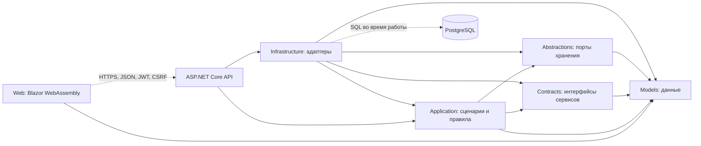
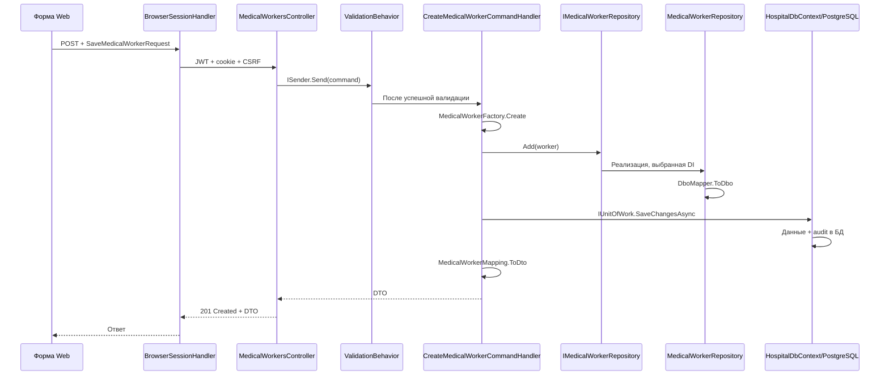

# MedSoft: устройство системы, технологии, запуск и демонстрация — v1

Обновлено 23 ноября 2026 года. Документ описывает HIS, запуск, безопасность, ЭМК и обмен с LIS по FHIR. Для лабораторной 4 приняты C4 и fixtures, реализованы роль HL7 Import, атомарный импорт, HL7 codec/ACK, opt-in MLLP/mTLS listener, подробный аудит импорта и Make-профиль запуска (L2–L7). Listener по умолчанию выключен, включается командой `make lab4-run`. Сетевые сценарии проверяются отдельным Linux-профилем. Сценарий приёмки с desktop (L8) описан в [карточке Льва](lab4-lev-tasks-v1.md).

Для первого знакомства прочитайте разделы 1–3. Для понимания реализации — 4–10. Для подготовки к защите — 11–13.

Содержание:

- [1. Возможности и роли](#1-что-представляет-собой-система)
- [2. Первоначальная подготовка на Mac](#2-запуск-на-mac-что-нужно-подготовить-один-раз)
- [3. Обычный и демонстрационный запуск](#3-два-режима-запуска)
- [4. Архитектура и модели](#4-архитектура-и-ответственность-проектов)
- [5. Подробно о технологиях](#5-технологии-что-они-делают-в-проекте)
- [6. Взаимодействие классов](#6-как-запрос-проходит-между-классами)
- [7. Сотрудники, пациенты, CSV и ЭМК](#7-предметные-модули-и-данные)
- [8. Безопасность](#8-безопасность-механизмы-и-их-взаимодействие)
- [9. База данных и параллельные изменения](#9-хранение-транзакции-и-параллельные-изменения)
- [10. API и интерфейс](#10-карта-api-и-интерфейса)
- [11. Сценарий защиты](#11-сценарий-показа-преподавателю)
- [12. Резервирование, продление TLS и передача проекта](#12-обслуживание-резервирование-и-перенос-напарнику)
- [13. Проверки и границы результата](#13-проверки-и-границы-результата)
- [14. Диагностика ошибок](#14-если-что-то-не-запускается)
- [15. Скрипты и исходники](#15-скрипты-и-навигация-по-исходникам)

## 1. Что представляет собой система

MedSoft — учебная медицинская информационная система. Администратор управляет сотрудниками, их аккаунтами, справочниками диагнозов и лабораторных анализов. Медработники работают с пациентами и электронными медицинскими картами — ЭМК. Доступ зависит от роли сотрудника.

Из первой лабораторной сохранены сотрудники, пациенты, справочник диагнозов с CSV-импортом, ЭМК, диагнозы и назначения в карте, история и восстановление состояния карты на выбранный момент. Вторая лабораторная добавляет полноценные аккаунты, медицинские роли, первоначальную настройку администратора, TOTP, JWT/refresh, TLS 1.3 и аудит безопасности.

В штатном запуске нет готового пароля администратора. Владелец задаёт его сам в мастере настройки и подтверждает второй фактор. Медицинским аккаунтам пароль генерирует сервер при создании или сбросе.

### 1.1. Кто что может делать

В системе два разных уровня ролей:

- Роль аккаунта Identity: `Administrator` или `MedicalWorker`.
- Медицинская роль связанного сотрудника: `Doctor`, `Nurse`, `LaboratoryTechnician` или `Other`.

Должность — текстовое поле, например «Врач-терапевт». Она не назначает права автоматически. Права задаёт медицинская роль.

| Действие | Администратор | Врач | Медсестра | Лаборант | Other |
|---|---|---|---|---|---|
| Управлять сотрудниками, аккаунтами, ролями | Да | Нет | Нет | Нет | Нет |
| Изменять и импортировать справочник диагнозов | Да | Нет | Нет | Нет | Нет |
| Создавать, изменять и отключать лабораторные анализы в справочнике | Да | Нет | Нет | Нет | Нет |
| Читать справочник лабораторных анализов через API | Да | Да | Да | Да | Да |
| Читать справочники сотрудников/диагнозов через API | Да | Да | Да | Да | Да |
| Читать аудит безопасности | Да | Нет | Нет | Нет | Нет |
| Читать пациентов, ЭМК, историю и снимки | Нет | Да | Да | Да | Да |
| Создавать и изменять регистрационные данные пациента | Нет | Да | Да | Нет | Нет |
| Удалять пациента без ЭМК | Нет | Да | Да | Нет | Нет |
| Создавать ЭМК | Нет | Да | Да | Нет | Нет |
| Менять диагнозы и назначения в ЭМК | Нет | Да | Нет | Нет | Нет |
| Назначать лабораторные анализы через UI/API | Нет | Да | Нет | Нет | Нет |

Администратор не получает клинический доступ автоматически. Пациента с ЭМК нельзя удалить даже врачу: это отдельное предметное ограничение. Сотрудник с ролью `Other` имеет медицинский доступ на чтение; это роль по умолчанию.

Проверки есть в интерфейсе и API. Скрытая кнопка улучшает интерфейс, но окончательное решение принимает сервер при каждом запросе.

## 2. Запуск на Mac: что нужно подготовить один раз

Нужны Docker Desktop, .NET 10 SDK, Python 3, OpenSSL с TLS 1.3 и браузер. Для администратора потребуется приложение-аутентификатор с TOTP. Команды ниже выполняются из корня проекта:

```bash
cd ~/hospital-information-system
dotnet --version
docker info
python3 --version
dotnet restore
dotnet tool restore
```

`global.json` задаёт SDK `10.0.100` с `rollForward=latestFeature`: допускается совместимый установленный feature band .NET 10. Версии библиотек хранятся централизованно в `Directory.Packages.props`.

Makefile выбирает установленный `/opt/homebrew/bin/python3`, если этот файл существует. Для другого интерпретатора передайте `PYTHON=/absolute/path/to/python3`. Совместный прогон требует Python 3.11+ с TLS 1.3.

Для первоначальной подготовки новой установки выполните `make prepare FRESH_DATABASE=1`. Команда восстанавливает .NET-зависимости и инструменты, запускает настройку БД и создаёт сертификаты. Для существующей установки используйте `make prepare`. При наличии манифеста сертификатов используется прежний выпуск. Отдельные этапы доступны через `make restore`, `make setup` и `make certificates`.

### 2.1. Подготовка базы

Если `.env` и `src/Presentation/HospitalInformationSystem.Api/appsettings.Local.json` уже существуют, не создавайте их заново.

Для совершенно новой установки без существующего тома PostgreSQL:

```bash
python3 scripts/setup-development.py --fresh-database
```

Скрипт сам сгенерирует пароль базы и создаст приватные настройки. Для существующей базы используйте:

```bash
python3 scripts/setup-development.py
```

Если скрипту понадобится пароль, он спросит действительный пароль PostgreSQL. Это не пароль администратора приложения и не пароль пользователя macOS. Существующие настройки скрипт не перезаписывает.

`.env` используется Docker Compose, а `appsettings.Local.json` — локальными инструментами и скриптом обычного запуска. Оба файла исключены из Git. Изменение `POSTGRES_PASSWORD` в `.env` не меняет пароль PostgreSQL в уже созданном томе.

### 2.2. Сертификаты и постоянные ключи

Рабочие материалы хранятся вне репозитория:

```bash
MEDSOFT_SECURITY_DIR="$HOME/.local/share/MedSoft/development-security/408944"
```

Только при первоначальной подготовке, когда этого выпуска ещё нет:

```bash
python3 scripts/generate-development-certificates.py \
  --isu-id 408944 \
  --output-dir "$MEDSOFT_SECURITY_DIR"
```

Если подходящий OpenSSL не найден, на Mac с Homebrew можно установить его командой `brew install openssl@3`, затем повторить генератор. Генератор проверяет также стандартные пути Homebrew и принимает явный `--openssl /absolute/path`.

Генератор создаёт:

| Каталог/файл | Для чего нужен |
|---|---|
| `ca/ca-cert.pem` | Публичный корневой сертификат, которому доверяет клиент |
| `ca/` с закрытым ключом и его паролем | Подпись учебных серверных сертификатов; остаётся у владельца |
| `server/server.pfx` и файл пароля | Сертификат и закрытый ключ HTTPS для локального API/Web |
| `jwt/` | Отдельная RSA-пара для подписи и проверки JWT |
| `data-protection/` | Сертификат защиты и постоянный keyring для Data Protection |
| `setup/token.txt` | Случайный токен владельца для первоначальной настройки |
| `development-security.json` | Манифест с путями к материалам, который читает launcher |

`408944` — ИСУ владельца учебного CA. У издателя указаны `O=ITMO`, `OU=MedSoft 2026/27 408944`.

### 2.3. Доверие сертификату

На Mac установите доверие только публичному корневому сертификату:

```bash
security add-trusted-cert \
  -r trustRoot \
  -p ssl \
  -k "$HOME/Library/Keychains/login.keychain-db" \
  "$MEDSOFT_SECURITY_DIR/ca/ca-cert.pem"
```

Команда меняет доверие текущего пользователя. macOS может запросить подтверждение или пароль пользователя компьютера. После установки полностью перезапустите браузер. Браузер с собственным хранилищем доверия может потребовать отдельный импорт того же публичного CA.

Закрытый ключ CA и серверный PFX не нужны для установки доверия. Проверку сертификатов в клиенте отключать не требуется.

## 3. Два режима запуска

В корне проекта есть [Makefile](../Makefile) с короткими командами запуска. После первоначальной подготовки из раздела 2 достаточно:

```bash
make run
```

Это обычный запуск PostgreSQL, API и Web с рабочими данными. Для отдельного демонстрационного стенда:

```bash
make demo
```

`make demo` использует одноразовую БД и запрашивает добавление публичного CA в пользовательскую связку ключей macOS. Если доверие уже настроено, используйте `make demo TRUST_CA=0`. Остановка приложения — Ctrl+C. Первоначальные настройки и сертификаты обычного стенда Makefile не пересоздаёт.

| Команда | Назначение |
|---|---|
| `make` или `make help` | Показать команды без запуска приложения |
| `make run` | Обычный запуск вместе с PostgreSQL |
| `make demo` | Демонстрационный запуск с отдельной пустой БД |
| `make db` | Запустить только рабочий PostgreSQL и дождаться готовности |
| `make db-stop` | Остановить рабочий PostgreSQL, сохранив данные |
| `make build` | Собрать solution |
| `make test` | Запустить C#-тесты и Python-проверки скриптов |

Параметры передаются явно: `make run NO_BUILD=1`, `make run SECURITY_DIR="/absolute/path/to/security"`, `make demo ISU_ID=408944 TRUST_CA=0`. Для другого Python/Docker можно задать `PYTHON`/`DOCKER`. На Mac при отсутствии `make` установите Command Line Tools через `xcode-select --install`. Команды совместимы с системным GNU Make 3.81; `docker-compose.yml` остаётся единственным Compose-описанием PostgreSQL. Удаления рабочих томов в Makefile нет.

Ниже описаны Python-команды, которые вызывает Makefile, и подробности обоих режимов.

### 3.1. Обычная работа: существующие данные и администратор

Запустите Docker Desktop. Остановите предыдущий API/Web через Ctrl+C, если они работают. Затем:

```bash
cd ~/hospital-information-system
python3 scripts/run-application.py --start-database
```

Скрипт:

1. Читает существующую строку подключения из `appsettings.Local.json`.
2. Для API в Docker заменяет локальный адрес БД на `host.docker.internal`, сохраняя остальные параметры и пароль.
3. По `--start-database` запускает PostgreSQL через Docker Compose и ждёт его готовности.
4. Использует прежний каталог рабочих сертификатов `development-security/408944`.
5. Вызывает общий launcher, который собирает API-образ и Web и запускает оба процесса.

Если PostgreSQL уже работает, флаг можно опустить:

```bash
python3 scripts/run-application.py
```

После сборки откройте:

| Адрес | Назначение |
|---|---|
| `https://localhost:5101` | Приложение |
| `https://localhost:5101/admin/login` | Вход администратора |
| `https://localhost:5101/login` | Вход сотрудника |
| `https://localhost:5201` | API, не отдельный пользовательский сайт |
| `https://localhost:5201/health/ready` | Готовность API и соединения с БД |

Используйте именно `localhost`: адреса должны совпадать с сертификатами, CORS и cookies. Терминал с launcher оставьте открытым.

Дополнительные параметры:

```bash
python3 scripts/run-application.py --security-directory /absolute/path/to/existing/security
python3 scripts/run-application.py --no-build
```

`--no-build` подходит, когда API-образ и Web уже собраны и код не менялся. При перевыпуске TLS укажите новый выпуск через `--security-directory`, сохранив прежние JWT/Data Protection согласно разделу 12.

В обычном Development применяются миграции и могут добавляться синтетические сотрудники и диагнозы. Аккаунты и известный пароль администратора seed не создаёт. Если рабочая БД уже настроена, прежний администратор, его пароль и TOTP остаются действительными.

Остановка API/Web — Ctrl+C. PostgreSQL продолжает работать, данные остаются в постоянном томе. При необходимости остановите его отдельно:

```bash
docker compose stop postgres
```

### 3.2. Повторная демонстрация настройки: отдельная одноразовая база

Этот режим нужен, чтобы показать создание администратора с самого начала, не меняя рабочую систему:

```bash
python3 scripts/run-setup-demo.py --trust-ca
```

Скрипт создаёт отдельный PostgreSQL со случайным паролем и свободным портом. Данные находятся во временной файловой системе контейнера, без рабочего Docker-тома. Миграции включены, seed выключен: первоначально в демонстрационной БД нет сотрудников и диагнозов.

Демонстрационные сертификаты, JWT и Data Protection хранятся отдельно в `$HOME/.local/share/MedSoft/demo-security/408944`. Если выпуска ещё нет, скрипт создаёт его. Флаг `--trust-ca` явно разрешает добавить публичный CA этого стенда в пользовательскую связку ключей macOS. Если доверие уже установлено, флаг можно опустить.

После сборки откройте `https://localhost:5101/admin/login`. Скрипт напечатает команду `pbcopy < ...` для копирования токена владельца. Выполните её во втором терминале и вставьте токен в мастер.

**Ctrl+C удаляет демонстрационную БД вместе со всеми созданными в ней аккаунтами, пациентами и аудитом.** Сертификаты сохраняются. При следующем запуске БД снова пустая и настройку можно повторить.

Для полного нового выпуска сертификатов, ключей и токена владельца:

```bash
python3 scripts/run-setup-demo.py --new-certificates --trust-ca
```

Этот вариант создаёт новый каталог выпуска. Прежние ключи и записи доверия macOS он не удаляет. Для показа настройки администратора новый CA не обязателен: готовность настройки хранится в БД.

На телефоне создавайте отдельную запись `MedSoft DEMO`, не заменяя рабочую. При каждом новом setup появляется новый TOTP-секрет. После завершения демонстрации остановите её и выполните обычный запуск из раздела 3.1; используйте прежнюю рабочую запись аутентификатора.

### 3.3. Первое создание администратора

1. Откройте административный вход. На новой БД система предложит мастер настройки.
2. Вставьте токен владельца. Для рабочего выпуска его можно скопировать во втором терминале:

   ```bash
   pbcopy < "$HOME/.local/share/MedSoft/development-security/408944/setup/token.txt"
   ```

3. Придумайте пароль и подтверждение: 12–128 символов, прописные/строчные латинские буквы и цифры; специальный символ необязателен.
4. В приложении-аутентификаторе добавьте аккаунт вручную, используя показанный секрет. Тип — TOTP, 6 цифр, 30 секунд, SHA1.
5. Введите код с телефона и завершите настройку.
6. Дождитесь следующего кода. На странице входа введите логин `admin` и свой пароль, нажмите «Продолжить». На отдельной странице введите новый код и нажмите «Подтвердить вход».

Код подтверждения setup повторно для входа не подходит. Кнопка повторного начала выдаёт новый секрет: запись аутентификатора тогда тоже нужно обновить. Один challenge действует 5 минут. Для уже настроенной БД мастер второго администратора не создаёт.

## 4. Архитектура и ответственность проектов

### 4.1. Какие процессы работают

Backend — одно приложение с гексагональным разделением: Application выполняет сценарии через интерфейсы, а Infrastructure предоставляет реализации для PostgreSQL, Identity и криптографии. Проекты — библиотеки внутри процесса API, а не отдельные микросервисы. MediatR вызывает обработчик в памяти того же процесса.

На схеме сплошная стрелка означает зависимость проекта при компиляции, пунктирная — обмен во время работы. Application не ссылается на Infrastructure и не использует EF Core, ASP.NET Identity, Npgsql или Firely.



Infrastructure реализует порты Contracts и Abstractions. Его внешняя зависимость от Application позволяет использовать фабрики и служебные компоненты при инициализации; обратной зависимости нет. API собирает обе стороны через DI. При выполнении сценария вызов проходит из Application в объект адаптера через интерфейс — это runtime-вызов, а не ссылка внутреннего проекта на внешний.

На Mac API запускается в Linux-контейнере для серверного TLS 1.3. Web обслуживается локальным development-сервером, а компоненты Blazor выполняются в браузере. PostgreSQL работает отдельным контейнером. Из проектов системы Web ссылается только на Models; обращения к серверу выполняет через HTTP-клиенты.

### 4.2. Структура solution

```text
src/
  Application/
    HospitalInformationSystem.Models/
    HospitalInformationSystem.Contracts/
    HospitalInformationSystem.Abstractions/
    HospitalInformationSystem.Application/
  Infrastructure/
    HospitalInformationSystem.Infrastructure/
  Presentation/
    HospitalInformationSystem.Api/
    HospitalInformationSystem.Web/
    HospitalInformationSystem.Maintenance/
tests/
  HospitalInformationSystem.UnitTests/
  HospitalInformationSystem.IntegrationTests/
  browser-security/
scripts/
docs/
  system-guide-v1.md
```

В [solution](../HospitalInformationSystem.slnx) три основные solution folder: Application, Infrastructure, Presentation. Solution folder группирует проекты в IDE и сама не является сборкой. В папке Application находятся четыре самостоятельных проекта.

| Проект | Ответственность |
|---|---|
| Models | Предметные модели, DTO и HTTP requests/responses, enum, payload истории, нейтральные read models, DBO и общие ограничения формата |
| Contracts | Интерфейсы прикладных и вспомогательных сервисов: аккаунты, setup, сервисные аккаунты, аудит, импорт и контекст текущего пользователя |
| Abstractions | Интерфейсы репозиториев, хранилища настройки/Identity, Unit of Work и управления транзакциями |
| Application | Команды/запросы MediatR, handlers, валидаторы, фабрики, бизнес-сервисы, построение снимков и координация операций через порты |
| Infrastructure | EF Core и PostgreSQL, конфигурации и миграции, реализации репозиториев/транзакций, ASP.NET Identity, криптография и адаптеры токенов/сессий |
| Api | HTTP-контроллеры, FHIR-представления, аутентификация/авторизация, middleware и сборка DI |
| Web | Страницы, формы, HTTP-клиенты, gateways, браузерная сессия и интерфейс |
| Maintenance | Отчёт совместимости старой БД, применение явного плана перехода, измерение KDF |

Models не зависит от остальных проектов системы и серверных фреймворков. Contracts и Abstractions зависят только от Models и содержат интерфейсы. Application зависит от этих трёх проектов. Например, `IMedicalWorkerRepository` находится в Abstractions, `IAccountService` — в Contracts, а его реализация `AccountService` — в Application. Регистрация DI выбирает конкретный адаптер при запуске API.

### 4.3. DTO, предметная модель и DBO

Все три представления объявлены в Models, но решают разные задачи:

| Представление | Пример | Для чего нужно |
|---|---|---|
| Request/DTO | `SaveMedicalWorkerRequest`, `MedicalWorkerDto` | Контракт HTTP и данных интерфейса |
| Предметная модель | `MedicalWorker` | Состояние, с которым работают прикладные сценарии |
| DBO | `MedicalWorkerDbo` | Структура сохраняемых данных; EF настраивает её в Infrastructure |

Обычная цепочка — request → command или вызов сервиса → предметная модель → DBO при сохранении и DBO → предметная модель → DTO при чтении. Общий проект не делает эти представления взаимозаменяемыми: HTTP endpoint возвращает DTO и не раскрывает хеши и внутренние данные таблиц.

Классы данных содержат свойства. Создание вынесено в `*Factory`, предметные изменения — в `*Service`, преобразования — в мапперы. Фабрики, бизнес-сервисы и DTO-мапперы находятся в Application. Например, `MedicalWorkerFactory` создаёт исходное состояние и ID, `MedicalWorkerService` применяет изменения, а `MedicalWorkerMapping` формирует DTO. В Infrastructure `MedicalWorkerDboMapper` преобразует предметную модель в DBO и обновляет отслеживаемую EF запись. Общие enum, JSON-конвертеры и чистые проверки формата остаются в Models, чтобы API и Web использовали одинаковые контракты.

18 DBO находятся в [Models/Persistence](../src/Application/HospitalInformationSystem.Models/Persistence) с namespace `HospitalInformationSystem.Models.Persistence`. EF-конфигурации, `HospitalDbContext`, миграции и репозитории остаются в Infrastructure. `HospitalUser : IdentityUser<Guid>` также остаётся в Infrastructure: это адаптерная модель ASP.NET Identity, а не нейтральная модель приложения. Перенос DBO изменил расположение CLR-типов, но не таблицы, колонки, ограничения и идентификаторы существующих миграций. Схема БД сохраняется.

Мапперы обновления намеренно не переписывают идентификатор и время создания. Парольный хеш, закрытые ключи и внутреннее состояние Identity не становятся обычными полями DTO интерфейса. Существующие JSON-имена, строковый формат пола пациента и числовые значения сохраняемых enum сохранены. Два enum медицинских ролей сопоставляются по именам, поскольку их числовые значения различаются.

## 5. Технологии: что они делают в проекте

Версии ниже взяты из репозитория, а не обозначают последние доступные версии. Основные источники — [Directory.Packages.props](../Directory.Packages.props), [Directory.Build.props](../Directory.Build.props), [global.json](../global.json) и [package.json браузерных тестов](../tests/browser-security/package.json).

| Технология | Версия/настройка проекта | Применение |
|---|---|---|
| .NET / C# | `net10.0`, nullable включён | Backend, Web, инструменты и тесты |
| ASP.NET Core, Identity, Blazor, EF Core | Пакеты `10.0.12` | HTTP API, аккаунты, UI, ORM |
| Npgsql EF provider | `10.0.3` | EF Core ↔ PostgreSQL |
| PostgreSQL | Docker-тег `17-alpine` | Реляционное хранилище; тег не фиксирует patch-версию |
| MediatR | `12.5.0` | Доставка команд/запросов обработчикам внутри процесса |
| FluentValidation | `12.1.1` | Валидация use cases перед выполнением |
| Mapperly | `4.3.1` | Генерация C#-мапперов при компиляции |
| Konscious Argon2 | `1.3.1` | Argon2id для паролей |
| System.IdentityModel.Tokens.Jwt | `8.19.2` | Формирование и проверка JWT |
| xUnit | `2.9.3` | Модульные и интеграционные тесты |
| Moq / FluentAssertions | `4.20.72` / `6.12.2` | Подмены зависимостей и проверки результатов |
| Testcontainers.PostgreSql | `4.15.0` | Настоящая временная PostgreSQL для интеграционных тестов |
| Playwright | `1.62.0` | Браузерные сценарии Chromium |
| Python / Bash / Docker / OpenSSL | Инструменты окружения | Подготовка, запуск, сертификаты и проверки |

### 5.1. .NET, C#, async/await и CancellationToken

.NET исполняет C#-код и предоставляет HTTP, криптографию, работу с файлами, JSON и DI. `Nullable=enable` помогает замечать возможный `null` ещё при компиляции. Общие настройки вынесены в `Directory.Build.props`, а версии пакетов — в `Directory.Packages.props`, чтобы проекты не расходились по версиям.

`async/await` позволяет ожидать БД и HTTP без блокирующего ожидания рабочего потока на всю длительность I/O. Это не означает запуск каждого обработчика на отдельном потоке. `CancellationToken` передаётся по цепочке контроллер → обработчик → репозиторий → EF, чтобы отмена запроса могла остановить ненужную работу.

### 5.2. ASP.NET Core, Kestrel и middleware

ASP.NET Core принимает HTTP-запрос, выбирает endpoint, проверяет доступ, десериализует JSON и вызывает контроллер. Kestrel — сервер, который слушает порт и устанавливает TLS-соединение.

Middleware — последовательные этапы обработки запроса. [Program.cs API](../src/Presentation/HospitalInformationSystem.Api/Program.cs) подключает заголовки безопасности, обработку исключений, контроль HTTPS, routing, CORS, rate limit, аутентификацию, авторизацию, ограничения тела и antiforgery. Контроллер вызывается после этих проверок.

`ApiExceptionHandler` переводит известные ошибки в HTTP-ответы с ProblemDetails и `traceId`. Внутренний stack trace не отправляется клиенту при ошибке 500. Аутентификационные и ограничительные middleware также могут сформировать ответ до контроллера.

### 5.3. HTTP, JSON и REST-подобный API

HTTP определяет метод, адрес, заголовки, тело и статус ответа. `GET` читает данные, `POST` создаёт ресурс или запускает действие, `PUT` изменяет его, `DELETE` удаляет или логически снимает состояние согласно конкретной операции.

JSON — формат обмена DTO. UUID идентифицирует объект независимо от позиции в таблице. Даты событий хранятся как UTC-моменты, дата рождения — `DateOnly`; интерфейс показывает местное время, включая секунды у событий.

Пример: создание сотрудника отправляет request в `POST /api/medical-workers`, получает `201 Created` с DTO и адресом ресурса. Неверное тело обычно даёт 400, отсутствие входа — 401, нехватка прав — 403, отсутствие объекта — 404, конфликт состояния — 409.

### 5.4. Dependency Injection

DI-контейнер создаёт объекты и передаёт им зависимости через конструкторы. Поэтому обработчик принимает `IMedicalWorkerRepository`, а не сам создаёт PostgreSQL-соединение. В production ему передаётся EF-реализация, в модульном тесте — подмена.

[AddApplication](../src/Application/HospitalInformationSystem.Application/DI/DependencyInjection.cs) регистрирует MediatR, валидаторы, pipeline валидации, фабрики аудита, сервисы аккаунтов/setup/сервисных аккаунтов/импорта, чтение и запись аудита, контекст команд ЭМК, builder снимков и время. [AddInfrastructure](../src/Infrastructure/HospitalInformationSystem.Infrastructure/DI/DependencyInjection.cs) связывает порты с EF-репозиториями, `IUnitOfWork`, менеджером транзакций, Identity и криптографическими адаптерами. Поэтому перенос прикладного сервиса не переносит SQL или криптографическую реализацию во внутренний слой.

DbContext и репозитории имеют scoped lifetime: в пределах серверного запроса они работают с одним контекстом. `IUnitOfWork` ссылается на этот же `HospitalDbContext`, а не на отдельное подключение со своим несогласованным сохранением. Singleton используется для общих объектов, например генератора паролей и `TimeProvider.System`.

### 5.5. MediatR и разделение команд/запросов

Команда описывает изменение: `CreateMedicalWorkerCommand`. Запрос описывает чтение: `GetMedicalWorkerQuery`. Для каждого есть handler с конкретным сценарием.

`ISender.Send(command)` находит обработчик и вызывает его внутри того же процесса. Это не очередь сообщений, не HTTP и не отдельный сервис. Разделение помогает держать контроллер коротким, а правила одного сценария — в одном обработчике.

В проекте это практическое разделение чтения и изменения; отдельной read-базы или брокера для CQRS нет.

### 5.6. FluentValidation

Валидаторы проверяют входные значения команд. `ValidationBehavior<TRequest,TResponse>` запускается в MediatR pipeline раньше handler. Он последовательно выполняет зарегистрированные валидаторы и собирает ошибки; при ошибке обработчик не вызывается.

Валидация имеет несколько уровней: UI помогает исправить форму, валидаторы Application проверяют вход use case, его фабрики и сервисы защищают предметные правила, PostgreSQL — уникальность и ссылки. Общие ограничения формата объявлены в Models. Проверка существования объекта или допустимости перехода состояния не заменяется проверкой длины строки.

### 5.7. Mapperly

Mapperly — генератор исходного кода. По объявлениям partial-мапперов он создаёт обычный C#-код преобразований во время сборки. Это избавляет от повторяющихся присваиваний и позволяет замечать проблемы маппинга при компиляции.

В Application мапперы формируют DTO из предметных моделей, в Infrastructure — преобразуют предметные модели и DBO и обновляют tracked DBO. Объявления обоих видов данных находятся в Models. Маппер не решает, имеет ли пользователь право изменить карту, и не назначает автора: эти решения остаются в политиках и use cases.

### 5.8. EF Core, Npgsql, Repository и Unit of Work

EF Core связывает DBO с таблицами и переводит LINQ в SQL. Npgsql — провайдер PostgreSQL. Конфигурации задают имена таблиц/колонок, ограничения, индексы и связи. Миграции описывают последовательное изменение схемы.

Репозиторий скрывает особенности загрузки и сохранения агрегата. Для чтения может использоваться `AsNoTracking`; при изменении используется tracked DBO. После предметного изменения `UpdateDbo` переносит изменяемые поля обратно в отслеживаемый объект.

`SaveChangesAsync` у Unit of Work фиксирует подготовленные изменения совместно. Контекст также добавляет связанные события аудита и обрабатывает изменения безопасности. Сохранение одной строки отдельно от её истории или каскадного отзыва сессий нарушило бы согласованность, поэтому эти операции объединены.

### 5.9. PostgreSQL и транзакции

Реляционная БД обеспечивает внешние ключи, уникальность, проверки значений, транзакции и блокировки. Уникальность кода диагноза или одной карты пациента не полагается только на предварительный `SELECT`: её закрепляет ограничение БД.

Транзакция позволяет сохранить все взаимосвязанные изменения или отменить их. PostgreSQL MVCC и concurrency tokens помогают обнаружить параллельную запись. Подробности согласованности приведены в разделе 9.

### 5.10. Blazor WebAssembly

Blazor WebAssembly исполняет C#-компоненты в браузере. Razor-файл описывает разметку, состояние и события формы. Backend при этом остаётся отдельным API: страницы обращаются к нему через `HttpClient`.

`WebClientRegistration` регистрирует API-клиенты, gateways, браузерную сессию и `BrowserSessionHandler`. Gateways собирают операции интерфейса и клиентские проверки прав. Эти проверки не заменяют серверную авторизацию.

`SessionAuthenticationStateProvider` сообщает компонентам, кто вошёл. `SessionState` держит текущую сессию, access-токен и версию состояния в памяти. При F5 токен в памяти исчезает, но cookie refresh позволяет восстановить вход.

### 5.11. Docker, Python, Bash и OpenSSL

Docker воспроизводит окружение PostgreSQL и Linux API. В обычном режиме БД использует постоянный volume, в демонстрационном — tmpfs без рабочего тома. Контейнер сам по себе не заменяет проверку прав или TLS.

Python-скрипты готовят настройки, выпускают сертификаты, запускают процессы и проверяют артефакты. Они используют стандартную библиотеку Python. Bash-скрипт нужен для отдельной сборки UI mock. OpenSSL выпускает и проверяет сертификаты и позволяет отдельно подтвердить разрешённые версии TLS.

Сертификаты и ключи создаются вне репозитория; пароль БД хранится в игнорируемых локальных `.env` и `appsettings.Local.json`. Launcher передаёт значения через окружение и отдельные mounts. Наличие Docker не означает, что сертификат автоматически стал доверенным в браузере пользователя.

### 5.12. Технологии тестирования

xUnit запускает C#-тесты. Moq подменяет зависимости в изолированных проверках, FluentAssertions делает проверки результатов читаемыми. `WebApplicationFactory` поднимает тестовый API, а Testcontainers предоставляет настоящую PostgreSQL с её ограничениями, транзакциями и SQL-поведением.

Playwright запускает Chromium и проверяет реальные страницы, cookies, HTTPS и CORS. Python unittest проверяет скрипты: права файлов, сохранение ключей, окружение дочерних процессов, очистку временной БД и TLS. Проверка публикации дополнительно ищет секреты и конфигурацию mock в готовых артефактах.

## 6. Как запрос проходит между классами

### 6.1. Создание сотрудника через MediatR



Контроллер принимает HTTP-модель из Models и создаёт команду Application. Handler создаёт предметный объект через фабрику Application и вызывает порт `IMedicalWorkerRepository` из Abstractions. DI передаёт реализацию `MedicalWorkerRepository` из Infrastructure. Она добавляет DBO, а `IUnitOfWork` фиксирует изменения через тот же `HospitalDbContext`. Handler знает интерфейсы и модели, но не знает EF и PostgreSQL.

При обновлении handler сначала загружает объект. Репозиторий сохраняет связь с tracked DBO, `MedicalWorkerService` изменяет предметную модель, `UpdateAsync` переносит состояние обратно. Конфликт параллельной записи превращается в 409, а не молча перезаписывает чужое изменение.

Чтение сотрудника короче: controller → query → handler → порт репозитория → EF-адаптер → предметная модель → DTO. Handler списка пациентов дополнительно одним запросом получает множество patient ID с ЭМК, чтобы заполнить `HasMedicalRecord` без запроса на каждую строку.

### 6.2. Почему часть контроллеров вызывает сервис напрямую

Сотрудники, пациенты, справочники и ЭМК организованы как команды/запросы MediatR. Аккаунты, первоначальная настройка, управление сервисными аккаунтами и аудит вызываются через специализированные сервисы Contracts. Их реализации находятся в Application и выполняют сценарии через порты Abstractions. MediatR не является условием работы DI или транзакций.

| Сценарий | Прикладной сервис | Порт и внешний адаптер |
|---|---|---|
| Создание аккаунта, смена активности и сброс пароля | `AccountService` | `IAccountRepository` → `AccountRepository` с ASP.NET Identity; `IMedicalWorkerRepository` для сотрудника |
| Первоначальная настройка и проверка TOTP | `AdministratorSetupService` | `IAdministratorSetupStore` → `AdministratorSetupStore`; `IAdministratorSetupCryptography` → `AdministratorSetupCryptography` |
| Создание/ротация/отключение сервисного аккаунта | `ServiceAccountService` | `IServiceAccountRepository` → `ServiceAccountRepository`; генератор ключей и отзыв сессий подключены отдельными интерфейсами |
| Подготовка/чтение аудита | `AuditWriter`, `AuditQueryService` | `IAuditRepository` → `AuditRepository`; `AuditEntryFactory` формирует событие в Application |
| Атомарный импорт HL7 | `ImportedPatientService` | `IImportedPatientRepository` → `ImportedPatientRepository`; handler передаёт нейтральный `ImportPatientRequest` |

Для атомарных операций Application использует `ITransactionManager` и `IApplicationTransaction`. Их EF-реализация `EfTransactionManager` работает с тем же DbContext, что и репозитории/Unit of Work; внутреннему слою не нужны `IDbContextTransaction` или SQL. Адаптеры выпуска JWT, refresh-сессий, хеширования паролей, TOTP и Data Protection остаются в Infrastructure. Контроллеры аутентификации также используют технические средства ASP.NET Identity для проверки входа.

Общая цепочка: controller → прикладной сервис или MediatR handler → порт → адаптер → хранилище. Например, `AccountsController` вызывает `IAccountService`, а `AuditController` — `IAuditQueryService`; бизнес-решения принимают реализации Application, запросы к БД выполняют реализации Infrastructure.

### 6.3. Вход в систему

Основная цепочка:

```text
Страница входа
  → AuthenticationGateway / HttpClient
  → BrowserSessionHandler: cookie и CSRF
  → AuthController
  → UserManager / SignInManager: аккаунт и пароль
  → AccountService.GetSessionAsync: актуальные роли и сотрудник
  → AdministratorSetupService.VerifyAdministratorCodeAsync: TOTP администратора
  → TokenSessionService.IssueAsync: сессия и токены
  → RefreshCookieService: защищённая cookie
  → SessionState.SetTokens: access и пользователь в памяти Web
```

Эта цепочка остаётся действующей для медицинского входа и совместимого единого endpoint. В административном интерфейсе она разделена на два HTTP-шага: `POST /api/auth/admin/login` проверяет пароль и создаёт challenge, а `POST /api/auth/admin/confirm` проверяет TOTP и только после этого выдаёт токены. `GET /api/auth/admin/challenge` позволяет восстановить страницу подтверждения после F5 без повторного хранения пароля на клиенте.

Параметр portal разделяет административный и медицинский вход в совместимом endpoint. Медработнику TOTP не требуется. Общее сообщение о неверных реквизитах не раскрывает, существует ли указанный аккаунт.

### 6.4. Изменение ЭМК

`MedicalRecordsController` получает автора через `ICurrentMedicalWorker.RequireId()` из проверенной сессии. Клиент передаёт диагноз или текст назначения, но не произвольного автора.

Handler использует `MedicalRecordCommandContext`: проверяет автора, загружает карту, получает текущее время и сохраняет изменения через репозиторий/Unit of Work. `MedicalRecordService` меняет агрегат и добавляет событие истории. При сохранении медицинская история также становится основанием для события аудита безопасности.

Например, добавление диагноза: controller → `AddMedicalRecordDiagnosisCommandHandler` → контекст → справочник → `MedicalRecordService.AddDiagnosis` → repository → DbContext → SQL. Сохранённая запись содержит снимок кода и названия диагноза на момент добавления.

## 7. Предметные модули и данные

### 7.1. Сотрудники и аккаунты

Имя и фамилия сотрудника допускают длину от одного символа. У сотрудника есть должность, медицинская роль и признак `IsDeleted`. Удаление сотрудника мягкое: он сохраняется для связей и истории, связанный аккаунт деактивируется, сессии отзываются.

Аккаунт хранит UUID, уникальное имя пользователя длиной 3–16 символов, хеш пароля, даты и активность. В БД связь аккаунт ↔ сотрудник допускает 0..1 с обеих сторон: FK nullable, непустая связь уникальна. Штатный медицинский аккаунт создаётся только из карточки действующего сотрудника; второй аккаунт к тому же сотруднику создать нельзя.

`POST /api/accounts` намеренно возвращает 410 с указанием использовать карточку сотрудника. Создание дополнительных администраторов через этот endpoint закрыто. Сгенерированный пароль из 12 букв/цифр показывается в ответе создания/сброса, но не возвращается в списке аккаунтов.

### 7.2. Пациенты

Пациент содержит регистрационные данные: имя, фамилию, отчество, дату рождения, пол и комментарий. Список показывает наличие ЭМК. Пациент без ЭМК может быть удалён физически; для пациента с картой handler запрещает удаление, а внешний ключ БД дополнительно защищает связь.

### 7.3. Справочник диагнозов и CSV

Код диагноза содержит 3–32 символа, название — 3–256 после удаления внешних пробелов (`Trim`). Общие пределы объявлены в Models и применяются в Application, REST/CSV, EF и Web, включая снимки диагнозов ЭМК. Поддерживаются коды `I10`, `I48`, `J45.9`, прежние шестисимвольные и локальные коды. Сопоставление выполняется по точному коду после `Trim`, поэтому `I10` и `I10.00` определяют разные записи. Код и название уникальны в справочнике, что закреплено отдельными уникальными индексами БД.

CSV должен быть UTF-8, с заголовком `Code,Name` и разделителем-запятой. Допускаются BOM и поля в кавычках. Пример:

```csv
Code,Name
I10.00,Гипертензия
E11.90,Диабет 2 типа
```

Ограничения: ровно один файл в поле `file`, непустой файл до 1 МиБ, не более 10 000 записей и хотя бы одна строка данных. Multipart-запросу разрешён небольшой дополнительный объём для служебных полей.

`DiagnosisCsvParser` использует `TextFieldParser` стандартной .NET-библиотеки `Microsoft.VisualBasic.FileIO`, а не CsvHelper. Парсер возвращает понятные ошибки с номером физической строки.

Handler сначала проверяет все строки, дубли и конфликты. Новый код добавляет запись, существующий обновляет название, полностью совпадающий считается неизменённым. Название, занятое другим кодом, отменяет импорт. Сохранение выполняется после всех проверок одной операцией, без частичного внесения успешно прочитанных строк.

### 7.4. ЭМК, диагнозы и назначения

У пациента не более одной ЭМК. Создание задаёт версию 1 и событие `MedicalRecordCreated`.

Диагноз в карте содержит ссылку и снимок справочных данных. Его снятие фиксирует `RemovedAt/RemovedBy`, а не уничтожает историю. Назначение содержит текст; отмена задаёт `CancelledAt/CancelledBy`. Текущий DTO скрывает снятые диагнозы и отменённые назначения, но история сохраняет их существование.

Замена назначения отменяет старое и создаёт новое с `ReplacesPrescriptionId`. В одной операции сохранения появляются два события и две последовательные версии. Это позволяет объяснить, какое назначение чем заменено.

### 7.5. История и снимок на момент времени

История ЭМК содержит последовательную версию, время, тип действия, автора со снимком имени/должности и JSON payload. Payload хранится в PostgreSQL как `jsonb`.

`MedicalRecordSnapshotBuilder` и `MedicalRecordSnapshotReplay` проигрывают события по версиям и строят состояние на момент `at`. Параметр требует ISO 8601 с `Z` или явным смещением, например `2026-10-28T12:00:00Z`. До момента создания карты возвращается 404.

Replay проверяет целостность всей истории: последовательность версий, время, содержимое событий, идентификаторы и допустимость добавления/снятия/отмены. Нельзя считать повреждённую историю корректной только потому, что запрошен более ранний момент.

Архитектура сочетает таблицы текущего состояния с неизменяемой историей и восстановлением снимков. Вся система не является чистым Event Sourcing: пациенты, аккаунты и другие данные не восстанавливаются универсальным проигрыванием одного журнала.

### 7.6. Лабораторные анализы: текущий этап лабораторной 3

В административном меню появился отдельный справочник **«Лабораторные анализы»** (`/admin/laboratory-tests`). Он поддерживает поиск, фильтр по активности, создание, изменение кода/названия, активацию и деактивацию с подтверждением. Даты создания и изменения показаны с секундами. Физического удаления нет; отключённый элемент остаётся доступен при чтении по ID.

Начальный набор содержит семь исследований: глюкозу, гемоглобин, антитела к ВИЧ, HBsAg, антитела к гепатиту C, антитела к Treponema pallidum и ДНК Yersinia pestis. Коды, уточнённые названия и официальные источники LOINC находятся в [общем JSON](../tests/Fixtures/Lab3/laboratory-test-catalog.json). Приложение не обращается к внешней терминологии при каждом открытии.

`LaboratoryTestDefinition` хранит только состояние. Фабрика и `LaboratoryTestDefinitionService` выполняют нормализацию и изменения; команды/запросы идут через MediatR и FluentValidation. `LaboratoryTestRepository` преобразует предметную модель ↔ DBO через Mapperly, `HospitalDbContext` сохраняет данные. На UI `LaboratoryTests.razor` вызывает gateway, тот проверяет роль и обращается к typed API client. Проверка прав повторяется на сервере: чтение — администратор и медицинские аккаунты, запись — только администратор, с CSRF.

При создании и изменении справочника код имеет длину 3–32, ASCII-форму `цифры-дефис-цифра` и корректную контрольную цифру Mod10. Поддержаны 14 исторических исключений LOINC. Application и Web используют один алгоритм проверки из Models. Имя содержит 3–256 Unicode-символов после trim. Уникальный индекс запрещает повтор кода независимо от активности. Проверка контрольной цифры выполняется локально. Источники правил приведены в [руководстве LOINC](https://loinc.org/kb/users-guide/calculating-mod-10-check-digits/) и [списке исторических исключений](https://loinc.org/kb/users-guide/calculating-mod-10-check-digits/terms-with-invalid-check-digits/).

Старые назначения сохраняют код, прошедший действовавшую при создании проверку формата. `MedicalRecordSnapshotReplay` читает такие события, а `FhirObservationReader` и валидатор результата проверяют прежнюю ASCII-форму кода. `MedicalRecordService` требует точное совпадение кода и пациента с сохранённым заказом. Новые назначения проходят Mod10. Предыдущие payload истории сохраняются.

API возвращает `version`, полученную из PostgreSQL `xmin`. При изменении кода, названия или активности клиент передаёт эту версию. Отсутствующая или нулевая версия даёт 400, устаревшая — 409. EF проверяет версию и при записи в БД. После конфликта UI сохраняет введённые данные в форме и предлагает явно загрузить актуальную карточку перед повторным редактированием. Обновление списка сохраняет исходную версию открытой формы. Для смены активности также требуется проверить актуальное состояние и заново подтвердить действие.

Миграция `AddLaboratoryTests` добавляет отдельную таблицу. Справочные записи создаются при инициализации БД даже с выключенными демоданными. Постоянные UUID исходных элементов и `ON CONFLICT DO NOTHING` сохраняют изменения кода, названия и активности при повторном/параллельном запуске. Настройки подключения и обычные команды запуска не меняются.

Этап L3 добавил лабораторные заказы и результаты в агрегат ЭМК. `CreateLaboratoryAnalysisRequestsCommand` через `ICurrentMedicalWorker` определяет текущего врача, проверяет весь набор из 1–100 анализов и одним сохранением создаёт N отдельных заказов и N событий. Один и тот же анализ можно назначить повторно отдельной операцией. Каждый заказ хранит снимки LOINC/названия; редактирование справочника не меняет ранее назначенное исследование.

При назначении клиент передаёт `laboratoryTestDefinitionIds`, `comment` и карту `expectedVersions` с прочитанной `version` каждой выбранной записи справочника. Пример карты имеет вид `{ "UUID анализа": 57 }`. Пропуск карты, отсутствующие или лишние UUID и нулевые значения дают 400. Если администратор изменил выбранный анализ после его загрузки врачом, сервер отвечает 409. Обработчик сравнивает все версии до создания заказов и истории. При конфликте весь пакет остаётся несохранённым, врачу нужно обновить справочник и подтвердить выбор заново. Версии читаются через `LaboratoryTestRepository` из PostgreSQL `xmin`.

У заказа есть статус `Active/Completed` и необязательный результат с самостоятельным ID. Результат содержит строку до 2000 Unicode-символов, дату фиксации LIS и отдельную дату получения HIS. `RecordLaboratoryAnalysisResultCommand` проверяет пациента, сохранённый LOINC и отсутствие прежнего результата; с L6 её вызывает FHIR POST. Автор берётся из `ICurrentServiceAccount`; пользователь не передаёт его ID. Настоящая выдача и проверка сервисных токенов добавлена в L8: обычный API проверяет подпись и действующую сервисную сессию. Изолированные тестовые host для прежних FHIR-сценариев сохранены; они не заменяют новые проверки настоящих JWT.

События `LaboratoryAnalysisRequested` и `LaboratoryAnalysisResultRecorded` имеют явный вид автора. История отображает сохранённые имя и позицию автора. Для лабораторного результата позиция равна `LIS`, для импорта пациента и диагнозов — `HL7 Import`. Replay восстанавливает лабораторное состояние по payload событий: результат появляется в снимке только после времени получения HIS, даже если LIS прислала более раннее `issued`. Время HIS согласовано с микросекундами PostgreSQL; входное `issued` имеет точность не более миллисекунд.

Миграция `AddLaboratoryAnalyses` сохраняет прежние данные, расширяет историю и добавляет две таблицы. Составные FK удерживают правильного пациента, уникальность RequestId — один результат на заказ; запись результата, статуса, истории и версии карты атомарна. Завершённый результат защищён от изменения/удаления, а обычное последующее изменение ЭМК его сохраняет. Обратная миграция с лабораторными данными останавливается до их удаления.

Этап L4 добавил вкладку **«Анализы»**. Врач открывает **«Назначить анализы»**, находит исследования по коду или названию, отмечает несколько активных вариантов, при необходимости пишет комментарий и подтверждает показанное количество самостоятельных заказов. Другие медицинские роли читают таблицу без формы назначения. Результат без данных обозначен прочерком; сохранённая строка, включая `0`, показывается как есть. Время назначения, фиксации LIS и получения HIS отображается с секундами, рядом указано отсутствие единиц измерения в учебном режиме.

`MedicalRecord.razor` подключает `LaboratoryAnalysesPanel` и чистую `LaboratoryAnalysesTable`. Панель получает справочник через `ILaboratoryTestsGateway`, отправляет пакет через `IMedicalRecordsGateway`, а тот проверяет роль и вызывает typed client. Клиент проверяет целостность ответа 201, включая выбранные анализы, отдельные ID, правильную карту, единого пациента/автора и отсутствие выдуманного результата. `LaboratoryAnalysisRequestDto.RequestedByNameSnapshot` содержит имя назначившего врача на момент назначения. Application извлекает его из неизменяемого события истории при чтении карты и ответе создания; replay добавляет то же имя в исторический снимок. Вкладка анализов использует поле DTO и обходится без загрузки полной истории. Последующее переименование сотрудника сохраняет прежнее авторство.

В запросе назначения `expectedVersions` содержит исходные версии выбранных исследований. Ошибка 409 блокирует повторную отправку до явного обновления справочника и повторного выбора анализов. Комментарий сохраняется. Обновление ЭМК сохраняет версии открытого выбора. UiMock воспроизводит проверку версий справочника и назначения, а также имена-снимки авторов.

После подтверждённого сохранения форма закрывается до обновления карты, успешные заказы остаются на экране даже при ошибке повторного чтения. Повторные нажатия и соседние изменения блокируются, старые ответы после смены пациента отбрасываются. POST автоматически не повторяется. **«Обновить анализы»** явно перечитывает актуальную ЭМК; push-обновление не требуется. Во вкладке **«История изменений»** выбранный снимок показывает анализы исключительно из исторического DTO, без подстановки текущих результатов. На телефоне таблица переходит в карточки.

Для изолированной разработки интерфейса `./scripts/run-ui-mock.sh` запускает UiMock со справочником и отдельным синтетическим пациентом **«Лабораторный Андрей Учебный»**. В панели демонстрационных данных можно выбрать врача или читающую роль, открыть ЭМК этого пациента и увидеть активный/выполненный анализ, назначить новые и сравнить историю до/после результата. Данные такого запуска живут в памяти вкладки; обычный `make run` обращается к настоящему API и БД.

L5 добавил читающий FHIR HTTP API, L6 — атомарный приём Observation, L7 — управление сервисными аккаунтами, выдачу ключей и отзыв сохранённых сервисных сессий. L8 добавил сервисные JWT и обновление сессий. L9 подтвердил приёмочные сценарии HIS, а L10 проверил HTTPS и обмен с Go-клиентом LIS.

### 7.7. FHIR R5: чтение для лабораторной системы

FHIR — стандарт медицинских ресурсов и их HTTP-представления. Сервер использует **Firely `Hl7.Fhir.R5` 6.7.0** только в API и тестах; Models, Contracts, Abstractions и Application не зависят от SDK. Это R5: код назначения находится в `ServiceRequest.code.concept.coding`, а результат передаётся через `Observation.valueString` без единиц измерения. Числоподобные значения остаются строками.

`FhirController` строго разбирает ID/поисковые параметры и отправляет MediatR queries. Их handlers обращаются к `IFhirReadRepository`, реализация в Infrastructure читает только нужные поля без tracking. Дальше `FhirResourceMapper` создаёт SDK-ресурс, `FhirResponseWriter` сериализует его в UTF-8 `application/fhir+json` с `Cache-Control: no-store`. Внутренние пациентские комментарии, Identity-аккаунты, TOTP и пароли через FHIR не выдаются. Практикующий врач читается и после soft delete с `active=false`, а лабораторный код/название берутся из сохранённого снимка заказа.

Сервер поддерживает чтение `Patient/{id}`, `Practitioner/{id}`, `ServiceRequest/{id}`, `Observation/{id}`, поиск `ServiceRequest` по `status=active/completed` или без фильтра и поиск `Observation` по обязательному `based-on=ServiceRequest/{UUID}`. Неизвестный UUID даёт 404; неверный ID, неподдерживаемые/повторные параметры — 400. Все транспортные даты имеют UTC `Z` и не более миллисекунд.

Поиск возвращает FHIR `Bundle` типа `searchset`, ссылки `self`/`next` и `entry.fullUrl`. `_count` ограничен 1–100, по умолчанию 20. Заказы отсортированы по времени, приведённому к точности JSON, и UUID. SQL получает максимум `count+1` записей; следующая страница использует keyset, без `Skip` и выгрузки всей таблицы. `FhirCursorProtector` защищает cursor через Data Protection и проверяет его соответствие типу, фильтру и размеру страницы. Клиент должен переходить по `next`, пока он не исчезнет. `Bundle.total=0` указывается для первой пустой страницы. Пустое продолжение поиска получает ответ без `total`, поскольку оставшиеся за курсором заказы могли завершиться, а предыдущие записи ещё соответствовать фильтру.

Абсолютные ссылки берутся из доверенной настройки `Fhir:PublicBaseUrl` (переменная окружения `Fhir__PublicBaseUrl`), по умолчанию **`https://localhost:5201/fhir`**. Для отдельного LIS-контейнера задают доступное ему имя HIS, разрешают его в `AllowedHosts` и включают в SAN сертификата. Входной Host не управляет URL выдачи. `FhirProtocolMiddleware` переводит ошибки FHIR, включая 401/403/413/405/406 и неожиданные исключения, в безопасный `OperationOutcome`; человеческие API сохраняют `ProblemDetails`. Доступен только JSON; из изменяющих операций поддержан ровно POST Observation.

Открытый `GET /fhir/metadata` объявляет реализованные read/search, create только Observation и версию `5.0.0`. Медицинские маршруты требуют **`ServiceBearer`**, сервисный тип аккаунта и роль `LIS`. JWT врача или администратора не получает этих прав. Настоящий ServiceBearer L8 принимает сервисный JWT только после криптографической проверки и подтверждения актуальной сессии/аккаунта в БД. Старый закрытый placeholder-handler удалён. Отдельные тестовые FHIR-handler используются в изолированных тестах протокола. Совместный прогон с настоящим Go-клиентом и формой подключения LIS описан в разделе 13.2.

### 7.8. FHIR R5: приём результата и атомарность

`POST /fhir/Observation` принимает `application/fhir+json` в UTF-8, до 64 KiB, только согласованный профиль R5: final, один LOINC coding, Patient reference, ровно один basedOn ServiceRequest, issued с timezone и точностью до миллисекунд, valueString длиной 1–2000 Unicode scalar values после trim. Запрещены другие value[x], component, hasMember, dataAbsentReason и modifierExtension. Reader проверяет дубли и регистр JSON-полей, Unicode и ссылки, затем использует Firely Strict. Корректный входной FHIR id не задаёт ID результата; идентификатор создаёт HIS.

`FhirController.CreateObservationAsync` получает input из `FhirObservationReader`, читает снимок заказа для ответа и отправляет `RecordLaboratoryAnalysisResultCommand`. `CurrentServiceAccount` берёт автора исключительно из одной аутентифицированной identity с `AuthenticationType=ServiceBearer`; `ServiceAccountPrincipal` читает корректные sub, account_kind, поддерживаемую сервисную роль и положительный auth_ver. FHIR policies отдельно требуют LIS. Человеческие claims или claims соседней identity не дополняют сервисные права. JwtBearer L8 сохраняет этот AuthenticationType у проверенного JWT и проверяет подпись, сессию, версию и активность до выполнения контроллера.

Handler загружает ЭМК, `MedicalRecordService` сверяет пациента и LOINC, создаёт результат и событие истории, завершает заказ и повышает версию карты. Repository передаёт изменения в DbContext. `TrackedSecurityChanges` добавляет security audit перед общим сохранением; одна локальная транзакция фиксирует результат, completed, клиническую историю, версию и аудит. Уникальный индекс результата на RequestId и optimistic concurrency версии карты разрешают гонки без дублей и потери соседнего изменения. Ошибка после SQL-записи до commit откатывает всё перечисленное.

Успех — 201 и Observation с серверным ID, нормализованным значением/issued и кодом/названием из снимка заказа; Location берётся из доверенного PublicBaseUrl. Повторный GET возвращает тот же JSON. Уже обработанный заказ возвращает 409 result_already_exists, конкурентный конфликт — state_conflict. Неверные ссылки/профиль дают 400, отсутствующий заказ — 404, неверный media type — 415, превышение тела — 413. Все ошибки — OperationOutcome. Автоматического повтора POST и изменения сохранённого результата нет; неизвестный исход проверяется чтением заказа/результата.

В security audit сервис имеет отдельный kind serviceAccount и ServiceAccountId, без фиктивного UserId. Он виден в административном журнале с именем и ID; значение анализа и bearer в security audit не записываются. Миграция AddServiceAccountAudit добавляет nullable колонку автора и FK, сохраняя старые события. Обратная миграция при наличии сервисных событий завершается отказом до изменения схемы, чтобы не потерять автора.

### 7.9. Сервисные аккаунты и API-ключи

Администратор открывает `/admin/service-accounts`. Страница показывает имя, роль LIS или HL7 Import, активность и время с секундами, поддерживает поиск и фильтр. При создании выбирается роль, рядом отображаются её разрешения. Роль сохраняется на весь срок существования аккаунта, редактируется его имя. Можно создать аккаунт, изменить имя, отключить/активировать и заменить API key после подтверждения. Аккаунт не связан с медработником и хранится отдельно от AspNetUsers; физического удаления нет, поэтому ссылки клинической истории сохраняются.

Создание или замена возвращает ключ ровно в успешном ответе этой операции. На странице появляется отдельный блок с копированием и кнопкой «Я сохранил ключ — скрыть». После закрытия/ухода ключ не восстанавливается из GET, localStorage или sessionStorage. Если он утрачен, администратор заменяет его новым. Пока блок открыт, другие мутации заблокированы; ошибка обновления списка не теряет подтверждённую выдачу. При неизвестном исходе запроса операция автоматически не повторяется: сначала нужно перечитать состояние. Сервер также отправляет no-store.

Формат ключа — `msa_<ID аккаунта в N lowercase>.<43 base64url символа>`. Секрет — 32 случайных байта RandomNumberGenerator. ServiceApiKeyGenerator проверяет канонический формат и хеширует base64url-представление секрета через Argon2id с отдельной случайной солью 16 байт. В bytea-поле api_key_hash сохраняется UTF-8 PHC-строка с алгоритмом, параметрами, солью и хешем. Параметры берутся из Security:PasswordHashing:Argon2id: по умолчанию 64 МиБ, 3 итерации, parallelism 1. Публичный KeyPrefix содержит ID аккаунта. Ранее выданные ключи с 32-байтовыми SHA-256-хешами проверяются в прежнем формате и при успешном получении новой сессии переводятся на Argon2id. Такой переход выполняется в транзакции выдачи сессии и сохраняет версию безопасности, время изменения аккаунта и действующие сессии. Увеличение параметров Argon2id также учитывается при следующем входе. Миграция разрешает оба формата хранения; откат к ограничению SHA-256 отклоняется, пока в базе есть Argon2id-хеши.

Цепочка вызова: ServiceAccounts.razor → IServiceAccountsGateway → ServiceAccountsApiClient → ServiceAccountsController → IServiceAccountService → ServiceAccountService (Application) → IServiceAccountRepository → ServiceAccountRepository (Infrastructure) → Mapperly → ServiceAccountDbo/EF. Прикладной сервис использует `ServiceAccountFactory` и `ServiceAccountDomainService` из Application, генератор API key и отзыв сессий подключает через интерфейсы. Модели содержат состояние, правила создания и изменения вынесены отдельно. Имена имеют 3–64 Unicode scalar values после trim, без управляющих символов и повреждённого UTF-16; уникальный нормализованный вариант действует и для отключённых аккаунтов. GET-проекции выбирают только публичные поля, без хеша и версии безопасности.

Для изменения существующей записи обязателен version из DTO (PostgreSQL xmin). В транзакции сервис делает SELECT FOR UPDATE, сравнивает версию и затем изменяет запись; устаревшее подтверждение получает 409. Ротация меняет хеш и повышает AuthenticationVersion, отключение также повышает эту версию. Обе операции отзывают сохранённые сессии и добавляют аудит в той же транзакции. Ошибка после SQL или отказ аудита откатывает всё. Переименование не отзывает доступ, повтор установки того же статуса не меняет запись, активация не восстанавливает старые сессии.

При конфликте 409 страница `ServiceAccounts.razor` сохраняет введённое имя и исходную версию, блокирует повторную отправку и предлагает явно загрузить актуальную карточку через `IServiceAccountsGateway.GetAsync`. После загрузки оператор заново подтверждает действие. Обновление общего списка сохраняет версию открытой формы и подтверждения. Если другой администратор уже установил требуемую активность, подтверждение закрывается с сообщением о текущем статусе. Ротация ключа требует отдельного повторного подтверждения.

`service_refresh_sessions` — отдельное хранилище сервисных refresh, с хешем, FamilyId, версией аккаунта, датами использования/отзыва и ссылкой замены в том же аккаунте/семействе. Обычное использование refresh отмечается ConsumedAtUtc, отдельно от RevokedAtUtc: поэтому уже выданные access продолжают работать до exp при нормальном обновлении L8. ServiceSessionRevoker требует транзакцию владельца, отзывает все неотозванные строки аккаунта и возвращает количество различных действующих семейств. Дата отзыва не может оказаться раньше создания строки даже при переводе серверных часов назад. В аудите администратор остаётся человеком, а сервисный аккаунт указан как цель, с отдельным счётчиком отозванных сервисных сессий.

Миграция AddServiceRefreshSessions сохраняет существующие аккаунты и ключевые хеши. Downgrade при непустом хранилище блокируется до удаления таблицы. Автоматического создания сервисных аккаунтов/ключей/токенов нет. В обычном запуске администратор получает настоящий API key; сервисная пара token/refresh L8 выдаётся только после проверки этого ключа и состояния аккаунта. Производственный FHIR требует действующий сервисный JWT, а не сам ключ. UiMock содержит примеры LIS и HL7 Import и поддерживает обе роли в цикле работы страницы.

### 7.10. Сервисные JWT, вход LIS и HL7 Import

L8 реализована в ветке `feat/lab3-l8-service-auth` на основе L7 ([PR #20](https://github.com/medsoft-united-system/hospital-information-system/pull/20)); итоговые автоматические проверки пройдены. Матрица L9 и результаты HTTPS-проверки L10 описаны в разделе 13. Согласование C2 отмечается в общем контракте.

`ServiceAuthController.TokenAsync` читает credentials через `ServiceCredentialReader`. Принимается JSON ровно с полем `apiKey`, до 64 KiB, Content-Type application/json с необязательным charset=utf-8. Для refresh аналогично разрешено только `refreshToken`. Неизвестные и повторные поля, другой регистр имени, null/пустая строка, управляющие символы, неверные UTF-8/Unicode и query с credentials дают безопасный отказ. Контроллер не использует человеческие login, TOTP или refresh-cookie.

Далее `ServiceTokenSessionService.AuthenticateAsync` разбирает открытый ID ключа, начинает транзакцию и блокирует сервисный аккаунт FOR UPDATE. Под блокировкой проверяются активность, поддерживаемая роль LIS/HL7Import, версия безопасности и Argon2id-хеш секрета; для прежних ключей выполняется совместимая проверка SHA-256 с последующим обновлением хеша. Создаются FamilyId и конкретная ServiceRefreshSessionDbo с хешем нового случайного refresh. Сервис подписывает access через существующий JwtKeyMaterial, добавляет аудит подтверждённого сервисного автора и сохраняет сессию/событие до commit. Ошибка аудита или сохранения откатывает выдачу; неподтверждённому ключу сервисное авторство не приписывается.

Access — RS256 JWT с собственной audience MedSoft.Lis, account_kind=service, role=LIS или HL7Import согласно аккаунту, sub=ID аккаунта и auth_ver=версия безопасности. `sid` содержит стабильный FamilyId, `jti` — ID конкретной строки выдачи. Стандартные iat/nbf/exp используют UTC NumericDate. `ServiceTokenValidationParameters` создаёт отдельный объект проверки подписи, issuer, единственной audience, сроков и AuthenticationType=ServiceBearer; настройки человеческого MedSoft.Web не изменяются. Криптографический handler после подписи вызывает `ValidatePrincipalAsync`, который проверяет единственную сервисную identity, claims, конкретную строку, неизменный срок семейства, отсутствие отзыва и актуальный аккаунт одним SQL-запросом. Это происходит на каждом обращении к защищённому FHIR или testConnection.

`RefreshAsync` вычисляет SHA-256 канонического 43-символьного base64url refresh и находит владельца. Затем порядок блокировок — аккаунт → строка сессии, такой же, как при ротации/отключении L7. Успех создаёт новую строку в том же семействе, помечает старую ConsumedAtUtc/replacement, добавляет аудит и фиксирует всё одной транзакцией. Срок семейства не продлевается; access не может закончиться позже семейства. Нормальный refresh оставляет прежний access действительным до exp. Повтор использованного refresh отзывает всё семейство и уже выданную замену. Замена API key или отключение отзывает все семейства аккаунта; последующая активация их не восстанавливает.

| Настройка | По умолчанию и назначение |
|---|---|
| Authentication:ServiceJwt:Issuer | MedSoft.Api, отдельная проверка issuer сервисной схемы |
| Authentication:ServiceJwt:Audience | MedSoft.Lis; совпадение с человеческой audience запрещено |
| Authentication:ServiceJwt:AccessTokenMinutes | 5 минут, разрешено 1–15 |
| Authentication:ServiceJwt:RefreshTokenDays | 7 дней, разрешено 1–30; срок фиксируется при создании семейства |
| Security:ServiceAuthRateLimit:PermitLimit | 10 credential-запросов за 5 минут на IP, допустимо 1–1000 |

Переменные окружения используют двойное подчёркивание, например Authentication__ServiceJwt__Audience. RSA-материал берётся из прежней настройки Authentication:Jwt; отдельного случайного ключа при запуске не создаётся. Общий лимит одновременных API-запросов остаётся в силе. Лимит тела credential POST и POST Observation составляет 64 KiB согласно C2.

Успешная выдача сервисной сессии записывается как `ServiceLogin` и отображается «Вход сервисного аккаунта». Для неё есть отдельный фильтр аудита. Сервисные события прежних версий с `event_type=UserLogin` определяются по `actor_kind=service` при чтении и фильтрации. Исторические строки журнала сохраняются.

`ServiceAccountSecurityRegistration` регистрирует схему ServiceBearer. Политики LisFhirRead/LisObservationCreate требуют эту схему и роль LIS. Общий LisConnectionProbe принимает проверенные Bearer/ServiceBearer identities. Человеческие CRUD policies используют Bearer, а право HL7-импорта проверяется через IHl7ImportTokenValidator. Для технических трёх endpoints `ServiceAuthProtocolMiddleware` пишет `{code,message,traceId}` и no-store на успехе/ошибке, без SQL, stack trace и секретов. FHIR продолжает возвращать OperationOutcome. CSRF пропускается только на двух точных POST credential endpoints с marker metadata; исключение проверенного POST Observation сохранено. Человеческие формы, вход, setup и logout не ослаблены.

Порядок подключения и показа после настройки сети:

1. В HIS администратор создаёт сервисный аккаунт LIS и сохраняет разовый API key. Сотрудник-врач создаёт пациента/ЭМК и назначает анализы обычным интерфейсом.
2. Оператор вводит HTTPS-адрес HIS и API key в настройках своего Go LIS. Ключ передаётся только Go-серверу, а тот вызывает POST token с JSON `{ "apiKey": "<ключ>" }`. Ответ содержит accessToken, accessTokenExpiresAt, refreshToken и refreshTokenExpiresAt; Go хранит пару на сервере, не возвращает браузеру.
3. Go предъявляет `Authorization: Bearer <access>` на GET /api/testConnection. Успех содержит status=connected, serviceAccountId, role=LIS, fhirVersion=5.0.0. Затем он проверяет открытый /fhir/metadata: одна metadata не доказывает вход.
4. LIS читает назначения через FHIR, перед новой медицинской операцией при необходимости обновляет access и отправляет ровно один Observation POST. Результат должен появиться в ЭМК HIS после обновления страницы/раздела. L10 подтвердил эту цепочку через Go FHIR-клиент. Для показа через интерфейс LIS остаётся подключить экран проведения и локальную историю.
5. Для проверки отзыва администратор HIS заменяет ключ или отключает аккаунт: прежние access/refresh должны отказать со следующего запроса после commit. Для проверки повторного refresh в отдельном тестовом сценарии его повтор используют сознательно; всё семейство прекращается. В обычном LIS после timeout refresh нельзя повторять автоматически или скрыто получать токены по API key — оператор явно переподключает систему. Медицинский POST также не повторяется скрыто.

Порядок настройки адреса HIS и доверенного CA приведён в разделе 7.11.

### 7.10.1. Роли лабораторной 4 и общий probe

Создание сервисного аккаунта принимает `{ "name": "hl7-import", "role": "HL7Import" }`. Если поле role пропущено, создаётся LIS. Неизвестное значение роли отклоняется. Миграция `AddHl7ImportServiceRole` расширяет CHECK таблицы service_accounts, сохраняя существующие строки. Откат к прежнему CHECK отклоняется, пока существуют аккаунты HL7Import.

В сервисном access JWT хранится фактическая роль аккаунта. При каждой проверке сессии она сравнивается с текущим значением в БД вместе с активностью, версией и семейством refresh. FHIR read и POST Observation требуют LIS. HL7 Import получает токены и проходит probe, а его доступ к MLLP обеспечивает `IHl7ImportTokenValidator`.

`IServiceTokenValidator.ValidateAsync` проверяет исходный JWT через RS256, issuer, audience и lifetime, затем через `ServiceTokenSessionService` проверяет живую сессию. `IHl7ImportTokenValidator.ValidateImportAccessAsync` использует ту же проверку и требует роль HL7Import. Эти интерфейсы работают без HttpContext. Прежняя сервисная audience MedSoft.Lis используется обеими сервисными ролями, человеческие JWT имеют отдельную audience.

`GET /api/testConnection` принимает проверенные токены человеческой Bearer и ServiceBearer схем. Формат успешного ответа зависит от identity.

| Identity | Поля ответа | Значения |
|---|---|---|
| LIS | status, serviceAccountId, role, fhirVersion | connected, ID сервиса, LIS, 5.0.0 |
| HL7 Import | status, serviceAccountId, role, hl7Version | connected, ID сервиса, HL7Import, 2.8 |
| Администратор/медработник | status, accountId, role, accountKind | connected, ID человека, Administrator/MedicalWorker, human |

Успех probe подтверждает действующий токен. Отзыв или окончание сессии приводит к 401. Для медработников endpoint доступен при всех четырёх медицинских ролях. Существующий LIS-клиент получает прежние поля JSON. MLLP listener и обработка ADT реализованы в L4/L5; listener включается отдельной настройкой.

### 7.10.2. Атомарный импорт пациента и диагнозов лабораторной 4

`ImportPatientCommand` остаётся запросом MediatR внутри Application. `ImportPatientCommandHandler` создаёт из его полей нейтральный `ImportPatientRequest` из Models и передаёт его в `IImportedPatientService` из Contracts. Реализация `ImportedPatientService` находится в Application и использует `IImportedPatientRepository` и `ITransactionManager` из Abstractions; EF/SQL реализованы в Infrastructure. `ImportPatientRequest` содержит `MessageControlId`, `ImportedPatientInput` и `ImportConnectionContext`. Данные пациента включают строковые `SourceSystem`/`ExternalPatientId` и список диагнозов, контекст — проверенный сервисный аккаунт, клиентский сертификат и время приёма. Поэтому контракт сервиса не зависит от MediatR. Источник профиля равен `LAB4_XML`. Внешний ID хранится строкой с ведущими нулями, пара `(SourceSystem, ExternalPatientId)` служит первичным ключом таблицы `patient_external_identifiers`.

Сервис начинает отдельную транзакцию для пациента и повторно проверяет активность сервисного аккаунта, роль `HL7Import` и версию безопасности под блокировкой строки аккаунта. Транзакционная advisory-блокировка сериализует обращения к одной паре внешних ID. Повтор такой пары возвращает `PatientImportRejection.Duplicate`. При успехе одной транзакцией сохраняются пациент, внешний ID, ЭМК, все вхождения диагнозов, новые определения справочника, клиническая история и успешный аудит. Ошибка любого диагноза откатывает всю транзакцию пациента, включая определения, добавленные при обработке предыдущих диагнозов.

Для известного кода выбирается существующее определение справочника с его справочным названием. Исходный `Title` каждого вхождения сохраняется в снимке диагноза ЭМК. Для нового кода создаётся определение с переданным названием. Разные названия одного нового кода в одном сообщении дают ошибку валидации. Повтор одного кода с разными клиническими датами создаёт отдельные записи диагноза ЭМК. Конкурентное создание одного кода обрабатывается через `ON CONFLICT (code) DO NOTHING` с последующим чтением сохранённого определения.

Уникальность кода и названия справочника действует и при HL7-импорте. Если новый код использует название, уже принадлежащее другому коду, сервис возвращает `PatientImportRejection.Validation` и откатывает весь импорт пациента. Аудит отказа с результатом `validation-failed` сохраняется после отката. Аудит импорта содержит сервисного автора, ID сообщения, источник и внешний ID, результат, число принятых диагнозов, HIS patient ID при успехе и метаданные клиентского сертификата из контекста соединения.

Создание ЭМК и добавление импортированного диагноза имеют сервисного автора. Ограничения требуют ровно одного автора — медработника или сервисный аккаунт. История сохраняет имя сервиса и позицию `HL7 Import`. `AddedAtUtc` и время событий обозначают момент внесения на HIS. Клиническая дата передаётся отдельно в `DiagnosedAt`, сохраняется как `DiagnosedAtUtc` с `DiagnosedAtOffsetMinutes` и отображается с секундами и исходным смещением. Страница ЭМК и исторический снимок показывают отдельные подписи «Дата диагноза» и «Внесён в ЭМК».

Командный сервис, миграция `AddAtomicHl7PatientImport` и PostgreSQL-проверки L3 реализованы. Нормализованный набор из 50 пациентов, 100 диагнозов и 25 кодов проверяется через этот сервис. HL7 codec L4 и сетевой MLLP/mTLS listener L5 реализованы. Listener включается отдельно после настройки сертификатов; сетевой профиль проверяется командой из раздела 7.10.4.

#### Воспроизведение конфликта названия

Из корня репозитория при запущенном Docker Desktop выполните отдельный PostgreSQL-тест.

```bash
dotnet test tests/HospitalInformationSystem.IntegrationTests/HospitalInformationSystem.IntegrationTests.csproj \
  --filter "FullyQualifiedName~ExistingTitleWithDifferentCode_ShouldRejectEntirePatientAndKeepCatalogUnchanged"
```

Тест использует синтетические коды и название. Он создаёт определение справочника, затем импортирует пациента с отдельным допустимым диагнозом и диагнозом с другим кодом и занятым названием. Тест проверяет результат `Validation`, сопоставляет состояние пациента, внешних ID, ЭМК, диагнозов, справочника и истории со снимком перед вызовом и проверяет аудит `validation-failed`. Testcontainers поднимает отдельную PostgreSQL для тестового host.

Для ручного разбора используйте отдельный учебный стенд, где пара (`LAB4_XML`, `904512`) ещё не импортирована и код `J45.9` ещё отсутствует в справочнике.

1. Администратор в `/admin/diagnoses` создаёт код `J45.90` с названием «Астма неуточненная».
2. В `tests/Fixtures/Lab4/patients.xml` найдите пациента `904512`. Его диагноз содержит код `J45.9` и название «Астма неуточненная». Те же значения находятся в `tests/Fixtures/Lab4/normalized-patients.json`.
3. Передайте данные этого пациента командному сервису L3 в подготовленном тестовом вызове. Сервис сравнивает строки `J45.90` и `J45.9` как разные коды. Попытка создать новое определение с занятым названием приводит к `PatientImportRejection.Validation`, откату транзакции пациента и аудиту `validation-failed`.

Текущий автоматизированный способ проверки приведён выше. Для ручного показа XML через desktop требуется подготовить сертификаты, включить listener по разделу 7.10.4 и завершить настройку стенда/приёмку L7–L8.

### 7.10.3. Разбор HL7 и формирование ответа лабораторной 4

Фамилия, имя и отчество PID-5 допускают до 64 единиц UTF-16 после декодирования HL7 escape-последовательностей. Общая константа `PatientFieldLimits.MaxNameLength` используется доменом пациента, REST-валидаторами, EF-конфигурацией и HL7 mapper. Значения 25–64 сохраняются без обрезания, превышение 64 отклоняется. Отчество остаётся необязательным. Действующая схема БД уже поддерживает этот размер, дополнительная миграция не требуется.

HIS реализует ограниченный профиль C4-v1 для `ADT^A28^ADT_A05` и `NMD^N02^NMD_N02`. Это отдельный HL7 v2 codec: Firely FHIR R5 продолжает обслуживать лабораторную 3. Сетевой listener подключён этапом L5, но по умолчанию выключен. Codec проверяется тестами внутри процесса, транспорт — отдельным Linux-профилем.

Путь обработки проходит через следующие классы:

1. `Hl7WireReader` проверяет размер до 1 MiB, строгий UTF-8 без BOM, CR-терминаторы, отсутствие запрещённых управляющих символов и читаемый MSH. Проверяются версия 2.8, processing ID P, адреса отправителя/получателя, charset и original ACK mode.
2. `Hl7Text` разделяет поля и компоненты с учётом escape. Только после выделения атома преобразуются `\F\`, `\S\`, `\R\`, `\E\`, `\T\`. Неподдерживаемые повторы/subcomponents и непустые поля вне C4 отклоняются; скрытого выбора первого значения нет.
3. `Hl7MessageCodec.DecodeEnvelope` извлекает заголовок и UAC. Проверяются credential type JWT, MIME application/jwt, Base64 и корректный UTF-8 исходного токена. Envelope и полное сообщение исключают AccessToken из JSON и не включают его в стандартный ToString.
4. `Hl7MessageProcessor` передаёт токен в `IHl7ImportTokenValidator`. Проверяется подпись и действующая сервисная сессия с ролью HL7Import. Только после успешной проверки вызывается клинический Decode.
5. `Hl7PatientMapper` читает PID/CX/XPN и все DG1. Внешний ID остаётся строкой, пол M/F/U превращается в доменный enum, отчество — MiddleName. `Hl7Timestamp` читает точные секунды и явный offset; часовой пояс ОС не подставляется.
6. Для ADT processor отправляет `ImportPatientCommand` через MediatR. Транзакцию выполняет L3. Для NMD/N02 проверяются NCK и профиль, затем сразу выбирается CONNECTED; пациент и ЭМК не создаются.
7. `Hl7AcknowledgementFactory` выбирает безопасный результат. Encoder создаёт новый MSH-10, переносит исходный control ID в MSA-2, меняет отправителя/получателя местами и экранирует данные. Ответ — UTF-8 с CR, без MLLP-маркеров. Маркеры добавляет `MllpFraming` транспорта L5.

| Результат | ACK |
|---|---|
| Импорт завершил commit | AA, MSA-3 содержит UUID пациента |
| Внешний ID уже импортирован | AE, DUPLICATE |
| Клиническая ошибка | AE, VALIDATION |
| Ошибка инфраструктуры | AE, INTERNAL |
| Нет сервисного доступа | AR, AUTH и ERR207 |
| Сообщение вне профиля | AR, PROTOCOL |
| Успешный probe | AA, CONNECTED |

Ответы об ошибках используют фиксированные тексты. SQL, stack trace, входной UAC, API key и JWT в них не передаются. Если безопасно читаемого заголовка для correlation нет, processor возвращает отсутствие ACK, чтобы транспорт закрыл соединение. Запрошенная отмена пробрасывается вызывающему коду, успешный ACK при ней не подделывается.

Проверить codec, ACK и маршрутизацию можно командой из корня репозитория:

```bash
dotnet test tests/HospitalInformationSystem.UnitTests --filter "FullyQualifiedName~Lab4Hl7"
```

Этап L5 добавляет TCP listener, framed reads, mTLS, deadlines и остановку соединений. Объект `ImportClientCertificate` формируется транспортом из проверенного TLS peer certificate. Клиентский JSON и поля HL7 не считаются доказательством проверки сертификата.

### 7.10.4. MLLP/mTLS listener лабораторной 4

`Hl7MllpListener` зарегистрирован как hosted service API. Program выполняет миграции и инициализацию ролей до app.Run, поэтому приём TCP начинается после этих операций. `Hl7ImportOptionsValidator` проверяет включённую конфигурацию. `Hl7TlsMaterial.Load` читает PFX сервера, пароль из отдельного файла и публичные CA. Ошибка конфигурации прерывает запуск включённого listener. Выключенный listener не читает эти файлы и не открывает сокет.

Пример секции конфигурации для подготовленного Linux API:

```json
{
  "Hl7Import": {
    "Enabled": true,
    "ListenAddress": "127.0.0.1",
    "Port": 2575,
    "ServerCertificate": {
      "PfxPath": "/run/medsoft/server.pfx",
      "PasswordFile": "/run/medsoft/server-password.txt"
    },
    "ClientTrust": {
      "CaCertificatePath": "/run/medsoft/client-ca.pem"
    },
    "Timeouts": {
      "HandshakeSeconds": 10,
      "FrameReadSeconds": 30,
      "ProcessingSeconds": 30,
      "WriteSeconds": 10,
      "ShutdownSeconds": 10
    },
    "Limits": {
      "MaxPayloadBytes": 1048576,
      "MaxConnections": 16,
      "Backlog": 32
    }
  }
}
```

Пути — пример внешнего комплекта; пароли и private keys в репозиторий не добавляются. Приватный ключ CA не нужен серверному runtime. Для опубликованного Docker-порта требуется ListenAddress 0.0.0.0 внутри контейнера, явный port mapping и монтирование только нужных материалов. Штатные Make/launcher-команды L7 описаны в разделе 7.10.6; обычная команда запуска listener не включает.

Для каждого соединения выполняются следующие действия:

1. Проверяется доступный слот. По умолчанию одновременно обрабатывается не более 16 соединений; лишнее закрывается сразу.
2. `SslStream` выполняет TLS 1.3 handshake. Требуется сертификат клиента, renegotiation/resumption отключены. Callback проверяет собственную trusted-root цепочку, срок, Client Authentication EKU и допустимое key usage. Системные trust roots не заменяют явно заданный клиентский CA. AIA downloads отключены и в предварительной политике SslStream, и в собственной проверке цепочки. Серверный сертификат должен иметь private key, Server Authentication EKU и SAN; клиент проверяет соответствие SAN своему TargetHost.
3. Из фактического RemoteCertificate извлекаются SHA-256 DER, Subject, Issuer, Serial и UTC validity. Имя CN информационное; сервисная identity выбирается по JWT.
4. `MllpFraming.ReadAsync` собирает ровно один кадр 0B + payload + 1C0D. Чтение учитывает произвольное дробление TCP. Размер ограничивается до записи в буфер; NUL, вложенный start, неполный конец и coalesced trailing bytes отклоняются. Временные буферы очищаются после использования.
5. Для сообщения создаётся новый DI scope и вызывается `Hl7MessageProcessor` из L4. JWT проходит проверку L2, ADT вызывает транзакцию L3, probe не вызывает импорт. Processing deadline отменяет операции EF и закрывает сокет; scope живёт до завершения обработки.
6. `MllpFraming.WriteAsync` добавляет к ACK точные маркеры и отправляет ответ. После одного ответа соединение закрывается. Потеря ACK после commit не запускает импорт повторно.

Deadlines абсолютные для каждой фазы: новые байты не продлевают чтение. При остановке сервера отменяется accept, закрываются клиенты и ограниченно ожидаются активные задачи. TLS-материал освобождается после завершения задач, чтобы проверка сертификата не обращалась к уже уничтоженным объектам.

TLS отказ и ошибка framing не возвращают HL7 ACK. Некорректный JWT после успешного mTLS даёт AR/AUTH с ERR207. В transport logs записываются фиксированная причина и номер соединения, без тела сообщения, UAC, JWT или содержимого ключей.

Текущий локальный CA-профиль использует `X509RevocationMode.NoCheck`: CRL/OCSP не проверяются. Это ограничение не отключает цепочку, сроки и EKU. Отзыв JWT/refresh-сессий работает независимо. Изменение файлов сертификатов/CA требует перезапуска listener; горячая ротация этим этапом не реализована.

Обычный `dotnet test` сохраняет прежний профиль и не включает платформенные TLS-сценарии. Полная проверка транспорта запускается отдельно при работающем Docker:

```bash
python3 scripts/verify-lab4-transport.py
```

Скрипт копирует только tracked и неигнорируемые исходники во временный каталог, собирает Linux-профиль `EnableMllpTlsTests=true` и выполняет Category=MllpTls. Используются временные сертификаты и отдельная PostgreSQL Testcontainers, рабочая база не сбрасывается. Контейнер и копия исходников удаляются после проверки. Полный прогон: 1651 unit-тест и 630 обычных интеграционных тестов без ошибок/пропусков. Дополнительно проверены 24 сетевых сценария без skip, включая настоящий импорт, actual cert audit, автоматический выбор клиентского сертификата, запуск/остановку через API-host, отказы, deadlines и лимиты.

Linux выбран для серверного TLS 1.3. В .NET 10 добавлена клиентская поддержка TLS 1.3 на macOS; это не означает поддержку серверного режима на macOS ([документация Microsoft](https://learn.microsoft.com/en-us/dotnet/core/whats-new/dotnet-10/libraries)).

### 7.10.5. Аудит HL7-импорта и сертификата

На странице `/admin/audit` выберите тип «Импорт (HL7)» и нужный период. Журнал показывает время с секундами, инициатора, сообщение и результат. Нажмите «Импорт и сертификат» у строки, чтобы раскрыть сведения.

В карточке находятся:

- имя и ID проверенного сервисного аккаунта, ID сообщения/correlation;
- источник LAB4_XML и строковый внешний ID с ведущими нулями;
- UUID пациента HIS, когда он известен, и число новых принятых диагнозов;
- SHA-256 DER, Subject, Issuer, серийный номер и начало/конец действия клиентского сертификата в UTC с секундами.

«Успех» обозначает завершённый импорт. «Дубликат» показывает существующий HIS ID; нулевой счётчик означает отсутствие новых диагнозов, а не пустую ЭМК. «Ошибка» объединяет validation/auth/protocol/internal отказы. При неполных старых metadata выводятся безопасные подписи отсутствующих значений. Unknown metadata fields, токены и raw JSON не отображаются.

`AuditTable` использует `Hl7ImportAuditDisplayFactory` для чтения allowlist полей и plain model `Hl7ImportAuditDisplay`. `Hl7ImportAuditDetails` выводит сведения через стандартное Razor-экранирование. Длинные DN/отпечатки переносятся, карточка адаптируется к узкому экрану. Карточка раскрывается отдельной строкой на всю ширину таблицы. Стабильный EventId сохраняет native disclosure при обновлении первой страницы. Существующий polling 1 с, фильтры времени/типа и архивная пагинация продолжают работать; SignalR не добавлен.

На сервере пути аудита разделены по факту завершения операции:

1. `ImportedPatientService` записывает success в той же транзакции, что пациента/ЭМК/диагнозы/историю. Ошибка этого обязательного аудита откатывает импорт. Duplicate и бизнес-валидация продолжают записываться существующим путём L3.
2. `Hl7MessageProcessor` передаёт ранний отказ в `IHl7ImportFailureAuditor`. `Hl7ImportFailureAuditor` создаёт новый DI scope, записывает событие через IAuditWriter и сохраняет только его через IUnitOfWork. Незавершённые объекты старого DbContext не попадают в эту запись.
3. Общая `Hl7ImportAuditMetadataFactory` формирует одинаковые безопасные поля для обоих путей. Внешний ID из ошибки clinical mapping сохраняется только после проверки service JWT. Неверный/неподходящий JWT получает anonymous actor, а не service ID из непроверенных claims или CN.
4. Processor учитывает уже обработанный результат. Сбой построения ACK после commit не добавляет второе ложное событие «Ошибка». Один обработанный отказ также не записывается повторно при сбое ответа.
5. Без читаемого MSH/correlation ID import event не выдумывается. Успешный probe не создаёт событие импорта. При неуспешном TLS handshake processor вообще не вызывается: нет ложных certificate/actor metadata. Ошибки транспорта остаются фиксированными transport logs.

Отказ-аудитору передаётся `Hl7ImportFailure`: message ID, категория, подтверждённый transport certificate context и при наличии проверенная service identity/безопасный внешний ID. Полный payload, UAC/JWT, API key, ФИО пациента и тексты исключений не являются параметрами записи. Если БД не позволяет сохранить отказ, возвращается false и пишется фиксированный server log без секретов; доступ от этого не разрешается. Запрошенная отмена пробрасывается.

API `GET /api/audit` остаётся только для администратора и сохраняет прежний JSON-контракт. EventType на проводе — Hl7PatientImported; From/To работают в UTC, сортировка стабильна по времени и EventId. Новая миграция не требуется, использованы поля существующего JSON metadata.

Для показа после подготовки стенда:

1. Откройте аудит в администраторской вкладке и поставьте фильтр «Импорт (HL7)».
2. Выполните один импорт из desktop: покажите «Успех», сервисного actor, UUID пациента и совпадение fingerprint с клиентским сертификатом.
3. Явно повторите тот же внешний ID: покажите «Дубликат», тот же HIS ID и 0 новых диагнозов.
4. Отправьте ошибочные clinical данные или отозванный JWT: покажите «Ошибка», отсутствие частичных данных и корректную anonymous/service identity.
5. Раскройте карточку и дождитесь нескольких обновлений — она остаётся открытой. Перейдите в архив — автообновление приостанавливается.

Итоговая проверка L6: 1707 unit-тестов, 649 обычных интеграционных тестов и 24 реальных Linux mTLS-сценария без пропусков. Визуальная проверка штатного UiMock в отдельном Chrome прошла на ширинах 1440 и 390 px; открытая карточка сохраняется при polling, горизонтального переполнения и ошибок браузера нет.

Для проверки только интерфейса UiMock содержит явно синтетические success/duplicate/validation примеры с фиктивным сертификатом. Это демонстрация рендеринга; доказательство actual certificate origin дают отдельные Linux mTLS-тесты L5.

### 7.10.6. Запуск лабораторной 4 через Makefile

Проверено 20.11.2026: 168 Python/Makefile/OpenSSL-теста, реальный launcher smoke и 25 Linux-сценариев (24 TLS/TCP + upgrade Lab3→Lab4), без ошибок и пропусков.

Нужны Docker Desktop, .NET 10 SDK, Python 3.11+ с TLS 1.3 и OpenSSL >= 1.1.1. Для новой установки сначала выполните первоначальную подготовку из раздела 2. Существующий рабочий выпуск сертификатов и БД не пересоздавайте.

Подготовка без запуска API:

```bash
make lab4-prepare
```

Команда переиспользует HTTPS-профиль `SECURITY_DIR-lab3` и создаёт отдельный учебный ClientAuth-выпуск в `SECURITY_DIR-lab4`. При повторе проверяются прежние сертификаты и ключи; действующий выпуск не перезаписывается. Исходные CA, JWT, Data Protection/keyring и owner token сохраняются. Доверие ОС автоматически не меняется.

Запуск:

```bash
make lab4-run
```

Команда поднимает существующую PostgreSQL через Compose `up -d --wait`, собирает Linux API и Web, включает MLLP и применяет миграции поверх прежней схемы. `Database:Seed=false`: демонстрационные пациенты не добавляются. Это запуск вместо `make run`/`make lab3-run`, занимающий те же HTTPS-порты. Остановите прежний HIS через Ctrl+C перед запуском. LIS может продолжать использовать сеть `medsoft-lab3` и адрес `https://his-api:5201`; её БД, API key и настройки не заменяются.

| Назначение | Адрес на машине разработчика |
|---|---|
| Интерфейс HIS | `https://localhost:5101` |
| HTTPS API desktop | `https://localhost:5201` |
| MLLP с обязательным mTLS | host `localhost`, port `2575` |
| HIS для Go LIS в Docker-сети | `https://his-api:5201` |

`his-api` — Docker DNS alias, его не нужно вводить в desktop на macOS. `localhost`/`127.0.0.1` присутствуют в SAN серверного сертификата. HTTPS и MLLP настраиваются отдельно: клиентский сертификат требуется MLLP, а HTTPS token/refresh/probe используют API key/JWT.

После подготовки терминал печатает только пути, не значения секретов:

- **Публичный CA HTTPS/MLLP сервера** — добавить в профиль desktop для проверки сертификата HIS. Проверку CA и hostname отключать нельзя.
- **Учебный client certificate** и **client private key** — два PEM-файла для MLLP. Leaf имеет RSA 3072, Client Authentication EKU и CN `MedSoft HL7 Import`. Приватный ключ без пароля хранится с правами 0600 в каталоге 0700 для совместимости с `tls.LoadX509KeyPair`. Это отдельный ключ; CA key desktop не получает.
- **Доверенный client CA** — корень, которым HIS проверяет предъявленный desktop-сертификат. При учебном выпуске он совпадает с исходным CA; при внешнем выпуске Т7 может отличаться от серверного CA.

В HIS откройте «Сервисные аккаунты», создайте аккаунт с ролью **HL7 Import**, сохраните однократно выданный API key и введите его в desktop. Сертификат не содержит API key или право импорта: нужны и действующий client certificate, и JWT подходящей сервисной роли в UAC. CN сертификата не обязан совпадать с названием аккаунта.

Параметры запуска:

```bash
make lab4-run NO_BUILD=1
make lab4-run MLLP_PORT=12575
make lab4-run SECURITY_DIR="/absolute/path/to/working-security"
make lab4-run HL7_CLIENT_CA="/absolute/path/to/t7-public-ca.pem"
```

`NO_BUILD=1` использует ранее собранный development API image и Web. `MLLP_PORT` меняет контейнерный и опубликованный loopback-порт; порты Web/API 5101/5201 запрещены. Другой процесс также не должен занимать выбранный порт. `LAB4_SECURITY_DIR` меняет каталог учебного клиента, `INTEGRATION_SECURITY_DIR` — прежний HTTPS-профиль, `LAB3_NETWORK` — общую сеть HIS/LIS. Пути с пробелами и апострофами передаются отдельными аргументами.

Если указан `HL7_CLIENT_CA`, генератор учебного клиента не вызывается: используйте сертификат/ключ, выпущенные Тёмычем под этим CA. На сервер передаётся только публичный CA. Предъявленный CA проверяется как действующий CA с KeyCertSign; PEM с private key отклоняется. Для смены/продления существующего учебного выпуска выберите новый `LAB4_SECURITY_DIR`; автоматической перезаписи действующих ключей нет.

На Linux сохранено явное требование `ConnectionStrings__Postgres` с адресом БД, доступным из контейнера. Хостовый loopback не становится доступным по Docker DNS автоматически. Приватный CA key не монтируется в API; сервер получает только необходимые PFX, файл пароля и публичный client CA отдельными readonly mounts. MLLP слушает `0.0.0.0` внутри контейнера, публикуется только `127.0.0.1` на хосте.

Проверка без изменения рабочей установки:

```bash
make lab4-check
```

Она выполняет Python/Makefile/OpenSSL-тесты, затем `verify-lab4-launcher.py`: временный CA/ClientAuth, два одинаковых запуска подготовки без изменения ключей, отдельная PostgreSQL в tmpfs и API на случайных loopback-портах. Реально проверяются HTTPS TLS 1.3/CA/SAN, первоначальная настройка администратора, сервисный token/probe, MLLP AA/CONNECTED, отказ неверному JWT/отсутствующему client certificate, повторный AA/CONNECTED до остановки listener и перезапуск с сохранением аккаунта и действующей сервисной сессии. Используются собственные случайно названные Docker-ресурсы с проверкой ownership при cleanup, рабочие `.env`/БД/секреты не читаются.

Далее `verify-lab4-transport.py --include-upgrade` запускает 24 Linux TLS/TCP-сценария и отдельный тест upgrade. Он создаёт схему последней Lab3-миграции `UseArgon2idForServiceApiKeys`, заполняет её синтетическими admin/TOTP, human/service refresh, LIS Argon2id API key, пациентом/ЭМК, анализом с результатом, историей и аудитом. Два применения новых миграций должны сохранить все прежние значения, пароли/ключи и восстановление ЭМК из истории. Проверка требует Docker и доступных SDK/runtime images; она не включает настоящий desktop-клиент и не заменяет L8.

Взаимодействие скриптов: `Makefile → prepare-lab4-integration.py → prepare-lab3-integration.py` сохраняет HTTPS/security-профиль; `prepare-hl7-client-certificate.py` выполняет offline-выпуск/проверку ClientAuth; `run-secure-development.py` валидирует и монтирует материалы, запускает API/Web и завершает их по Ctrl+C. Сам API применяет EF migrations до старта listener. Обычный выключенный HL7-профиль удаляет лишние унаследованные `Hl7Import__*` параметры перед .NET binding, setup-demo явно отключает MLLP, а изолированный Lab3 smoke очищает их из окружения.

### 7.11. Запуск HIS и LIS для лабораторной 3

На macOS запустите Docker Desktop. Из каталога HIS выполните `make lab3-run`. Команда готовит серверный сертификат с SAN `localhost` и `his-api`, поднимает рабочую PostgreSQL и запускает API и Web. Новый сертификат подписывается прежним CA. Приложение продолжает использовать прежние JWT-ключи, Data Protection и учётные записи. Для подготовки сертификата отдельно выполните `make lab3-prepare`. Параметр `SECURITY_DIR` указывает на существующий комплект ключей. Каталог сертификата интеграции по умолчанию получает суффикс `-lab3`. Параметр `INTEGRATION_SECURITY_DIR` позволяет выбрать другой каталог.

Web открывается по `https://localhost:5101`. API внутри сети `medsoft-lab3` доступен по `https://his-api:5201`. Ссылки FHIR `self`, `next` и `Location` используют этот же адрес. Если задаёте `LAB3_NETWORK`, используйте одинаковое значение для HIS и LIS. Для контейнерного запуска HIS на Linux укажите в `ConnectionStrings__Postgres` адрес PostgreSQL, доступный из контейнера.

Подготовьте `.env` в репозитории LIS по её README. Откройте второй терминал в каталоге HIS. Команда запуска подключает LIS к сети HIS и монтирует публичный сертификат для проверки TLS. Подготовка выставляет права чтения `0644` для пользователя контейнера.

```bash
make lis-up
```

`LIS_REPO` по умолчанию указывает на соседний каталог `../laboratory-information-system`. Для другого расположения передайте путь явно.

```bash
make lis-up LIS_REPO="/absolute/path/to/laboratory-information-system"
```

Предварительно подготовьте `.env` LIS по её README. Makefile подставляет публичный CA из `INTEGRATION_SECURITY_DIR`, сеть `LAB3_NETWORK` и оба Compose-файла. `NO_BUILD=1` позволяет использовать существующий образ LIS. Для просмотра состояния, логов и остановки применяются те же параметры.

```bash
make lis-status
make lis-logs
make lis-stop
```

Совместный прогон и его отчёт открываются короткими командами.

```bash
make lab3-check
make lab3-report
```

Для `lab3-check` путь к исходникам LIS берётся из `LIS_REPO`. Команда `lab3-smoke` поддерживает прежний отдельный параметр `LIS_SOURCE`.


В HIS администратор создаёт сервисный аккаунт LIS и копирует одноразово показанный ключ. Откройте LIS по `http://127.0.0.1:8080`, введите `https://his-api:5201` и ключ в настройках подключения. Сохраните и проверьте связь.

Для показа врач создаёт пациента, открывает ЭМК и назначает три анализа из семи доступных LOINC. Повторите один анализ отдельно и покажите, что он получает другой ID. На стороне LIS выполните анализ, затем откройте ЭМК врача и читающего сотрудника. Покажите значение, дату получения и событие истории. После ротации ключа прежнее подключение LIS должно получить отказ, а новый ключ позволяет подключиться снова. Экран проведения и локальная история нужны на стороне LIS для полного пользовательского показа.

`make lab3-smoke` создаёт временный стенд с отдельной PostgreSQL, тестовым администратором и синтетическими клиническими данными. Он проверяет TLS, назначения, запись результата по FHIR, чтение ЭМК и отзыв токенов. Чтобы также проверить форму подключения и настоящий Go FHIR-клиент, используйте `make lab3-smoke LIS_SOURCE=/path/to/laboratory-information-system`. Для этого режима нужны исходники LIS с библиотекой из PR #3 и Go. Отчёт сохраняется в `artifacts/lab3/integration-report.json`, путь можно изменить через `LAB3_REPORT`. `NO_BUILD=1` использует уже собранный образ `medsoft-api:lab3-smoke`.

## 8. Безопасность: механизмы и их взаимодействие

### 8.1. Пароли и Argon2id

Хеширование пароля — односторонняя проверка, а не шифрование с возможностью расшифровать исходный пароль. При входе сервер повторяет KDF с сохранённой солью и параметрами и сравнивает результат.

Argon2id требует не только вычислений, но и памяти, повышая стоимость массового перебора. Текущие параметры: 64 МиБ, 3 итерации, parallelism 1, случайная соль 16 байт и результат 32 байта. Хеш хранится в PHC-формате с префиксом `$argon2id$v=19$` и параметрами.

Пароль администратора проверяется правилами Identity: 12–128 символов, большие/маленькие буквы и цифры. Пароли сотрудников генерируются криптографически: 12 символов A–Z/a–z/0–9 с гарантией всех трёх групп.

Для старых БД сохранена ограниченная совместимость с прежним PBKDF2. После успешного входа старый хеш помечается для обновления на Argon2id. Наличие нового hasher не означает, что все старые строки личной БД уже физически преобразованы: это проверяется отчётом Maintenance и штатным входом/сбросом.

### 8.2. Первоначальная настройка

Owner token доказывает владение локальным стендом при setup. Он передаётся в `X-Setup-Token`; сервер сравнивает SHA-256 с использованием сравнения постоянного времени.

`BeginAsync` проверяет пароль/подтверждение и создаёт challenge на 5 минут. В нём хранятся парольный хеш и защищённый TOTP-секрет, а не открытый пароль. Новый begin заменяет предыдущую попытку. Разрешено не более пяти неверных подтверждений кода.

`ConfirmAsync` в транзакции завершает настройку единственного администратора, фиксирует принятый TOTP-шаг и аудит. До успешного подтверждения настройка не считается законченной. Единственность администратора дополнительно защищают singleton state, filtered unique index и ограничения связи с ролью в БД.

Штатный старт API вызывает `IdentityBootstrapper.InitializeRolesAsync`: он подготавливает роли. Администратор создаётся через setup, а не из известного bootstrap-пароля.

### 8.3. TOTP и Data Protection

TOTP — код из общего секрета и текущего временного шага. Телефон и сервер независимо вычисляют один результат; телефон не должен обращаться к нашему API для получения кода.

Используются секрет из 20 случайных байт в Base32, HMAC-SHA1, шесть цифр и шаг 30 секунд. Сервер допускает соседние шаги ±1 для небольшой разницы часов, но сохраняет последний принятый шаг и не принимает повтор кода. После пяти неверных TOTP действует блокировка на 5 минут.

TOTP-секрет нужно восстановить для вычисления кода, поэтому его нельзя хранить только как парольный хеш. Здесь применяется обратимая защита ASP.NET Core Data Protection с назначением `MedSoft.AdministratorTotp.v1` и именем приложения `MedSoft`.

Data Protection хранит постоянный keyring. Сам keyring защищён отдельным сертификатом с закрытым ключом. Сохранение БД без прежнего keyring и этого сертификата может оказаться недостаточным для рабочего TOTP. При обычном запуске эти материалы не перевыпускаются.

#### Два шага административного входа

На `/admin/login` есть только логин и пароль. После серверной проверки открывается `/admin/login/confirm`, где запрашивается TOTP. Первый шаг не выдаёт access/refresh и не открывает административные данные. Пароль очищается после отправки и не переносится в URL, browser storage или состояние следующей страницы.

`AdministratorLoginChallenges` хранит ограниченный набор краткоживущих попыток в памяти одного API-процесса. Попытка действует пять минут, допускает пять неверных кодов и привязана к SecurityStamp аккаунта. Случайный идентификатор защищён Data Protection и передаётся в HttpOnly/Secure cookie. В хранилище попытки нет открытого пароля или TOTP-секрета.

Подтверждение потребляет попытку однократно; параллельные подтверждения не создают две сессии. Logout, новый ввод пароля и завершённый вход отменяют прежнюю попытку. Перезагрузка страницы работает через GET challenge; после истечения попытки или перезапуска API нужно снова ввести пароль. Короткий синхронный `lock` согласует операции с этим локальным кешем, а SQL-блокировки продолжают защищать аккаунт и выдачу токенов. Для нескольких независимых экземпляров API такому хранилищу потребовалось бы общее состояние; текущий локальный стенд использует один API.

### 8.4. TLS, CA и разделение ключей

TLS защищает транспорт между клиентом и API и позволяет проверить сервер по цепочке сертификатов и имени. Учебный корневой CA подписывает серверный сертификат с SAN для localhost/127.0.0.1/::1. Клиент должен доверять публичному CA и проверить соответствие имени адреса.

API Kestrel допускает только TLS 1.3. Сам факт наличия сертификата не запрещает TLS 1.2 — ограничение версии отдельно задано в коде. На Mac штатный launcher запускает API в Linux Docker; нативный Web использует обычный HTTPS.

Ключи разделены по назначению: CA подписывает сертификаты, TLS-ключ обслуживает HTTPS, JWT-ключ подписывает access-токены, сертификат Data Protection защищает keyring. Один ключ не переиспользуется для всех этих задач.

Это описание канала API, а не утверждение о шифровании всей PostgreSQL или всех медицинских полей на диске.

### 8.5. JWT access-токен

JWT имеет три части: header, payload и signature. Header/payload кодируются Base64URL и читаются обладателем токена; подпись не делает их зашифрованными. Поэтому пароль и TOTP-секрет в JWT не помещаются.

Используется RS256: сервер подписывает закрытым RSA-ключом, проверка выполняется открытым. Размер RSA — не меньше 3072 бит. По умолчанию issuer — `MedSoft.Api`, audience — `MedSoft.Web`, срок access — 5 минут, clock skew — 0.

JWT содержит идентификатор пользователя, имя, роль, версию безопасности, семейство и конкретную сессию. Для медицинского аккаунта присутствуют сотрудник и его медицинская роль.

Проверка не ограничивается подписью и сроком. `JwtBearer.OnTokenValidated` вызывает `TokenSessionService.ValidatePrincipalAsync`: сервер сверяет БД, активность/блокировку аккаунта, роль, SecurityStamp, сотрудника и конкретную активную refresh-сессию. Поэтому авторизация здесь не полностью stateless.

### 8.6. Refresh, ротация и отзыв

Refresh — случайное значение из 32 байт, а не второй JWT. В БД хранится только его SHA-256. По умолчанию срок refresh — 7 дней. Значение передаётся в cookie с `HttpOnly`, `Secure`, `SameSite=Lax`, `Path=/`. У каждой вкладки Web собственная refresh-cookie: базовое имя дополнено идентификатором вкладки. Сам токен не попадает в browser storage.

При успешном refresh старая строка сессии отзывается и создаётся новая; клиент получает новый access и новую refresh-cookie. Старый access привязан к прежней строке, поэтому также сразу перестаёт проходить проверку, даже если `exp` ещё не истёк. Повторное использование уже израсходованного refresh отзывает оставшуюся семью сессий.

Logout отзывает соответствующую семью и очищает cookie текущей вкладки. Новый login при уже имеющейся refresh-cookie отзывает прежнюю семью этой вкладки. Вход, выход и обновление в соседней вкладке не меняют её. Разные пользователи и несколько независимых входов одного пользователя могут работать в обычных вкладках одного профиля браузера.

Сброс пароля, деактивация, смена медицинской роли и мягкое удаление сотрудника меняют `SecurityStamp` и отзывают активные непросроченные refresh-сессии. Количество записывается в аудит. Повторная активация аккаунта не возвращает старые сессии: нужен новый вход.

### 8.7. Браузерная сессия и SemaphoreSlim

Access хранится в `SessionState` в памяти WebAssembly, не в localStorage. Refresh-cookie браузер отправляет сам, JavaScript не получает её значение благодаря `HttpOnly`.

`BrowserTabSessionAccessor` через `js/tab-session.js` получает случайный идентификатор вкладки из 32 шестнадцатеричных символов. В `sessionStorage` хранится только этот идентификатор (`MedSoft.TabId`), без токенов и паролей. `BrowserSessionHandler` добавляет его в `X-MedSoft-Tab-Id` ко всем запросам, включая CSRF, вход, подтверждение TOTP, refresh и logout. Идентификатор выбирает набор cookies и не заменяет аутентификацию.

`BrowserTabSessionMiddleware` проверяет формат заголовка и изолирует antiforgery-cookie. `RefreshCookieService` и `AdministratorLoginChallenges` выбирают имена cookies с тем же суффиксом. У вкладок раздельны refresh, CSRF и незавершённые попытки входа администратора. Запрос с идентификатором вкладки не использует прежнюю общую cookie как запасной вариант. API-клиенты без нового заголовка сохраняют прежний формат cookies.

F5 сохраняет идентификатор и восстанавливает только сессию этой вкладки. Web Locks удерживает идентификатор за открытым документом: если браузер скопировал `sessionStorage` при дублировании вкладки, новый документ получает другой идентификатор и требует отдельного входа. При отсутствии Web Locks идентификатор сохраняется для reload и перевыпускается при обычном открытии документа. После закрытия вкладки новая вкладка требует входа; оставшаяся cookie истекает по сроку refresh. После обновления со старой версии Web потребуется один раз заново войти в каждой вкладке.

`BrowserSessionHandler` добавляет Bearer, разрешает отправку cookies только настроенному origin, получает CSRF и при допустимом 401 выполняет refresh и однократный повтор запроса. После F5 `SessionAuthenticationStateProvider` восстанавливает пользователя через session/refresh.

`SessionApiClient` сбрасывает кэш CSRF внутри `AuthenticationOperationCoordinator` перед входом, началом и подтверждением административного входа и выходом. Следующий запрос получает токен для фактической серверной идентичности. Это позволяет завершить или заменить сессию после истечения access JWT и сохраняет изоляцию других вкладок.

Для мутаций сервисных аккаунтов typed client устанавливает NoAutomaticRetry: браузер не обновляет credentials и не переотправляет такой запрос скрыто после 401. Оператор получает безопасное сообщение и проверяет состояние перед новым подтверждением. Остальные существующие запросы сохраняют прежнее поведение.

В Web используются три `SemaphoreSlim`:

| Место | Что согласует |
|---|---|
| `AuthenticationOperationCoordinator._gate` | Login/logout/refresh, чтобы операции входа не перезаписывали друг друга |
| `BrowserSessionHandler._tokenLock` | Получение и смену CSRF-токена |
| `BrowserSessionHandler._refreshLock` | Один refresh вместо нескольких одновременных ротаций при нескольких 401 |

Дополнительно проверяется версия сессии: старый ответ не должен восстановить пользователя после logout или входа другим аккаунтом.

Эти семафоры работают внутри экземпляра браузерного приложения. Они не блокируют другую вкладку, браузер или сервер. Вкладки используют разные refresh-семейства, поэтому их обновления не расходуют один токен. На сервере для согласованности используются PostgreSQL-транзакции и блокировки, а не общий `SemaphoreSlim`. Административные операции отзывают все сессии аккаунта: изоляция вкладок не отменяет сброс пароля, отключение аккаунта или смену роли.

### 8.8. CSRF и CORS

Браузер автоматически прикладывает cookie, поэтому одного наличия cookie недостаточно для подтверждения намерения пользователя выполнить изменяющий запрос. Antiforgery использует связку cookie и request token. Web получает token через `GET /api/auth/csrf` и отправляет его в `X-CSRF-TOKEN` для POST/PUT/PATCH/DELETE, включая login, refresh и setup.

Для L6 добавлено узкое исключение: только POST `/fhir/Observation`, только endpoint с `LisObservationCreate` и схемой `ServiceBearer`, только после успешного `AuthenticateAsync` этой схемы и проверки сервисной identity. Cookie или человеческий JWT такого исключения не дают. L8 отдельно исключает только два точных POST `/api/service-auth/token` и `/api/service-auth/refresh`, причём у выбранного endpoint обязателен специальный marker. Эти операции не используют cookies. Остальные человеческие и медицинские изменяющие маршруты сохраняют прежнюю проверку CSRF.

CORS регулирует, каким origin браузер разрешает читать ответы API с credentials. В Development разрешён конкретный `https://localhost:5101`; wildcard с credentials не применяется. Origin включает схему, имя и порт.

CORS не заменяет аутентификацию, авторизацию или CSRF и не запрещает небраузерному клиенту отправить запрос. Серверные проверки прав действуют независимо от CORS.

### 8.9. Ограничения запросов и ошибок

По умолчанию auth/setup/login/refresh ограничены 10 запросами за 5 минут на IP; используется sliding window. Общая конкурентность API — 32 запроса без очереди. При превышении возвращается 429 и, когда доступно, `Retry-After`.

Пять неверных паролей приводят к блокировке аккаунта на 15 минут. Это отдельный механизм от ограничения частоты и TOTP-блокировки. Для неизвестного/неактивного пользователя выполняется проверка фиктивного хеша, а сообщение о неверных реквизитах остаётся общим.

Лимит JSON — 64 КиБ, максимальное тело upload — 1 МиБ + служебный запас. Настроены ограничения заголовков и формы. HTTP вне Testing отклоняется; production включает HSTS на 180 дней. Заголовки API запрещают кеширование и встраивание ответа, включают `nosniff`, `no-referrer` и ограничительную CSP.

### 8.10. Аудит безопасности

Аудит и история ЭМК решают разные задачи. История объясняет медицинское состояние карты, аудит — кто и когда выполнил значимое действие в системе.

Таблица аудита — `security_audit_events`. Событие содержит UUID, время UTC, тип, однозначного инициатора, сообщение и метаданные. Actor бывает User с ID/именем, Anonymous с корреляцией запроса, System с компонентом или ServiceAccount с самостоятельным ID сервисного аккаунта. FK и check constraint не позволяют смешать человеческий и сервисный ID; старые события продолжают читаться.

События покрывают семь обязательных групп: вход администратора, вход сотрудника, неуспешный вход, изменения сотрудников, пациентов, ЭМК и аккаунтов. Дополнительно отражаются служебные действия setup и сессий.

`AuditWriter` в Application формирует событие через `AuditEntryFactory` и передаёт его в `IAuditRepository`. Реализация `AuditRepository` в Infrastructure добавляет DBO в тот же DbContext; общий `SaveChangesAsync` сохраняет аудит вместе с изменением. `AuditQueryService` проверяет параметры чтения и вызывает тот же порт репозитория. `TrackedSecurityChanges` создаёт аудит предметных изменений и каскадов. У EF запрещены изменение/удаление сохранённых audit/history, а PostgreSQL дополнительно запрещает UPDATE/DELETE/TRUNCATE таблицы security audit. API предоставляет только чтение журнала. Это защита средствами приложения и БД, но не обещание защиты от владельца PostgreSQL, способного изменить DDL и отключить триггеры.

События показываются от новых к старым, с фильтрами и страницами. Первая страница опрашивается раз в секунду через REST, без параллельных запросов; при возврате на вкладку выполняется отдельное обновление. WebSocket/SignalR не используются. В интерфейсе видны секунды и точное число отозванных refresh-токенов, включая ноль.

## 9. Хранение, транзакции и параллельные изменения

Основные таблицы:

| Таблица | Содержимое |
|---|---|
| `medical_workers` | Сотрудники, должность, роль, мягкое удаление |
| `patients` | Регистрационные данные пациента |
| `diagnosis_definitions` | Справочник диагнозов |
| `laboratory_test_definitions` | Справочник лабораторных анализов с LOINC и активностью |
| `laboratory_analysis_requests` | Заказы анализов, пациент, врач, снимки справочника и статус |
| `laboratory_analysis_results` | Единственный зафиксированный результат заказа и сервисный автор |
| `service_accounts` | Аккаунты LIS, активность, Argon2id-хеш API key и версия безопасности; управление доступно администратору |
| `service_refresh_sessions` | Хеши одноразовых refresh, неизменный срок семейства, конкретные строки выдачи access, использование/замена и отзыв |
| `medical_records` | Корень ЭМК и текущая версия |
| `medical_record_diagnoses` | Диагнозы карты и снятие |
| `prescriptions` | Назначения, отмена и замена |
| `medical_record_history_events` | Последовательная медицинская история |
| `AspNetUsers` и таблицы Identity | Аккаунты и роли |
| `refresh_sessions` | Хеши refresh и состояние семейств/сессий |
| `administrator_setup_state` | Завершённость единственной настройки |
| `administrator_setup_challenges` | Краткоживущие попытки настройки |
| `administrator_totp_verification` | Защита от повторов и блокировка TOTP |
| `security_audit_events` | Аудит безопасности |

Для сотрудников, пациентов, справочника и ряда security-объектов используется PostgreSQL `xmin` как optimistic concurrency token. EF включает прежнюю версию в условие обновления. Если другой запрос уже изменил строку, сохранение обнаружит конфликт.

У ЭМК есть явный `Version`, а у истории — уникальная пара `(medical_record_id, version)`. Это защищает порядок событий и предотвращает запись разных изменений под одной версией.

При загрузке агрегата ЭМК несколькими SQL-запросами репозиторий использует RepeatableRead. Если транзакция уже есть, используется single query. Так diagnoses/prescriptions/history не читаются как части разных состояний из-за параллельного изменения между SELECT.

Операции аккаунтов и сессий применяют `FOR UPDATE` к необходимым строкам. Setup и подготовка ролей согласуются PostgreSQL advisory lock в транзакции, в том числе между разными серверными процессами.

Смена роли или удаление сотрудника обрабатывается `TrackedSecurityChanges`: изменение сотрудника, связанного аккаунта, SecurityStamp, отзыв refresh и аудит фиксируются совместно. Несогласованное состояние «роль изменилась, старый доступ остался» не является штатным результатом частичного сохранения.

`HospitalDbContext.SaveChangesAsync` переводит конфликты EF и значимые ошибки уникальности/FK/check/serialization/deadlock в предметный конфликт. API возвращает 409: пользователю следует перечитать актуальное состояние и повторить допустимое действие.

## 10. Карта API и интерфейса

### 10.1. Основные группы endpoint

Ниже указаны основные маршруты. Человеческие изменяющие запросы требуют CSRF; защищённые — Bearer и соответствующую политику. Сервисные POST token/refresh и проверенный POST Observation имеют узкие исключения CSRF, описанные выше. Наличие маршрута в таблице не означает анонимный доступ.

| Метод и маршрут | Операция |
|---|---|
| `GET /api/auth/csrf` | Получить request token |
| `POST /api/auth/login`, `/refresh`, `/logout` | Вход, ротация пары, выход |
| `GET /api/auth/session` | Текущая проверенная сессия |
| `POST /api/auth/admin/login` | Проверить пароль администратора и начать попытку без выдачи токенов |
| `GET /api/auth/admin/challenge` | Получить действующую попытку для страницы кода |
| `POST /api/auth/admin/confirm` | Подтвердить TOTP и получить сессию |
| `GET /api/auth/setup/status` | Статус первоначальной настройки |
| `POST /api/auth/setup/begin`, `/confirm` | Начать и подтвердить setup с owner token |
| `GET/POST /api/medical-workers` | Список/создание сотрудника |
| `GET/PUT/DELETE /api/medical-workers/{id}` | Карточка/изменение/мягкое удаление |
| `POST /api/medical-workers/{id}/account` | Создать медицинский аккаунт |
| `GET /api/accounts` | Список аккаунтов |
| `POST /api/accounts/{id}/reset-password` | Сгенерировать новый пароль и отозвать сессии |
| `PUT /api/accounts/{id}/activity` | Активировать/деактивировать аккаунт |
| `GET/POST /api/service-accounts` | Список сервисных аккаунтов/создание с однократной выдачей ключа; только администратор |
| `GET/PUT /api/service-accounts/{id}` | Публичная карточка/имя; PUT требует version |
| `PUT /api/service-accounts/{id}/active` | Активность с version; отключение отзывает сервисные сессии |
| `POST /api/service-accounts/{id}/rotate-key` | Однократная выдача нового ключа с отзывом сессий; version обязателен |
| `POST /api/service-auth/token` | Пара сервисных токенов по одному apiKey в JSON; без человеческой cookie/CSRF |
| `POST /api/service-auth/refresh` | Новая пара по одному refreshToken в JSON; прежний refresh используется один раз |
| `GET /api/testConnection` | Проверка настоящего сервисного bearer; connected, ID аккаунта, LIS, FHIR 5.0.0 |
| `GET /api/audit` | Страницы/фильтры аудита |
| `GET/POST /api/diagnoses`, `GET/PUT/DELETE /api/diagnoses/{id}` | Справочник |
| `POST /api/diagnoses/import` | CSV в multipart-поле `file` |
| `GET/POST /api/laboratory-tests` | Список анализов/создание; GET по умолчанию только активные, `?activeOnly=false` — все |
| `GET/PUT /api/laboratory-tests/{id}` | Чтение/изменение анализа, включая неактивные. PUT требует `loincCode`, `displayName`, `version` |
| `PUT /api/laboratory-tests/{id}/active` | Смена активности, обязательные `isActive` и ненулевая `version` |
| `GET/POST /api/patients`, `GET/PUT/DELETE /api/patients/{id}` | Пациенты |
| `GET/POST /api/patients/{id}/medical-record` | Прочитать/создать ЭМК пациента |
| `GET /api/medical-records/{id}` | Карта |
| `POST /api/medical-records/{id}/laboratory-analysis-requests` | Назначить 1–100 анализов: `laboratoryTestDefinitionIds` и необязательный `comment`; только врач |
| `POST /api/medical-records/{id}/diagnoses` | Добавить диагноз |
| `DELETE /api/medical-records/{id}/diagnoses/{diagnosisId}` | Снять запись диагноза карты |
| `POST /api/medical-records/{id}/prescriptions` | Добавить назначение |
| `PUT /api/medical-records/{id}/prescriptions/{prescriptionId}` | Заменить назначение |
| `POST /api/medical-records/{id}/prescriptions/{prescriptionId}/cancel` | Отменить назначение |
| `GET /api/medical-records/{id}/history` | История |
| `GET /api/medical-records/{id}/snapshot?at=...` | Состояние на момент времени |
| `GET /fhir/metadata` | Открытый CapabilityStatement R5; read/search и create только Observation |
| `GET /fhir/Patient/{id}`, `/fhir/Practitioner/{id}` | Медицинские ресурсы; выделенная сервисная policy |
| `GET /fhir/ServiceRequest/{id}`, `/fhir/Observation/{id}` | Заказ/результат с сохранёнными LOINC-снимками |
| `GET /fhir/ServiceRequest?status=active&_count=20` | Поиск заказов; также completed/без status, переход по next |
| `GET /fhir/Observation?based-on=ServiceRequest/{id}` | Поиск результата одного заказа |
| `POST /fhir/Observation` | Принять один final valueString, 201 + серверный ID/Location; только сервисная policy |
| `GET /health/live`, `/health/ready` | Живость процесса и готовность БД |

В маршруте снятия диагноза используется ID записи диагноза в конкретной карте, а не ID справочного определения. Изменение роли выполняется через карточку сотрудника. OpenAPI-документ доступен в Development администратору; отдельная Swagger UI автоматически не подразумевается.

### 10.2. Основные страницы

Административная часть содержит вход/настройку, отдельную страницу кода подтверждения, сотрудников, справочники диагнозов и лабораторных анализов, человеческие и сервисные аккаунты и аудит. Медицинская часть содержит вход, пациентов, карточку пациента и ЭМК с диагнозами, назначениями, анализами, историей и снимками. В карточке сотрудника слева находится компактная сводка и блок доступа, справа — основная форма данных. Создание человеческого аккаунта содержит статус, назначенную роль, поле логина и подсказку о выдаче пароля; на узком экране блоки переходят в одну колонку.

Режим редактирования ЭМК включается в интерфейсе врачом. Разблокировка — состояние UI, а не выдача новых серверных прав: каждый изменяющий запрос всё равно проверяется API. Выбора другого автора нет.

UiMock — отдельный development-режим с синтетическими данными и `UiMockHttpMessageHandler`. Он нужен для работы над интерфейсом без API/БД. Его нельзя использовать как подтверждение серверных прав, TLS или настоящей сохранности данных. В обычном режиме `WebClientRegistration` требует корректный HTTPS `ApiBaseUrl`.

## 11. Сценарий показа преподавателю

### 11.1. Подготовка

Для первичной настройки используйте `run-setup-demo.py`. Для показа уже заполненной рабочей системы — `run-application.py`. Не запускайте оба на портах 5101/5201 одновременно.

Подготовьте телефон с TOTP и синхронизированным временем. Администратора и сотрудников можно открыть в обычных вкладках одного профиля браузера: каждая вкладка имеет собственную сессию. В первой войдите через `/admin/login`, в остальных — через `/login`. После F5 каждая вкладка должна сохранить своего пользователя; выход в одной не должен завершить работу остальных. Новый или дублированный документ требует своего входа.

На пустом демонстрационном стенде создайте сотрудников, аккаунты и хотя бы один диагноз. Используйте вымышленные данные. Удобные логины: `demo.doctor`, `demo.nurse`, `demo.lab`, `demo.other`. Пароли возьмите из фактических ответов системы при создании, не задавайте их по памяти.

Один отрицательный вход достаточен для показа отказа. Частые репетиции могут упереться в auth rate limit; при 429 дождитесь `Retry-After`.

### 11.2. Последовательность на 15–25 минут

**Вступление.** «Мы продолжили HIS из первой лабораторной: сохранили медицинский функционал и добавили аккаунты, роли, TOTP администратора, защищённый транспорт, токены и аудит. Права проверяет сервер при каждом запросе».

**Первичная настройка.** Откройте административный вход на пустом стенде. Вставьте owner token, задайте пароль, добавьте секрет на телефон, подтвердите TOTP. Объясните, что до подтверждения настройка не завершена. После setup дождитесь нового кода. Введите логин `admin` и пароль, нажмите «Продолжить», затем на отдельной странице подтвердите вход кодом. Между этими шагами доступа к административным данным ещё нет.

**Сотрудники.** Создайте врача, медсестру, лаборанта и сотрудника с ролью Other. Можно показать имя/фамилию из одного символа и роль по умолчанию. Объясните разницу должности и роли.

**Аккаунты.** В каждой карточке создайте аккаунт с уникальным логином. Покажите сгенерированный пароль, список аккаунтов, активность и даты с секундами. Укажите, что второй аккаунт к одному сотруднику создать нельзя.

**Справочник и CSV.** Добавьте диагноз или импортируйте маленький CSV из раздела 7.3. Повторный импорт без изменений должен отражать неизменённые строки. Файл с конфликтом не должен сохраняться частично.

**Медсестра.** В новой вкладке войдите медсестрой, создайте пациента и ЭМК. Покажите доступ на создание, затем отсутствие права изменить содержимое карты. Административная вкладка при этом остаётся открыта под администратором.

**Врач.** Войдите врачом, откройте того же пациента. Включите редактирование, добавьте диагноз и назначение, замените/отмените назначение. Покажите автоматически указанного автора, историю и состояние на более ранний момент.

**Остальные роли.** Войдите лаборантом и Other. Одна и та же карта открывается на чтение, но создание пациента/ЭМК и медицинское редактирование недоступны.

**Аудит.** Вернитесь к администратору. Откройте журнал и выполните действие сотрудником: запись должна появиться без ручного обновления. Покажите инициатора, время с секундами, фильтр и число отозванных токенов при соответствующем действии.

**Отзыв доступа.** Пока сотрудник вошёл, деактивируйте его аккаунт. Следующий защищённый запрос сотрудника должен потерять доступ. Активируйте обратно и выполните новый вход. Отдельно можно повторить сброс пароля и смену роли; старые сессии после этих действий не должны работать.

**Мягкое удаление.** На отдельном учебном сотруднике покажите удаление, деактивацию связанного аккаунта и сохранение истории. Сотрудник, который нужен для остальных шагов, удаляется последним.

**F5 и выход.** После перезагрузки браузера вход восстанавливается через refresh. После выхода восстановление не происходит. Объясните, что при ротации меняются оба токена, а старый access также отзывается.

**Завершение.** «Система фиксирует автора медицинских действий, сохраняет историю и отзывает доступ при изменении аккаунта. Интерфейс отражает права, а сервер обеспечивает их соблюдение».

### 11.3. Чем показать семь групп аудита

| Группа | Действие на показе |
|---|---|
| Вход администратора | Обычный вход после setup с паролем и TOTP |
| Вход сотрудника | Вход по выданным реквизитам |
| Неуспешный вход | Один неверный пароль в отдельном незалогиненном профиле |
| Изменение сотрудника | Создать/изменить/мягко удалить сотрудника |
| Изменение пациента | Создать или изменить пациента |
| Изменение ЭМК | Создать карту, добавить диагноз или назначение |
| Изменение аккаунта | Создать аккаунт, сбросить пароль, изменить активность/роль |

Число отозванных refresh-токенов — число активных непросроченных сессий, а не число всех открытых вкладок. Ноль корректен, если сотрудник ещё не входил. Для двух независимых сессий войдите в двух вкладках: каждая получает своё семейство. Деактивация аккаунта или сброс пароля должны завершить обе сессии, а обычный logout — только текущую.

### 11.4. Короткие ответы на вопросы

| Вопрос | Ответ |
|---|---|
| Где выполняется бизнес-логика? | В handlers, сервисах и фабриках Application; данные находятся в Models, HTTP — в Presentation, SQL и Identity — в Infrastructure |
| Зачем MediatR? | Разделяет HTTP и конкретный use case, подключает общий pipeline валидации |
| Почему auth без MediatR? | Для него используются специализированные сервисы Identity/setup/session; это выбранная граница реализации |
| Зачем DTO и DBO? | Контракт API не должен совпадать с EF-моделью и раскрывать её внутренние поля |
| Что делает Mapperly? | Генерирует код преобразования моделей при сборке, но не проверяет права |
| JWT зашифрован? | Нет, payload читается; подпись защищает подлинность и целостность |
| Почему старый JWT перестал работать до exp? | Сервер дополнительно проверяет актуальную session row и SecurityStamp |
| Что делает SemaphoreSlim? | Согласует auth/CSRF/refresh внутри браузерного экземпляра; DB-согласованность обеспечивается отдельно |
| Как восстанавливается ЭМК? | Replay проверенной истории по версиям до выбранного момента |
| Аудит обновляется по WebSocket? | Нет, REST polling с интервалом в одну секунду |
| Можно сбросить сертификат для повторного setup? | Setup зависит от БД; безопаснее отдельная одноразовая БД, рабочие ключи сохраняются |

## 12. Обслуживание, резервирование и перенос напарнику

### 12.1. Что передавать через Git

Передаются исходники, solution, project-файлы, версии пакетов, миграции, скрипты, тесты и этот документ. Markdown больше не исключён общим правилом `.gitignore`.

`.env`, `appsettings.Local.json`, PFX/PEM/private keys, пароли, owner token и keyring не передаются через Git. Независимый стенд напарника получает свои локальные настройки, БД и выпуск сертификатов с его ИСУ. `run-setup-demo.py --isu-id ...` позволяет явно указать другого владельца CA.

Если требуется перенести именно рабочую систему с прежним администратором, одного репозитория недостаточно: нужен согласованный backup БД и защищённый перенос необходимых JWT/Data Protection материалов. Их не следует подменять новыми в надежде сохранить прежний TOTP автоматически.

### 12.2. Резервная копия БД

Для обычного Compose PostgreSQL:

```bash
umask 077
mkdir -p "$HOME/.local/share/MedSoft/backups"
MEDSOFT_BACKUP_FILE="$HOME/.local/share/MedSoft/backups/hospital-$(date +%Y%m%d-%H%M%S).dump"
docker compose exec -T postgres pg_dump -U postgres -d hospital -Fc > "$MEDSOFT_BACKUP_FILE"
```

Копия содержит чувствительные данные и хеши, поэтому хранится вне Git с ограниченным доступом. Отдельно сохраняются keyring Data Protection и нужный ему сертификат/пароль. Публичного CA недостаточно для восстановления защищённого TOTP.

### 12.3. Перевыпуск TLS с сохранением входа

Обычное продление TLS не требует менять JWT и Data Protection. Используйте прежние каталоги:

```bash
python3 scripts/generate-development-certificates.py \
  --isu-id 408944 \
  --ca-directory "$HOME/.local/share/MedSoft/development-security/408944/ca" \
  --jwt-directory "$HOME/.local/share/MedSoft/development-security/408944/jwt" \
  --data-protection-directory "$HOME/.local/share/MedSoft/development-security/408944/data-protection" \
  --output-dir "$HOME/.local/share/MedSoft/development-security/408944-renewed" \
  --valid-days 365
```

После выпуска:

```bash
python3 scripts/run-application.py \
  --start-database \
  --security-directory "$HOME/.local/share/MedSoft/development-security/408944-renewed"
```

Новый манифест продолжает ссылаться на сохранённые JWT/Data Protection. Не удаляйте прежние каталоги, на которые он ссылается. При сохранённом CA повторное доверие обычно не требуется. Замена скомпрометированного CA или ротация ключей — отдельная операция с управлением доверием и действующими сессиями.

### 12.4. Старая база и Maintenance

Maintenance предназначен для осознанного перехода со старой схемы. При необходимости сначала остановите API и сделайте резервную копию. Для нативного подключения на Mac нужен `Host=localhost`; уберите Docker override из окружения команды:

```bash
umask 077
env -u ConnectionStrings__Postgres dotnet run \
  --project src/Presentation/HospitalInformationSystem.Maintenance \
  -- report /private/tmp/medsoft-upgrade-report.json
```

Отчёт показывает совместимость аккаунтов и роли; `accounts[].hasLegacyPassword` указывает старые парольные хеши. Явный план `SecurityUpgradePlan` применяется через `-- apply /absolute/plan.json`. Это не обязательная команда каждого запуска. Автоматически включать `RetireLegacyCredentials` нельзя: этот режим инвалидирует прежние реквизиты.

Измерение KDF без БД:

```bash
dotnet run --project src/Presentation/HospitalInformationSystem.Maintenance -- \
  benchmark-password-hashing --iterations 5
```

## 13. Проверки и границы результата

После архитектурного рефакторинга issue #42 (23.11.2026) прошли **1733 unit-теста, 655 интеграционных тестов и 25 Linux-проверок TLS 1.3/mTLS и обновления Lab3 → Lab4**, без пропусков. Проверки миграций подтверждают отсутствие расхождений EF-модели со снимком. В migration designer/snapshot изменены только CLR-пространства имён; схема БД и идентификаторы миграций сохранены. Рабочая БД в прогонах не используется.

`ArchitectureBoundaryTests` закрепляет зависимости проектов: Models не зависит от остальных слоёв и серверных адаптеров, Contracts/Abstractions содержат интерфейсы и зависят только от Models, Application не ссылается на Infrastructure или адаптерные фреймворки. Отдельные проверки фиксируют принадлежность DBO проекту Models и прежний JSON-формат пола пациента. Эти архитектурные проверки дополняют функциональные и интеграционные тесты.

Основные команды:

```bash
dotnet build HospitalInformationSystem.slnx
dotnet test tests/HospitalInformationSystem.UnitTests
dotnet test tests/HospitalInformationSystem.IntegrationTests
python3 -m unittest discover -s scripts/tests
```

Для интеграционных тестов нужен Docker: Testcontainers поднимает свою PostgreSQL. Проверки скриптов выпускают временные сертификаты и могут открывать локальные тестовые TLS-порты. Рабочая БД для этих тестов не нужна.

После добавления L2 лабораторной 3 09.11.2026 прошли **618 unit-тестов и 325 интеграционных тестов**, без пропусков. Новые проверки покрывают LOINC-справочник, PostgreSQL, seed, реальные роли и CSRF, HTTP-контракт и поведение новой страницы. Браузерный сценарий ниже относится к прежнему проходу лабораторной 2; новый экран проверен автоматическим рендерингом и тестами состояния компонентов, отдельный ручной браузерный прогон в этом изменении не выполнялся.

После L3 полный прогон 09.11.2026 прошёл **689 unit-тестов и 355 интеграционных тестов**, без пропусков. В него включены пакетное назначение, сервисное авторство результата, снимки, ограничения/конкуренция PostgreSQL, сохранение результата при последующем изменении карты и миграция с данными L2. Приём по FHIR HTTP и настоящая сервисная авторизация в этот этап не входят.

После L4 09.11.2026 прошли **762 unit-тестов и 355 интеграционных тестов**, без пропусков: новые тесты проверяют клиент, gateway, компоненты, роли, асинхронные ошибки, локальное подтверждение записи и UiMock. Ручной браузерный UiMock-проход подтвердил назначение двух заказов, перечитывание, результат `5.6`, чтение медсестрой без кнопки назначения и историческую версию до результата с прочерками. При ширине 390 px горизонтального переполнения нет. Это отдельная проверка UI; она не заменяет реальные API/БД-тесты и будущую проверку обмена с Go LIS.

После L5 09.11.2026 прошли **882 unit-теста и 394 интеграционных теста**, без пропусков. Новые проверки проходят HTTP-путь FHIR и настоящую PostgreSQL: четыре ресурса, snapshot LOINC, исторический удалённый врач, поиск и полный обход страниц, времена в пределах миллисекунды, защищённый cursor, строгий R5 JSON, безопасные ошибки и отказ человеческому JWT. На этапе L5 сервисная аутентификация положительного HTTP-сценария была заменена только в test host; тогда production оставался закрыт до L8. Приём POST Observation и реальная Go LIS не объявляются выполненными этим прогоном.

После L6 09.11.2026 прошли **1017 unit-тестов и 438 интеграционных тестов**, без пропусков. Новые проверки покрывают строгий входной Observation, Unicode/размеры/ссылки, сервисную identity, 201/Location и чтение результата, снимки/replay, повтор и гонки POST, соседнее изменение карты и rollback после SQL-записи до commit. Проверена сохранность прежнего аудита при миграции и отказ downgrade при сервисных событиях, правильный сервисный автор и сохранение человеческой CSRF-границы. Тесты используют одноразовую PostgreSQL и тестовый сервисный handler; на момент L6 настоящие token/refresh/testConnection и Go LIS оставались следующими этапами.

После L7 10.11.2026 прошли **1088 unit-тестов и 484 интеграционных теста**, без пропусков. Проверены правила имени и API key, административные роли и CSRF, обязательные версии строк, одноразовая выдача и отсутствие ключа в GET/аудите, конкурентные создание/ротация, сохранность чужих и ранее отозванных сессий, атомарный rollback после SQL/ошибки аудита и обновление миграции с данными L6. Тесты сессий заполняют отдельное хранилище синтетическими строками; рабочая БД не используется. На момент L7 реальная выдача/проверка JWT и token/refresh/testConnection относились к следующей L8. Матрица L9 и проверка обмена с Go-клиентом описаны в разделах 13.1 и 13.2.

Браузерный UiMock-smoke L7 прошёл создание сервисного аккаунта, копирование и закрытие разового ключа, переименование, отключение/активацию, замену ключа и фильтрацию. Дополнительно проверена компоновка при ширинах **1280 и 390 px**: после CSS-правки горизонтального переполнения нет на обеих ширинах. Данные и ключи синтетические и живут в памяти; обычный запуск использует настоящий административный API и БД.

После L8 10.11.2026 прошли **1164 unit-теста и 544 интеграционных теста**, без пропусков. Настоящий RS256 HTTP-цикл покрывает получение пары, testConnection, FHIR-чтение, POST Observation и сохранение результата/истории/сервисного аудита. Проверены точные сроки access и семейства, прежний access после обычного refresh, повтор refresh с отзывом только его семейства, конкурентное обновление, отключение/ротация ключа и отказ старых credentials. Дополнительно проверены подмена привязок jti/sid/account, отдельный rate limit, строгий JSON/Content-Type/размер тела с C2-ошибками и без человеческих cookies, rollback после SQL/ошибки аудита и гонка с account-lock ротации/отключения. Человеческие JWT-политики и CSRF-проверки сохраняются. PostgreSQL одноразовые; рабочая БД не затрагивалась. Этот прогон покрывал HIS. Результаты приёмки и обмена с внешним клиентом приведены в разделах 13.1 и 13.2.

После исправлений ревью PR #15 11.11.2026 прошли **683 unit-теста и 330 интеграционных тестов**, без пропусков. Добавлены проверки Mod10, всех 14 исторических исключений LOINC, передачи версии карточки, конфликтов устаревших форм и защиты сохранённого состояния при конкурентной записи. Web-проверки подтверждают сохранение ввода после 409, явную загрузку актуальной карточки и повторное подтверждение смены активности.

После изоляции сессий вкладок 29.10.2026 прошли 478 модульных и 281 интеграционный C#-тест. Публикация API и Web завершилась успешно; в финальной сборке C# нет ошибок и предупреждений. В тестах сессий устранено несовпадение часов: выдача токенов, проверка JWT и отзыв теперь используют один тестовый `TimeProvider`. Для скриптов и Makefile в предыдущем проходе прошёл 101 Python-тест; Python-скрипты в этом изменении не менялись. Эти числа фиксируют выполненные прогоны, а не обещают неизменное количество тестов в будущем.

Изолированный Chromium-сценарий проверил setup, двухшаговый административный вход с F5 на странице кода, четыре роли, создание медицинских данных, F5/refresh/logout и отзыв старых access/refresh при сбросе пароля, деактивации и смене роли. Карточка сотрудника проверена на широком экране и при ширине 390 px: сводка и аккаунт образуют компактную левую колонку, основная форма находится справа, горизонтального переполнения нет. Также проверено состояние после выдачи пароля; на проверочных снимках пароль скрыт. После переработки компоновки прошли 72 связанные проверки интерфейса. Проверены счётчики отзыва 0 и 1. В завершённом прогоне 29.10.2026 новое событие аудита появилось за 986 мс, обновление при возврате на вкладку — за 20 мс. Это измерения конкретного стенда, а не универсальная гарантия задержки при любой нагрузке.

В том же Chromium-контексте отдельно проверены администратор, врач и медсестра: параллельные изменения пациентов, несколько одновременных F5 и независимый logout. Четвёртая вкладка, открытая из врачебной через `window.open`, получила другой идентификатор и отдельное семейство входа того же врача. Обновление и выход в ней не затронули исходного врача, медсестру или администратора. Проверен реальный CORS для `X-MedSoft-Tab-Id`, а также отдельные HttpOnly/Secure refresh-cookie. В проверочном браузере ответы API дополнительно считываются через `Response.clone()` до передачи WASM: это предотвращает гонку между освобождением HTTP-ответа приложением и чтением тела через DevTools. Подмена ответов, отключение CORS и отключение проверки сертификатов не используются.

Проверка работающего API:

```bash
python3 scripts/verify-lab2-tls.py \
  --host localhost --port 5201 \
  --ca "$HOME/.local/share/MedSoft/development-security/408944/ca/ca-cert.pem" \
  --isu-id 408944 \
  --openssl /opt/homebrew/opt/openssl@3/bin/openssl
```

Путь OpenSSL скорректируйте для своего компьютера. Проверка сначала подтверждает успешный доверенный TLS 1.3, затем именно отказ TLS 1.2; выключенный сервер или ошибка цепочки не считаются правильным запретом версии.

Проверка публикации:

```bash
dotnet publish src/Presentation/HospitalInformationSystem.Api -c Release -o artifacts/publish/api
dotnet publish src/Presentation/HospitalInformationSystem.Web -c Release -o artifacts/publish/web
python3 scripts/check-lab2-publish.py --api artifacts/publish/api --web artifacts/publish/web
```

Для настоящего браузерного инструмента используется `Dockerfile.browser-tests`. Он получает пути через `BROWSER_CA_FILE`, `BROWSER_SERVER_PFX_FILE`, `BROWSER_SERVER_PFX_PASSWORD_FILE`, `BROWSER_WEB_ROOT`, `BROWSER_CREDENTIALS_FILE`, а также `BROWSER_API_HOST` и при необходимости `BROWSER_API_PORT`. Web root — опубликованный `wwwroot`; credentials-файл содержит `userName/password` отдельного синтетического сотрудника и хранится приватно вне Git. API и проверочный контейнер должны быть в общей тестовой Docker-сети.

Полный сценарий включается `BROWSER_SYSTEM_SCENARIO=true`: он проходит setup и создаёт данные, поэтому запускается только на свежей одноразовой БД. Публичный CA добавляется в отдельный временный профиль Chromium; обход проверки сертификатов не используется. `BROWSER_RESULT_FILE` задаёт путь безопасного JSON результата.

Выполненные проверки использовали временную БД. Они не подтверждают автоматически, что личная рабочая БД обновлена, все старые хеши уже заменены и CA установлен в доверие именно текущего браузера. Система учебная: в ней не заявлены промышленная эксплуатация реальных медицинских данных, полный Event Sourcing, WebSocket и шифрование всей БД на диске. Раздел «Анализы» реализован в лабораторной 3 и проверяется отдельной матрицей; точная копия оформления макетов не требуется.

### 13.1. Приёмка лабораторной 3 на стороне HIS

Прогон L9 10.11.2026: **546 интеграционных тестов**, без пропусков и предупреждений. C# production-код не менялся; последний полный unit-прогон L8 — **1164 теста**. Общие 22 JSON fixtures совпадают с Go LIS PR #3 на commit `7a26f23f005ab34f04cf170b83cf638387e259d4`. Согласование C2 остаётся отдельным действием участников.

`Lab3AcceptanceTests` проходит связанный сценарий с настоящими human/service JWT: администратор создаёт врача и аккаунты читателей, врач назначает три исследования и повторяет одно с новым ID, LIS фиксирует результат через FHIR, все четыре медицинские роли читают текущую ЭМК, историю и снимки до/после результата. Читающие роли не могут назначать анализы, администратор не получает клинический доступ. Переименование/мягкое удаление врача и изменение справочника не переписывают исторические снимки; Practitioner остаётся разрешимым.

Матрица приёмки закреплена в [Lab3AcceptanceTests](../tests/HospitalInformationSystem.IntegrationTests/Lab3AcceptanceTests.cs) и связанных интеграционных проверках. Она также включает конкурирующие POST, неизменность соседних записей карты, безопасные ошибки, human/service границы, отзыв credentials и строгие FHIR/технические fixtures. Это проверка HIS на одноразовой PostgreSQL. Отдельный прогон L10 проверяет доверенную TLS-цепочку и внешний Go-клиент.

### 13.2. Миграции и обмен с Go LIS

`Lab3UpgradeFromLab2Tests` поднимает PostgreSQL с последней схемой лабораторной 2 и представительными данными. После применения существующих миграций он сверяет исходные данные 15 таблиц, в том числе учётные записи, хеши паролей, зашифрованный TOTP, refresh-сессии, аудит и медицинскую историю. Пароль и TOTP проверяются на сохранённых данных. Исторические снимки карты восстанавливаются. Итоговая модель совпадает со схемой миграций.

Для `make lab3-smoke` нужен Python 3.11 или новее с OpenSSL и поддержкой TLS 1.3. При необходимости укажите путь через `make lab3-smoke PYTHON=/opt/homebrew/bin/python3`. Скрипт проверяет версию Python и возможность включить TLS 1.3 до запуска Docker и выпуска сертификатов. Ошибка окружения попадает в отчёт как этап `python_runtime`.

Первоначальный прогон 11.11.2026 включал **1164 модульных и 547 интеграционных C#-тестов**, а также **117 Python-тестов**. Сборка решения прошла без ошибок и предупреждений. Автономный запуск `make lab3-smoke` и запуск с исходниками LIS оба завершились успешно. Использован Go-код из PR #3 на commit `7a26f23f005ab34f04cf170b83cf638387e259d4`.

После исправлений ревью PR #16–23 11.11.2026 прошли **1242 модульных, 568 интеграционных C#-тестов и 122 Python-теста**. Сборка решения завершилась без ошибок и предупреждений, EF подтвердил соответствие модели миграциям. Совместный прогон с актуальной LIS `main` на commit `ffb79ba20ab8366437070d543c8ddcf7954bf512` прошёл все 21 этап. Он включает настоящую форму подключения LIS, Go FHIR-клиент, возврат результата в HIS, ротацию и отзыв сервисных сессий. Временные ресурсы очищены.

Стенд передаёт в `LIS_ALLOWED_HOSTS` точный адрес loopback с выбранным публикуемым портом. Проверка готовности и формы используют этот же адрес. Совпадение адресов покрыто отдельным Python-тестом. Проверка несовпадающего пациента в Go smoke требует локальную ошибку `input / invalid_input` с нулевым HTTP-статусом.

- TLS 1.3 работает с доверенным CA и правильным именем сервера. TLS 1.2, неизвестный CA и чужое имя отклоняются.
- Форма LIS сохраняет подключение и подтверждает связь. Go-клиент проходит FHIR-пагинацию, читает ресурсы и получает `201 Created` при записи результата. HIS показывает значение и дату в ЭМК врача и читающей роли. Повтор записи даёт `409`.
- Обычный refresh сохраняет действующий access. Повтор refresh отзывает семейство. Ротация ключа и отключение аккаунта отзывают прежние credentials, а после включения требуется новая сессия.
- Временные контейнеры, сети и секреты удаляются по завершении. Отчёт содержит этапы и отпечаток исходников Go.

Для полного пользовательского показа LIS остаются интерфейс очереди и проведения, сохранение локальной истории и её просмотр. Итоговый прогон подключает настоящую форму настроек и Go FHIR-клиент из проверенной версии LIS. Поле `actualLisLocalHistoryChecked` в отчёте показывает границу этого прогона.

### 13.3. Общая проверка после слияния PR

12.11.2026 проверка началась с актуальной `main` на commit `782c06835c1efdd8dd51059e9b56db936fe84857`. Её содержимое совпало с проверенной итоговой веткой лабораторной 3. Найдены и исправлены четыре ошибки.

- Обновление CSRF перед переходами входа позволяет выйти или повторно войти после истечения access JWT. Сквозные тесты проверяют реальный Web-клиент, сервер, cookies, отзыв первого семейства и продолжение работы второй вкладки.
- Страница сервисных аккаунтов восстанавливается после конфликта через явную загрузку карточки и новое подтверждение. Проверены переименование, ротация, обе стороны смены активности, повторный конфликт и ошибки загрузки.
- История и результаты существующих назначений поддерживают коды, принятые прежней проверкой формата. Код и пациент результата должны совпасть с заказом. Новые записи каталога и назначения проходят строгую проверку контрольной цифры.
- Пустая страница продолжения FHIR-поиска возвращается без ложного `total=0`. HTTP-тест завершает оставшиеся за курсором заказы и проверяет ответ при сохранённых активных записях первой страницы.

После исправлений прошли **1269 модульных, 573 интеграционных C#-теста и 122 Python-теста**. Полная сборка завершилась без ошибок и предупреждений. Выпуски API и Web в Release проверены на запрещённые конфиги и материалы ключей. EF подтвердил соответствие модели существующим миграциям. Проверка всех прямых и транзитивных NuGet-зависимостей по сведениям `api.nuget.org` известных уязвимостей не выявила.

Совместный HTTPS/FHIR-прогон прошёл 21 этап с LIS `main` на commit `240c282fea9f2c1d33c4023476faa382b45db407`. Проверены форма подключения LIS, Go-клиент, запись результата и отзыв доступа. Временные контейнеры и сеть очищены.

## 14. Если что-то не запускается

| Симптом | Что проверить |
|---|---|
| Контейнер PostgreSQL работает, сайта нет | База не запускает API/Web; выполните `run-application.py` |
| Не найдены рабочие сертификаты | Нужен первоначальный выпуск или правильный `--security-directory`; demo-каталог не заменяет рабочий |
| Нужен OpenSSL / найден LibreSSL | Установите OpenSSL с TLS 1.3 или передайте явный путь |
| Браузер не доверяет HTTPS | Импортируйте публичный CA соответствующего рабочего/demo-выпуска и перезапустите браузер |
| `28P01 password authentication failed` | Действительный пароль существующей БД должен совпадать с локальными настройками; изменение `.env` не меняет пароль в томе |
| Порт 5432 занят | Возможно, работает другой PostgreSQL; выясните, какой экземпляр нужен, и согласуйте порт с настройками |
| Порт 5101/5201 занят | Остановите прежний обычный или демонстрационный launcher |
| API в Docker не видит PostgreSQL | Для БД на Mac нужен `host.docker.internal`; `run-application.py` заменяет локальный Host автоматически |
| Setup уже выполнен | В этой БД уже настроен администратор; для повтора используйте `run-setup-demo.py` |
| TOTP не подходит сразу после setup | Дождитесь следующего кода; проверьте время телефона и правильную запись аутентификатора |
| Страница кода вернулась к вводу пароля | Попытка истекла, исчерпана, отменена или API перезапущен; снова введите пароль |
| TOTP перестал читаться после замены ключей | Нужны прежний keyring и сертификат Data Protection, а не просто новый PFX HTTPS |
| После повтора setup телефон выдаёт неверный код | Новый challenge/новая БД имеют новый секрет; обновите отдельную demo-запись |
| 400 | Неверные входные данные или отказ CSRF; смотрите detail/Network, при необходимости обновите страницу |
| 401 | Нет действительной сессии, токен отозван/истёк или изменены аккаунт/права; выполните новый вход |
| 403 | Нет требуемого права или передан неправильный owner token; смотрите detail и Network |
| 409 | Конфликт предметных правил или параллельного изменения; перечитайте состояние |
| 429 | Сработало ограничение частоты/конкурентности; дождитесь Retry-After, если он указан |
| CORS в консоли | Проверьте точные HTTPS origin, `localhost`, порты и обычный режим вместо UiMock |

При ошибке сохраняйте `traceId` и текст ответа, но не публикуйте пароли, cookies, токены или содержимое приватных настроек.

## 15. Скрипты и навигация по исходникам

### 15.1. Все скрипты

Повседневные команды объединены в [Makefile](../Makefile); он вызывает существующие скрипты и Compose, не дублируя реализацию настройки и безопасности.

| Скрипт | Когда нужен |
|---|---|
| [run-application.py](../scripts/run-application.py) | Повседневный запуск с существующей БД и ключами |
| [run-setup-demo.py](../scripts/run-setup-demo.py) | Одноразовый стенд для повторного показа первоначальной настройки |
| [run-secure-development.py](../scripts/run-secure-development.py) | Общий механизм запуска API и Web |
| [prepare-lab3-integration.py](../scripts/prepare-lab3-integration.py) | Подготовка сертификата `his-api` и запуск HIS в общей сети |
| [verify-lab3-integration.py](../scripts/verify-lab3-integration.py) | Изолированная проверка HTTPS и FHIR, включая Go-клиент при заданном `LIS_SOURCE` |
| [setup-development.py](../scripts/setup-development.py) | Первоначальная подготовка `.env` и Local-конфига |
| [generate-development-certificates.py](../scripts/generate-development-certificates.py) | Выпуск и продление сертификатов/ключей |
| [run-ui-mock.sh](../scripts/run-ui-mock.sh) | Автономная разработка UI без настоящего API/БД |
| [verify-lab2-tls.py](../scripts/verify-lab2-tls.py) | Проверка работающего TLS endpoint |
| [check-lab2-publish.py](../scripts/check-lab2-publish.py) | Проверка опубликованных артефактов |
| [verify-browser-security.mjs](../scripts/verify-browser-security.mjs) | Входная точка Chromium-проверок |
| [verify-browser-system.mjs](../scripts/verify-browser-system.mjs) | Импортируемый полный браузерный сценарий |

Обычный и demo-launcher передают настройки отдельным словарём окружения, не меняя глобальный `os.environ`. Проверка секретов, сборка и остановка приложений сосредоточены в общем launcher. `scripts/tests` проверяет сами скрипты; `__pycache__` и `.pyc` — игнорируемый кеш Python.

### 15.2. Куда смотреть при вопросах по реализации

| Вопрос | Исходник |
|---|---|
| Настройка HTTP и порядок middleware | [API Program](../src/Presentation/HospitalInformationSystem.Api/Program.cs) |
| Политики, JWT validation, CORS, CSRF и rate limit | [ApiSecurityRegistration](../src/Presentation/HospitalInformationSystem.Api/Security/ApiSecurityRegistration.cs) |
| Предметные модели, DTO, enum и payload истории | [Models](../src/Application/HospitalInformationSystem.Models) |
| Интерфейсы сервисов и контекста | [Contracts](../src/Application/HospitalInformationSystem.Contracts) |
| Порты хранения, Unit of Work и транзакций | [Abstractions](../src/Application/HospitalInformationSystem.Abstractions) |
| Команды/запросы, валидаторы, фабрики и бизнес-сервисы | [Application](../src/Application/HospitalInformationSystem.Application) |
| Управление аккаунтами и первоначальной настройкой | [Application/Auth/Services](../src/Application/HospitalInformationSystem.Application/Auth/Services) |
| Управление сервисными аккаунтами | [Application/ServiceAccounts/Services](../src/Application/HospitalInformationSystem.Application/ServiceAccounts/Services) |
| Подготовка и чтение аудита | [Application/Audit/Services](../src/Application/HospitalInformationSystem.Application/Audit/Services) |
| Сценарий импорта и MediatR-обёртка | [Application/Hl7Import](../src/Application/HospitalInformationSystem.Application/Hl7Import) |
| DBO с namespace Models.Persistence | [Models/Persistence](../src/Application/HospitalInformationSystem.Models/Persistence) |
| Сохранение и согласованность | [HospitalDbContext](../src/Infrastructure/HospitalInformationSystem.Infrastructure/Contexts/HospitalDbContext.cs) |
| EF-конфигурации, мапперы, миграции и транзакции | [Infrastructure/Persistence](../src/Infrastructure/HospitalInformationSystem.Infrastructure/Persistence) |
| Адаптеры ASP.NET Identity, setup, паролей и токенов | [Infrastructure/Identity](../src/Infrastructure/HospitalInformationSystem.Infrastructure/Identity) |
| Хранилище и контекст аудита | [Infrastructure/Audit](../src/Infrastructure/HospitalInformationSystem.Infrastructure/Audit) |
| Хранилище импорта | [ImportedPatientRepository](../src/Infrastructure/HospitalInformationSystem.Infrastructure/Hl7Import/ImportedPatientRepository.cs) |
| Регрессионные проверки архитектурных границ | [ArchitectureBoundaryTests](../tests/HospitalInformationSystem.UnitTests/ArchitectureBoundaryTests.cs) |
| Браузерная сессия и блокировки | [Web/Authentication](../src/Presentation/HospitalInformationSystem.Web/Authentication) |
| Страницы и клиентские операции | [Web](../src/Presentation/HospitalInformationSystem.Web) |
| Обслуживание старой БД | [Maintenance](../src/Presentation/HospitalInformationSystem.Maintenance) |
